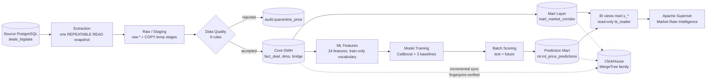

# Smart Logistics Data & ML Platform

The Apache Superset dashboard **Smart Logistics — Market Rate Intelligence** is the interface on the warehouse. Four tabs cover the market, route corridors, dynamics, and fact versus forecast. Amounts are RUB.

### Market Overview


### Route Pricing


### Market Dynamics


### Fact vs Forecast


### Chart editor


A local, repeatable batch platform on PostgreSQL 17 and Python 3.12. It loads a synthetic operational snapshot of 300,000 freight deals into a warehouse, publishes a monthly market price corridor with a Data Trust rating, trains a CatBoost model of the carrier trip price, and writes fact-versus-forecast predictions for the held-out test window and for planned future deals. One command runs the whole chain and writes an execution report.

> **Verification status.** Docker could not be run on the development host (no Docker binary, no root, no rootless support). Everything else was executed: the compose file was validated with Docker Compose v2.39.4, the pinned requirements were resolved to Python 3.12 wheels, and the full pipeline and test suite ran against a clean PostgreSQL 17.11 cluster set up the way the `postgres:17` container sets up an empty volume. `docker compose up` itself has not been executed. See [Known limitations](#25-known-limitations-and-future-improvements).

## Contents

1. [Project overview](#1-project-overview)
2. [Business problem](#2-business-problem)
3. [Architecture diagram](#3-architecture-diagram)
4. [Technology stack](#4-technology-stack)
5. [Database architecture](#5-database-architecture)
6. [Data flow](#6-data-flow)
7. [ETL implementation](#7-etl-implementation)
8. [Data quality rules](#8-data-quality-rules)
9. [Currency conversion methodology](#9-currency-conversion-methodology)
10. [Idempotency and backfill strategy](#10-idempotency-and-backfill-strategy)
11. [Core DWH modeling](#11-core-dwh-modeling)
12. [Analytical mart definitions](#12-analytical-mart-definitions)
13. [Market pricing corridor methodology](#13-market-pricing-corridor-methodology)
14. [Data Trust calculations](#14-data-trust-calculations)
15. [ML feature engineering](#15-ml-feature-engineering)
16. [Leakage prevention](#16-leakage-prevention)
17. [Temporal train/test methodology](#17-temporal-traintest-methodology)
18. [CatBoost model](#18-catboost-model)
19. [Evaluation metrics](#19-evaluation-metrics)
20. [Batch inference](#20-batch-inference)
21. [Fact vs Forecast reporting](#21-fact-vs-forecast-reporting)
22. [Docker deployment instructions](#22-docker-deployment-instructions)
23. [Testing instructions](#23-testing-instructions)
24. [Example SQL queries](#24-example-sql-queries)
25. [Known limitations and future improvements](#25-known-limitations-and-future-improvements)

Detailed documents: [architecture](docs/architecture.md), [data dictionary](docs/data_dictionary.md), [ETL design](docs/etl_design.md), [data quality report](docs/data_quality_report.md), [mart design](docs/mart_design.md), [feature engineering report](docs/feature_engineering_report.md), [ML design](docs/ml_design.md), [ML evaluation report](docs/ml_evaluation_report.md), [Airflow orchestration](docs/airflow.md), [Superset dashboard](docs/superset.md), [ClickHouse analytical copy](docs/clickhouse.md).

## 1. Project overview

| What | Where |
| --- | --- |
| Source snapshot | `requirements/reference/sql/schema.sql` + `synthetic.sql`, applied unchanged on first start (`setseed(0.20261026)`, `n_prices = 300000`) |
| ETL into the core warehouse | `etl/` → `raw`, `core`, `audit` schemas of `logistics_dwh` |
| Market corridor mart | `sql/mart/001_market_corridor.sql` → `mart.mart_market_corridor` |
| ML features, training, scoring | `ml/` → `ml/artifacts/<version>/`, `ml.ml_model_registry`, `ml.ml_price_predictions` |
| Orchestration | `python -m scripts.run_pipeline` (`orchestration/`): dependency graph, retries, report |

Measured on a clean warehouse, run twice:

| | Run 1, empty warehouse | Run 2, same data |
| --- | --- | --- |
| Pipeline duration, exit code | 126.0 s, 0 | 34.9 s, 0 |
| Source deals / accepted / quarantined | 300,000 / 299,797 / 203 | same, 0 rows rewritten |
| Mart cells | 203,644 inserted | refresh skipped, inputs unchanged |
| Model | `20261026-8f32ec6d6901`, 263 trees | same version, byte-identical `model.cbm` |
| CatBoost test metrics | R² 0.9203, MAPE 15.72 %, RMSE 54,018.83 RUB, MAE 28,190.88 RUB | same |
| Predictions | 12,808 test + 4,891 future inserted | 17,699 unchanged |

## 2. Business problem

A freight platform needs a defensible answer to "what should this trip cost?" for buyers and carriers. Three questions from the brief:

1. **Market corridor.** For a route, body type, and load size in a given month, what is the typical price and the normal range (P25–P75), per trip and per kilometre, and how did it move month over month and year over year?
2. **Data Trust.** Is the corridor based on enough independent evidence to be trusted, or is the market too thin?
3. **Forecast.** What price should be expected for a deal that has not happened yet, and how accurate was the model on recent deals whose price is known?

The operational data has the usual problems: prices in three currencies, duplicate city records, deals with several body types, missing categories, invalid prices, auction bids mixed with completed deals, and an outlier flag that is not yet set for the newest deals.

## 3. Architecture diagram



Two orchestrators run the same task functions:

- The command-line runner (`python -m scripts.run_pipeline`) runs `source_ready → warehouse_ready → migrate → etl → data_quality → mart → features → train → score_test → score_future → verify → report`, with retries and a run report. It is what `docker compose up` runs.
- The Apache Airflow 3.4 DAG `smart_logistics_data_pipeline` runs one data interval per day, plus backfills: `check_source_connectivity → validate_source_data → prepare_warehouse → run_etl → run_data_quality → (refresh_marts ‖ generate_features → train_or_load_model → run_batch_inference) → validate_prediction_records → publish_pipeline_statistics`. See [docs/airflow.md](docs/airflow.md).

The Apache Superset dashboard **Smart Logistics — Market Rate Intelligence** (compose profile `superset`) reads three views in schema `mart` through the read-only login `bi_reader`. It has four tabs: Market Overview, Route Pricing, Market Dynamics, and Fact vs Forecast. See [docs/superset.md](docs/superset.md).

ClickHouse 26.8 (compose profile `clickhouse`) holds an analytical copy for heavy aggregations: normalized deals, corridor observations, monthly route statistics as aggregate states, the market corridor, and ML prediction analytics. PostgreSQL remains the source and the authoritative warehouse. `python -m etl.clickhouse.sync` copies only changed partitions, verifies each against PostgreSQL by row fingerprint before and after publishing it, and checks every corridor cell against `mart.mart_market_corridor` within documented tolerances. On identical data the four aggregation benchmarks ran 11–20× faster at 291,000 rows and 21–43× faster at 2.9 million rows. Single-route filtering was equal at 291,000 rows and 10× faster at 2.9 million. All results were equal in both systems. See [docs/clickhouse.md](docs/clickhouse.md).

## 4. Technology stack

| Component | Choice | Why |
| --- | --- | --- |
| Database | PostgreSQL 17, two databases in one server | Required engine. Separate databases and roles give a hard boundary between the read-only source and the warehouse |
| Language | Python 3.12 (image), tested on 3.11 too | Required runtime |
| Database access | SQLAlchemy 2 Core + psycopg 3 | Set-based SQL and `COPY`; no ORM for 300,000-row batches |
| Dataframes | Polars | Fast, typed, low-memory transforms (peak 675 MB for a full load) |
| Model | CatBoost 1.2 | Native categorical features, strong on tabular data, deterministic with a fixed seed |
| Baselines, metrics | scikit-learn | Ridge and DecisionTree baselines, metric cross-checks |
| Storage of features | Parquet (PyArrow) | Exact, typed, reproducible feature snapshots |
| Deployment | Docker Compose | One command to build the snapshot, warehouse, mart, and model |
| Scheduling | Apache Airflow 3.4 (optional compose profile) | Daily data intervals, backfills, per-task retries and timeouts, run history. Tasks run the platform in its own virtualenv, because Airflow's constraints pin other library versions |
| BI | Apache Superset 6.1 (optional compose profile) | Dashboard for procurement managers, provisioned from code over the REST API, reading the warehouse with a read-only role |
| OLAP | ClickHouse 26.8 LTS (optional compose profile), clickhouse-connect | Columnar copy for large aggregations and exact percentiles; rebuilt from PostgreSQL, never written by users |
| Tests | pytest | 330 tests: unit and integration against the real snapshot, plus Airflow DAG, Superset BI, and ClickHouse sync tests |

All 39 Python packages are pinned in `constraints.txt` (`pip install -r requirements.txt -c constraints.txt`).

## 5. Database architecture

| Database | Login role | Rights | Schemas |
| --- | --- | --- | --- |
| `deals_bigdata` | `source_reader` | `CONNECT`, `SELECT` | `public` (reference DDL, unchanged) |
| `logistics_dwh` | `dwh_etl` | Owns the schemas, `TEMPORARY` | `raw`, `core`, `mart`, `ml`, `audit` |

| Schema | Contents |
| --- | --- |
| `raw` | Source rows of the loaded windows, source types, plus lineage (`batch_id`, `extracted_at`) |
| `core` | `fact_deal`, `fact_deal_date`, `bridge_deal_body_group`, `dim_city`, `dim_body_type`, `dim_body_group`, `dim_exchange_rate` |
| `mart` | `mart_market_corridor`; view `ml_price_predictions` (the prediction mart under the brief's name) |
| `ml` | `ml_model_registry`, `ml_price_predictions`; views `v_fact_vs_forecast`, `v_prediction_error_summary`, `v_prediction_error_distribution` |
| `audit` | `etl_batch`, `quarantine_price` (view `dq_quarantine_prices`), `dq_statistic`, `mart_refresh`, `ml_scoring_batch`, `pipeline_run`, `bootstrap` |

Migrations are plain SQL files applied in order by `python -m etl.migrate` (`sql/core`, then `sql/mart`, then `sql/ml`). Every file is repeatable. The full catalog, with every column, key, and index, is in [docs/data_dictionary.md](docs/data_dictionary.md).

## 6. Data flow

1. **Extract** the deals whose `loading_date` is in the window (or all of them), their body-type links and price dates, and the full reference tables, from one consistent source snapshot.
2. **Stage** everything with `COPY` into temporary tables and merge it into `raw`.
3. **Validate** every deal against nine rules. Rejected deals go to `audit.quarantine_price`, one row per failed rule.
4. **Normalize** accepted deals: exact FX conversion to RUB, category fill, one city per `gc_id`, body groups.
5. **Publish** `core` in the same transaction, then run an independent SQL **reconciliation** of source against core.
6. **Mart:** rebuild `mart.mart_market_corridor` from core when its inputs changed.
7. **ML:** build features from core, train CatBoost, score test and future deals into `ml.ml_price_predictions`.
8. **Verify** keys, foreign keys, and business invariants, and write the execution report.

Three dates have different roles: `loading_date` is the ETL window and the ML time axis, `price_dates.price_date` is the mart month, and `nearest_rate_date` selects the exchange rate. `AS_OF_DATE = 2026-10-26` is configuration, never the system clock.

## 7. ETL implementation

```bash
python -m etl.main --full                                          # complete history
python -m etl.main --start-date 2026-09-01 --end-date 2026-09-30   # window on loading_date, both bounds included
```

- **Extract** (`etl/extract/source.py`): one `REPEATABLE READ READ ONLY` transaction, server-side cursor in chunks of `ETL_FETCH_SIZE`.
- **Transform** (`etl/transform/`): vectorized Polars expressions. The rules live in one module shared by the code and the tests.
- **Load** (`etl/load/warehouse.py`): one transaction under the advisory lock `logistics_dwh.core_etl`. `COPY` into temporary stages, then `INSERT … ON CONFLICT DO UPDATE … WHERE (…) IS DISTINCT FROM (…)`, plus deletes of window rows that left the source or now fail a rule. `audit.etl_batch` is marked `succeeded` in that same transaction.
- **Audit:** a `running` batch row is committed first, so a crash stays visible; a failure rolls back the data and records `failed` with the error.
- **Reconciliation** (`etl/quality/reconcile.py`): recomputes the expected outcome of every source deal in SQL on the source database, independently of the Polars code, and compares it with raw, core, and quarantine. Any unexplained deal fails the pipeline.

Exit codes: 0 committed, 1 failed, 2 usage or configuration error. Logs are JSON lines on stdout. Details: [docs/etl_design.md](docs/etl_design.md).

## 8. Data quality rules

Every deal is evaluated against every rule. A deal that fails any rule is kept out of core, and every failed rule is stored with a readable detail and the full source row as JSONB.

| Reason code | Rule | Deals in the snapshot |
| --- | --- | ---: |
| `PRICE_NON_POSITIVE` | `price IS NULL OR price <= 0` | 164 |
| `RUB_PRICE_LE_1000` | currency 643 and `0 < price <= 1000` | 0 |
| `DISTANCE_NON_POSITIVE` | `distance IS NULL OR distance <= 0` | 0 |
| `WEIGHT_NEGATIVE` | `total_weight IS NULL OR total_weight < 0` | 0 |
| `VOLUME_NEGATIVE` | `total_volume IS NULL OR total_volume < 0` | 0 |
| `ORIGIN_CITY_NOT_FOUND` | `loading_city_gcid` not in `cities` | 0 |
| `DESTINATION_CITY_NOT_FOUND` | `unloading_city_gcid` not in `cities` | 0 |
| `CURRENCY_UNSUPPORTED` | currency not 643, 840, or 978 | 0 |
| `FX_RATE_MISSING` | USD or EUR without a rate on exactly `nearest_rate_date` | 39 |

Not rejected, by design: same-city routes, `outlier_mark`, composite routes, auction bids, non-fact deals, and future loading dates. They are loaded as delivered; the mart and the model apply their own eligibility filters. Rules that the snapshot never triggers are covered by fixture tests through the real merge.

```sql
SELECT reason_code, count(*) AS deals, min(reason_detail) AS example
FROM audit.dq_quarantine_prices GROUP BY reason_code ORDER BY deals DESC;
```

**Snapshot limitation: outlier marks on 2026-10-26.** The source marks outliers in a nightly job. In this snapshot the generator sets `outlier_mark` only for deals created before `2026-10-26 02:30:00`, so the 5,785 deals created later that day are unmarked even when their price is extreme. The ETL does not recalculate the flag; each batch reports the count. Full audit: [docs/data_quality_report.md](docs/data_quality_report.md).

## 9. Currency conversion methodology

- RUB (643): rate 1, no rate row needed.
- USD (840), EUR (978): the rate with `num_code = currency_code` and `setting_date = nearest_rate_date`. No nearest-date search, no fallback to `loading_date`, no recomputation of `nearest_rate_date`. A missing rate or a NULL date is `FX_RATE_MISSING`.
- Duplicate rate rows for one currency and date: the greatest `id` wins.
- Exact arithmetic: `price_rub = ROUND(ROUND(price, 2) × ROUND(rate, 6), 2)`, half away from zero, computed with integers (cents × micro-units) and stored as `numeric(18,2)`. The reconciliation recomputes it with PostgreSQL `numeric` and finds 0 mismatches.

`core.fact_deal` keeps `price_src`, `currency_code`, `fx_rate`, `fx_rate_date`, and `price_rub`, and a CHECK constraint ties `fx_rate_date` to `nearest_rate_date` for foreign currencies.

## 10. Idempotency and backfill strategy

| Step | Mechanism | Rerun with unchanged data |
| --- | --- | --- |
| ETL | Upsert on natural keys, written only when a value differs; window deletes | 0 inserted, 0 updated, 0 deleted; original `batch_id` kept |
| Mart | Full rebuild, skipped when the input fingerprint is unchanged | Skipped in 1.4 s |
| Training | Model version = hash of config, features, split, data, library | Same version, byte-identical model |
| Scoring | Upsert on `(price_id, model_name, model_version)`, written only when a value differs | 17,699 unchanged |

**Backfill.** `python -m scripts.run_pipeline --mode backfill --start-date 2026-09-01 --end-date 2026-09-30` reloads only deals with `loading_date` in September, reconciles that window, refreshes the mart if needed, and rescores with the current model. Deals outside the window are not touched. A failed batch rolls back completely, so rerunning the same command is the recovery. Concurrent writers serialize on the advisory lock.

## 11. Core DWH modeling

A star around one fact at deal grain, with two child tables:

| Table | Grain | Key |
| --- | --- | --- |
| `core.fact_deal` | One accepted deal | `price_id` (source `prices.id`) |
| `core.fact_deal_date` | One price date of a deal (a long deal has one per month) | `(price_id, price_date)` |
| `core.bridge_deal_body_group` | One deal and business body group | `(price_id, body_group_code)` |
| `core.dim_city` | One place, from the smallest source `cities.id` per `gc_id` | `gc_id` |
| `core.dim_body_type` | One source body type | `body_type_id` |
| `core.dim_body_group` | Тент, Рефрижератор, Изотерм, Борт, Прочие, Не указан | `body_group_code` |
| `core.dim_exchange_rate` | One currency and date | `(currency_code, rate_date)` |

- **City deduplication.** Moscow and Kazan have two source rows each. The dimension keeps one row per `gc_id`, so joins cannot multiply deals.
- **Body groups.** Source types map to six business groups (56–61 Тент; 4, 46–48 Рефрижератор; 2 Изотерм; 1, 15 Борт; others Прочие; none Не указан). The bridge holds every distinct group of a deal's links (fallback: `prices.body_type`, then Не указан); the fact holds the group of `prices.body_type` for the model.
- **Categories.** Valid source weight and volume categories are kept; NULL or invalid ones are recomputed from weight (rounded to 0.1 t) and volume, and flagged `*_imputed`.
- **Constraints.** 13 foreign keys in core (34 in the warehouse) and CHECK constraints (positive prices and distance, known currencies and categories, FX consistency, body-group mapping) make invalid rows impossible to store.

## 12. Analytical mart definitions

`mart.mart_market_corridor`, one row per **month × origin city × destination city × body group × weight category** (203,644 rows).

| Column group | Columns |
| --- | --- |
| Key and labels | `price_month`, `loading_city_gcid`, `unloading_city_gcid`, `body_group_code`, `weight_category`, city and body-group names |
| Trip corridor | `p25_trip`, `median_trip`, `p75_trip`, `avg_trip` |
| Per-km corridor | `p25_km`, `median_km`, `p75_km` |
| Evidence | `trips_count`, `carriers_count`, `cv_rate`, `max_price_date`, `freshness_days` |
| Dynamics | `mom_pct`, `yoy_pct` |
| Data Trust | `reliability_level` |
| Lineage | `as_of_date`, `refresh_id` |

An observation is a deal × month × body group:

- **Month:** `price_month` comes from `core.fact_deal_date`, so a deal with price dates in two months counts in both.
- **Body group:** groups come from the bridge, so a deal with Тент and Борт links counts in both cells, but once per group.

Eligible observations are completed (`is_fact`, `price_type` in 1–5, 9), direct (`NOT complex`), not outliers, positive price and distance, and have `price_date <= as_of`. Auctions and future months never enter market history.

```bash
python -m etl.mart.refresh                # rebuild for AS_OF_DATE in one transaction
python -m etl.mart.refresh --if-changed   # what the pipeline runs: skip when inputs are unchanged
```

Details and design decisions: [docs/mart_design.md](docs/mart_design.md).

## 13. Market pricing corridor methodology

| Metric | Definition |
| --- | --- |
| `p25_trip`, `median_trip`, `p75_trip` | `percentile_cont(0.25 / 0.5 / 0.75)` of `price_rub` (RUB without VAT) |
| `p25_km`, `median_km`, `p75_km` | The same over `price_rub / distance_km` per observation |
| `avg_trip` | Mean `price_rub` |
| `mom_pct` | `(median_trip / median_trip of the same cell one calendar month earlier − 1) × 100`. NULL if that cell does not exist |
| `yoy_pct` | The same against the same month one year earlier |

- MoM and YoY are exact joins on the shifted month. A gap stays NULL; the last available month is never substituted.
- The mart is rebuilt as a whole from core in one transaction. Readers see the previous version until commit.
- A full rebuild takes 12 s and is always consistent, so percentiles are never patched incrementally. The input fingerprint (an MD5 over every core value the build reads plus both SQL definitions) skips the rebuild when nothing changed.

## 14. Data Trust calculations

| Measure | Definition |
| --- | --- |
| `trips_count` | Distinct deals in the cell |
| `carriers_count` | Distinct `organization_id` among carrier rows (`price_type` 3 or 9). Customer and forwarder requests count as trips, not carriers |
| `cv_rate` | `stddev_samp(price_rub) / avg(price_rub)`; NULL with fewer than 2 observations |
| `freshness_days` | `as_of_date − max(price_date)` inside the cell |
| `reliability_level` | **HIGH**: `trips_count ≥ 30` and `carriers_count ≥ 5` and `freshness_days ≤ 30`. **MEDIUM**: otherwise `trips_count ≥ 10`. **LOW_DATA**: everything else |

Freshness is evaluated per cell, so an old month cannot be HIGH just because the route is active today. LOW_DATA cells are kept and labelled rather than dropped. At this grain the market is thin: across all months 10 cells are HIGH, 924 MEDIUM, and 202,710 LOW_DATA, and 78 % of cells hold one deal.

## 15. ML feature engineering

24 features, each a function of its own row plus a vocabulary frozen on train:

| Group | Features |
| --- | --- |
| Geography (7 categorical / numeric) | `origin_city`, `destination_city`, `origin_region`, `destination_region`, four coordinates |
| Load and equipment | `distance`, `total_weight`, `total_volume`, `body_group`, `weight_category`, `volume_category` |
| Calendar from `loading_date` | `year`, `month`, `day_of_week`, `day_of_year`, and sine/cosine pairs for month, weekday, and day of year |

- Cities come from the deduplicated `core.dim_city`; origin and destination are separate categories, not a sparse route string.
- Unseen categories become `__UNKNOWN__`, nulls `__MISSING__`.
- No scaler or imputer for CatBoost. The Ridge baseline fits its one-hot encoder and scaler on train only.
- `price_type` is not a feature: it is not a permitted planning attribute for future deals.

```bash
python -m ml.features.dataset   # X/y/ids Parquet, metadata.json, profile.json in artifacts/features
```

Distributions and the leakage audit: [docs/feature_engineering_report.md](docs/feature_engineering_report.md).

## 16. Leakage prevention

| Risk | Control |
| --- | --- |
| Target or target-derived columns (`price`, `price_rub`, `price_src`, price per km or per tonne, VAT, cost, margin) | Strict allow-list plus a ban list by name and by fragment. `make_pool` rejects any other column; `assert_no_leakage` runs before anything is written |
| `price_group_stats` (nightly aggregate that includes the predicted deal) | Not extracted into the warehouse at all |
| `outlier_mark` | Used only to filter the training target, never as a feature |
| FX columns | Not selected: with the source price they rebuild the target |
| Mart medians, MoM, YoY | Not used: a cell includes the deal's own month |
| Encoders fitted on test or future | Vocabulary fitted on train only. Early stopping uses the last 14 days of train, never test |
| Future source price | The future query does not select any price; the scorer sends only `(price_id, split_role, prediction)`. Actuals are filled in SQL from core for test rows only. A CHECK constraint makes a future row with an actual impossible |

Tests copy the target into 13 banned columns and scramble it, and assert that the features do not change.

## 17. Temporal train/test methodology

| Set | `loading_date` | Rows |
| --- | --- | ---: |
| Train | 2026-07-26 to 2026-10-04 | 24,226 |
| of which validation (early stopping) | 2026-09-21 to 2026-10-04 | 5,523 |
| Test | 2026-10-05 to 2026-10-26 | 12,808 |
| Future (scored, no actuals) | 2026-10-27 to 2027-02-13 | 4,891 |

- The split is a filter on `loading_date` against the fixed `as_of = 2026-10-26`. No `train_test_split`, no shuffle, no K-fold, no system date. A test scans the code for these calls.
- `2026-10-05` belongs to test only. Rows are ordered by `(loading_date, price_id)` and CatBoost runs with `has_time=True`.
- Train and test: `is_fact`, not composite, not outlier, `price_rub > 0`, `distance_km > 0`. Future: `loading_date > as_of`, not composite, not auction, `distance_km > 0`; no price-derived predicate.

## 18. CatBoost model

| Setting | Value |
| --- | --- |
| Estimator | `CatBoostRegressor`, native categorical features, RMSE loss |
| Seed | `random_seed = 42` |
| Depth, learning rate, L2 | 6, 0.05, 3.0 |
| Trees | Up to 3,000 with early stopping (200 rounds) on the validation window; best iteration 262; final model refitted on all of train with 263 trees |
| Target | `price_rub`, not logged |

Artifacts in `ml/artifacts/<model_version>/`: `model.cbm` (made deterministic), `model_card.json` (config, periods, features, vocabulary, metrics, SHA-256), `baselines.pkl`. `latest.json` is written only after the registry row commits. Feature importance: distance 66.8 %, weight category 17.4 %, total weight 7.5 %, body group 6.1 %.

```bash
python -m ml.model.train
```

## 19. Evaluation metrics

On the 12,808 test deals:

| Model | R² | MAPE % | RMSE, RUB | MAE, RUB |
| --- | ---: | ---: | ---: | ---: |
| **CatBoost** | **0.9203** | **15.72** | **54,018.83** | **28,190.88** |
| DecisionTree (depth 12) | 0.9067 | 15.87 | 58,432.65 | 30,287.09 |
| Ridge (one-hot + scaling) | 0.8405 | 49.43 | 76,408.01 | 48,308.56 |
| Median RUB/km per body group × distance | 0.7486 | 41.90 | 95,926.78 | 57,968.45 |

- 42.6 % of test deals are within 10 % and 72.5 % within 20 % of the actual. Median APE is 12.0 %.
- Error is flat across the three test weeks. Short hauls under 300 km are the weakest segment (26 % MAPE).
- `ml.v_prediction_error_summary` recomputes the metrics in SQL from the stored rows; a test asserts they match.

The research note's R² ≈ 0.93 and MAPE ≈ 13 % come from another dataset. They are reference points, not guaranteed results. Full analysis: [docs/ml_evaluation_report.md](docs/ml_evaluation_report.md).

## 20. Batch inference

```bash
python -m ml.scoring.score                    # test and future deals with the model in latest.json
python -m ml.scoring.score --role future      # one role; the other role's rows are left alone
python -m ml.scoring.score --model-version 20261026-8f32ec6d6901
```

1. Load the model and verify its SHA-256 and feature order against the model card.
2. Rebuild features with the frozen train vocabulary; predict in one vectorized call per role.
3. In one transaction under the advisory lock: COPY `(price_id, split_role, predicted_price_rub)` to a stage, merge with `ml.upsert_price_predictions`, and record `audit.ml_scoring_batch` with counts and test metrics.

Future deals always get `actual_price_rub`, `abs_error_rub`, and `ape_pct` = NULL, even though every planned deal in the snapshot has a source price.

## 21. Fact vs Forecast reporting

| Object | Contents |
| --- | --- |
| `mart.ml_price_predictions` | The prediction mart with the brief's columns: `price_id`, `loading_date`, `loading_city_gcid`, `unloading_city_gcid`, `body_group`, `actual_price_rub`, `predicted_price_rub`, `abs_error_rub`, `ape_pct`, `model_name`, `scored_at` (+ `model_version`, `split_role`) |
| `ml.v_fact_vs_forecast` | Per deal: route and body names, distance, actual, predicted, signed and absolute error, APE band, `record_type` historical or future |
| `ml.v_prediction_error_summary` | Per model version and record type: R², MAE, RMSE, MAPE, bias, median and p90 APE, share within 10 % and 20 % |
| `ml.v_prediction_error_distribution` | Historical deals per APE band |

```bash
psql -f sql/ml/fact_vs_forecast.sql   # ten queries; 3-9 use the latest registered model version
```

```sql
SELECT record_type, deals, mae_rub, rmse_rub, mape_pct, r2
FROM ml.v_prediction_error_summary
WHERE model_version = '20261026-8f32ec6d6901';
```

| record_type | deals | mae_rub | rmse_rub | mape_pct | r2 |
| --- | ---: | ---: | ---: | ---: | ---: |
| future | 4891 | | | | |
| historical | 12808 | 28190.88 | 54018.83 | 15.7230 | 0.920268 |

## 22. Docker deployment instructions

**Prerequisites:** Docker Engine and Docker Compose **v2.24 or newer** (the compose file uses `env_file` entries with `required: false`). Host port 15432 must be free.

```bash
docker compose up --build --exit-code-from pipeline
```

On the first start this:

1. builds the Python 3.12 image;
2. creates the PostgreSQL 17 volume, both databases, and both roles;
3. runs the unchanged `schema.sql` and `synthetic.sql` (about 40 s);
4. creates the warehouse schemas;
5. runs `python -m scripts.run_pipeline --mode full`.

The `pipeline` container prints a summary and exits with 0 on success. `postgres` keeps running. Later starts reuse the volume; the snapshot is not regenerated and the pipeline is idempotent.

```bash
docker compose up                                                          # run the pipeline again
docker compose run --rm pipeline python -m scripts.run_pipeline --mode score
docker compose run --rm pipeline python -m scripts.run_pipeline --mode backfill --start-date 2026-09-01 --end-date 2026-09-30
docker compose run --rm pipeline python -m scripts.run_pipeline --dry-run  # print the plan, connect to nothing
docker compose logs pipeline
docker compose exec -T postgres psql -U dwh_etl -d logistics_dwh < sql/mart/examples.sql
docker compose down -v                                                     # delete everything, including the snapshot
```

Pipeline modes: `full`, `etl`, `mart`, `train`, `score`, `backfill`. Mode tasks:

| Mode | Tasks |
| --- | --- |
| `full` | all |
| `etl` | readiness, migrate, etl, data_quality, verify |
| `mart` | readiness, migrate, mart, verify |
| `train` | readiness, migrate, features, train, verify |
| `score` | readiness, migrate, score_test, score_future, verify |
| `backfill` | readiness, migrate, etl, data_quality, mart, score_test, score_future, verify |

Exit codes: 0 success, 1 a task failed or did not run, 2 usage or configuration error. Each run writes `artifacts/reports/pipeline_run_<UTC start>_<run id>.json` (in the `pipeline_artifacts` volume) and a row in `audit.pipeline_run`.

**Configuration.** Compose loads `.env.example`, then `.env` if it exists. To change a value, `cp .env.example .env` and edit `.env`; it is git-ignored. The passwords in `.env.example` are local development defaults: replace them before any shared use. The pipeline container unsets the superuser password before Python starts.

| Variable | Meaning |
| --- | --- |
| `SOURCE_DB_*`, `DWH_DB_*` | Application roles and databases |
| `POSTGRES_USER`, `POSTGRES_PASSWORD` | Superuser, used only by initialization and the health check |
| `POSTGRES_HOST`, `POSTGRES_PORT` | `postgres`, `5432` on the compose network |
| `POSTGRES_PUBLISH_PORT` | Host port, bound to `127.0.0.1` only (default `15432`) |
| `N_PRICES` | Deals generated by `synthetic.sql` (default 300,000) |
| `AS_OF_DATE` | Snapshot date, `2026-10-26`. The pipeline refuses any other value, because the ML split is fixed |
| `ETL_FETCH_SIZE`, `LOG_LEVEL`, `PGCONNECT_TIMEOUT` | ETL tuning |
| `PIPELINE_DB_WAIT_TIMEOUT_S`, `PIPELINE_DB_WAIT_INTERVAL_S`, `PIPELINE_RETRY_BACKOFF_S` | Readiness wait and retry backoff |
| `PIPELINE_REPORT_DIR`, `ML_FEATURE_DIR`, `ML_ARTIFACT_DIR` | Output directories (relative defaults) |

**Airflow.** The `airflow` profile adds a metadata database, `airflow-init`, an API server with the UI at `http://127.0.0.1:18080`, a scheduler with the LocalExecutor, and a DAG processor:

```bash
docker compose up --build --exit-code-from pipeline                     # first full load, as above
docker compose --profile airflow up -d --build
docker compose exec airflow-apiserver cat /opt/airflow/simple_auth_manager_passwords.json.generated   # admin password
docker compose exec airflow-scheduler airflow dags unpause smart_logistics_data_pipeline
docker compose exec airflow-scheduler airflow backfill create --dag-id smart_logistics_data_pipeline \
  --from-date 2026-09-01 --to-date 2026-09-07 --max-active-runs 1
docker compose exec airflow-scheduler airflow dags trigger smart_logistics_data_pipeline \
  --conf '{"start_date": "2026-09-01", "end_date": "2026-09-30"}'
```

A scheduled run at D+1 00:00 UTC loads `loading_date` D. Transient database errors are retried with exponential backoff; data quality, integrity, and credential errors fail at once. Every run, failed or not, is recorded in `audit.pipeline_run` with `mode = 'airflow'`. Variables: `AIRFLOW_DB_*`, `AIRFLOW__API_AUTH__JWT_SECRET`, `AIRFLOW_PUBLISH_PORT`, `PIPELINE_AIRFLOW_RETRIES`, `PIPELINE_AIRFLOW_RETRY_DELAY_S`. Details, the test results, and running without Docker are in [docs/airflow.md](docs/airflow.md).

**Superset.** The `superset` profile adds a metadata database, `superset-init`, the web server at `http://127.0.0.1:18088`, and `superset-provision`, which creates the warehouse connection, datasets, charts, filters, and the dashboard:

```bash
docker compose up --build --exit-code-from pipeline                     # first full load; creates the BI views
docker compose --profile superset up -d --build
docker compose --profile superset logs -f superset-provision           # ends with the dashboard URL
# http://127.0.0.1:18088/superset/dashboard/market-rate-intelligence/  (SUPERSET_ADMIN_USERNAME / _PASSWORD)
```

On a warehouse volume created before this profile existed, create the BI role once: `docker compose exec postgres bash /docker-entrypoint-initdb.d/03_bi_reader.sh`, then `docker compose run --rm pipeline python -m etl.migrate`. Variables: `BI_DB_USER`, `BI_DB_PASSWORD`, `SUPERSET_DB_*`, `SUPERSET_SECRET_KEY`, `SUPERSET_ADMIN_*`, `SUPERSET_PUBLISH_PORT`. Metric definitions, filter scopes, the PostgreSQL validation (91 of 91 checks match), and running without Docker are in [docs/superset.md](docs/superset.md).

**ClickHouse.** The `clickhouse` profile adds the server at `http://127.0.0.1:18123` and the one-shot `clickhouse-sync`, which applies the ClickHouse DDL, copies changed partitions, and exits 0 only when ClickHouse matches PostgreSQL:

```bash
docker compose --profile clickhouse up -d clickhouse
docker compose --profile clickhouse run --rm clickhouse-sync                     # after each pipeline run
docker compose --profile clickhouse run --rm clickhouse-sync python -m etl.clickhouse.sync --months 2025-01..2025-03
docker compose --profile clickhouse run --rm clickhouse-sync python -m etl.clickhouse.check
```

Variables: `CLICKHOUSE_HOST`, `CLICKHOUSE_PORT`, `CLICKHOUSE_DB`, `CLICKHOUSE_USER`, `CLICKHOUSE_PASSWORD`, `CLICKHOUSE_PUBLISH_PORT`, `CLICKHOUSE_INSERT_BATCH_ROWS`, `CLICKHOUSE_WATERMARK_OVERLAP_S`. Engines, partitioning, deduplication, tolerances, and the benchmark (`scripts/benchmark_clickhouse.py`) are in [docs/clickhouse.md](docs/clickhouse.md).

**Running from the host** against the compose database (Python 3.11+):

```bash
python -m venv .venv && .venv/bin/pip install -r requirements.txt -c constraints.txt
set -a && source .env.example && set +a
export POSTGRES_HOST=localhost POSTGRES_PORT=15432
export PGHOST=localhost PGPORT=15432 PGUSER="$DWH_DB_USER" PGPASSWORD="$DWH_DB_PASSWORD" PGDATABASE="$DWH_DB_NAME"
.venv/bin/python scripts/check_databases.py
.venv/bin/python -m scripts.run_pipeline
```

## 23. Testing instructions

```bash
docker compose --profile test run --rm tests        # migrations + whole suite in the container
pytest -q -m "not integration"                      # unit tests, no database needed
pytest -q                                           # everything; needs the databases and the loaded snapshot
```

| Area | Modules |
| --- | --- |
| ETL rules and rounding | `test_etl_transform.py` |
| Warehouse schema and smoke | `test_core_schema.py`, `test_db_smoke.py` |
| ETL load, data quality | `test_etl_load.py`, `test_etl_extract.py`, `test_dq_edge_cases.py`, `test_dq_idempotency_backfill.py`, `test_dq_transaction_safety.py`, `test_dq_reconciliation.py` |
| Mart | `test_mart_market_corridor.py` (independent Python recomputation of every metric) |
| ML | `test_ml_features.py`, `test_ml_feature_dataset.py`, `test_ml_model.py`, `test_ml_scoring.py` |
| Pipeline | `test_pipeline_runner.py`, `test_pipeline_integration.py` |
| Airflow | `test_airflow_steps.py`, `test_airflow_dag.py` (DAG graph and retry tests run only where `apache-airflow` is installed: `.venv-airflow/bin/python -m pytest -o addopts="" tests/test_airflow_dag.py`) |
| Superset BI | `test_superset_bi.py` (BI views against the mart, `bi_reader` privileges, dashboard specification); chart data against PostgreSQL: `superset/validate.py` |
| ClickHouse | `test_clickhouse.py` (plan, fingerprint, and tolerance units; sync into a scratch database: full, idempotent re-run, backfill, drift repair, PostgreSQL updates and deletes, late predictions, refused unverified loads, lock). Skips the integration part when ClickHouse is unreachable |

Latest result against a clean warehouse and a local ClickHouse 26.8 server: **324 passed, 6 skipped in 541.54 s**. The 6 skipped tests need `apache-airflow`; in the Airflow virtualenv, `tests/test_airflow_dag.py` gives 21 passed. `-m "not integration"` alone: 199 passed, 6 skipped in 2.4 s with no database configured. The 8 ClickHouse integration tests skip when `CLICKHOUSE_*` is unset or the server is unreachable. The `bi_reader` tests need the role and `BI_DB_PASSWORD`, and skip without them. Integration tests commit idempotent batches to the warehouse they target and assert the exact counts of the 300,000-deal snapshot, so run them against a disposable warehouse built from that snapshot.

Quality tools:

```bash
python -m etl.quality.reconcile --full --by-month   # source-to-core reconciliation; exit 1 on any unexplained deal
python scripts/benchmark_etl.py                     # cold load (rolled back) and warm rerun timings
python scripts/dq_audit.py                          # evidence behind docs/data_quality_report.md
```

## 24. Example SQL queries

All mart queries are in `sql/mart/examples.sql` (`psql -f sql/mart/examples.sql`), with results in [docs/mart_design.md](docs/mart_design.md#example-queries).

Market corridor for Moscow → Kazan in October 2026:

```sql
SELECT body_group_name, weight_category, trips_count, carriers_count,
       p25_trip, median_trip, p75_trip, median_km, mom_pct, yoy_pct, reliability_level
FROM mart.mart_market_corridor
WHERE origin_city_name = 'Москва' AND destination_city_name = 'Казань'
  AND price_month = DATE '2026-10-01'
ORDER BY trips_count DESC
LIMIT 3;
```

| body_group_name | weight_category | trips | carriers | p25_trip | median_trip | p75_trip | median_km | mom_pct | yoy_pct | reliability |
| --- | --- | ---: | ---: | ---: | ---: | ---: | ---: | ---: | ---: | --- |
| Тент | FTL | 37 | 9 | 84,734.66 | 95,018.57 | 104,907.97 | 105.9293 | 1.2629 | 10.1330 | HIGH |
| Рефрижератор | FTL | 14 | 6 | 103,273.00 | 122,729.10 | 131,353.15 | 136.8217 | 3.3520 | 6.4753 | MEDIUM |
| Тент | L5T | 11 | 3 | 36,389.44 | 37,245.48 | 42,067.54 | 41.5223 | 3.8816 | 4.3290 | MEDIUM |

Is a quoted price inside the market band?

```sql
SELECT median_trip, p25_trip, p75_trip,
       CASE WHEN 110000 BETWEEN p25_trip AND p75_trip THEN 'inside'
            WHEN 110000 > p75_trip THEN 'above market' ELSE 'below market' END AS verdict,
       reliability_level
FROM mart.mart_market_corridor
WHERE loading_city_gcid = 1001 AND unloading_city_gcid = 1003
  AND body_group_code = 'TENT' AND weight_category = 'FTL' AND price_month = DATE '2026-10-01';
```

Reliability mix of the latest month:

```sql
SELECT reliability_level, count(*) AS cells, sum(trips_count) AS observations
FROM mart.mart_market_corridor WHERE price_month = DATE '2026-10-01'
GROUP BY reliability_level ORDER BY cells DESC;
```

Fact vs forecast for one route:

```sql
SELECT record_type, count(*) AS deals, round(avg(actual_price_rub)) AS mean_actual,
       round(avg(predicted_price_rub)) AS mean_predicted, round(avg(ape_pct), 2) AS mape_pct
FROM ml.v_fact_vs_forecast
WHERE origin_city = 'Москва' AND destination_city = 'Казань' AND body_group = 'TENT'
  AND model_version = (SELECT model_version FROM ml.ml_model_registry ORDER BY registered_at DESC LIMIT 1)
GROUP BY record_type;
```

Run history:

```sql
SELECT run_id, mode, status, duration_s, failed_task
FROM audit.pipeline_run ORDER BY started_at DESC LIMIT 5;
```

## 25. Known limitations and future improvements

**Not verified here**

- `docker compose up` was never executed (no Docker on the development host). The compose file passes `docker compose config`, the image's dependencies resolve to Python 3.12 wheels, and the pipeline ran against an equivalent clean PostgreSQL 17.11 cluster. The image build and the container network are untested.
- Training ran on Python 3.11; the image uses 3.12 with the same pinned package versions.
- The Airflow image and compose services were never started either. The DAG ran on Airflow 3.4.0 outside Docker against the clean cluster: normal, backfill, repeated, transient-failure, and permanent-failure runs ([docs/airflow.md](docs/airflow.md), section 8).
- The Superset image and compose services were never started. The dashboard was provisioned on Superset 6.1.0 from a virtualenv against the clean cluster, checked against PostgreSQL (91 of 91 checks), and opened in a browser ([docs/superset.md](docs/superset.md), section 5).
- The ClickHouse image and compose services were never started. The sync, checks, tests, and benchmark ran against the official ClickHouse 26.8.34.13 binary, the version of the image tag ([docs/clickhouse.md](docs/clickhouse.md), section 10).

**Data and ETL**

- `outlier_mark` is used as delivered. 5,785 deals created on 2026-10-26 after the nightly job are unmarked, and the mart and model include them.
- The ETL window is on `loading_date`, as the brief specifies. A source change to an already-loaded deal is picked up only when its window, or a full load, runs again. There is no `updated_at` watermark.
- An unknown `price_type` (for example 7) fails the batch on a CHECK constraint instead of being quarantined. This is deliberate fail-fast behaviour for an unknown business meaning.
- The full load runs in memory (peak 675 MB) in one transaction. That is fine for 300,000 deals; tens of millions would need chunked, windowed loads.
- The window delete on `core.fact_deal` is a sequential scan (46 ms here) because of an `OR EXISTS` predicate.

**Mart**

- The mart is rebuilt as a whole (12 s). At larger volume: partition by month and rebuild only touched months.
- At this grain 99 % of cells are LOW_DATA. A coarser fallback (region pair, or no weight category) would give buyers more usable corridors.

**ML**

- Train covers 26 July to 4 October 2026, while future deals run to February 2027. Seasonality (November–December peak) has never been seen, and `year` is constant. Future predictions are planning estimates whose error is unknown.
- No prediction intervals. No outlier rule beyond the source flag; 0.4 % of test deals produce 25 % of the squared error.
- Five planned deals with a non-positive source price were quarantined by the ETL, so they are not scored.
- Metrics come from one synthetic snapshot and will differ on real data.

**Operations**

- The readiness checks and the integration tests assert the counts of this snapshot (300,000 deals, 42 cities, 19 body types).
- Tests share the warehouse they target and commit idempotent batches.
- Dependencies are pinned by version, not by hash. The runtime image also contains `tests/`.
- A process killed outside the database leaves its `audit.etl_batch` row `running`; no sweeper exists.
- The run report spends about 5.5 s on fingerprints of raw and quarantine.

**Next steps:** an `updated_at` watermark for late changes; monthly partitions for the mart; a rolling retraining schedule and drift monitoring on `ml.v_prediction_error_summary`; prediction intervals (quantile loss); a hash-locked requirements file; and a rolling as-of date, so the Airflow DAG's ML steps follow the data interval instead of the fixed snapshot.
