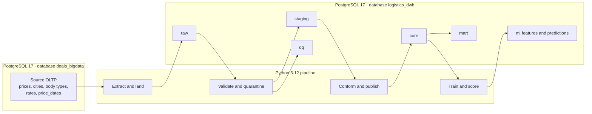
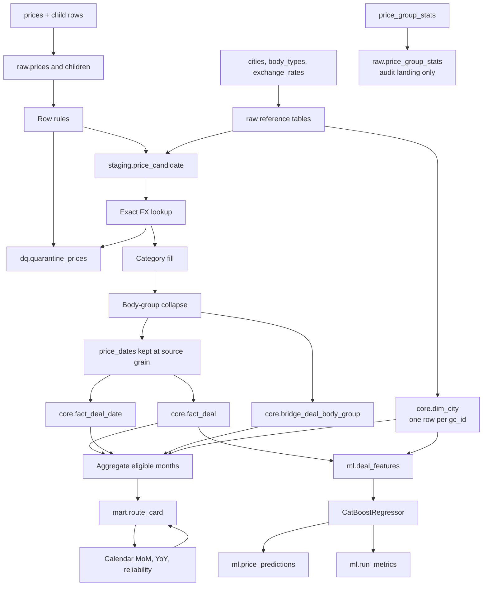
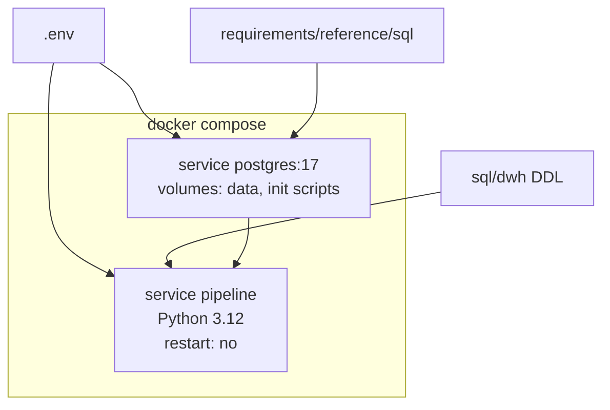

# Architecture — Smart Logistics Data & ML Platform

Status: design for approval. No application code is included in this document set.

The platform builds a market-rate corridor and a batch tariff forecast on top of the operational deal snapshot described in `requirements/reference/`. The mandatory shape is a local, repeatable batch system: PostgreSQL 17 holds a read-only source database and a separate analytical database; Python 3.12 orchestrates extraction, data-quality checks, warehouse loads, and CatBoost scoring.

Bonus products named in the brief (Apache Airflow, Apache Superset, ClickHouse) are seams, not part of this architecture. The mart table is the contract a later ClickHouse copy or Superset dataset would read.

## 1. Requirements coverage

### 1.1 Functional requirements

| ID | Requirement | Where it is satisfied |
| --- | --- | --- |
| FR-1 | Batch ETL from the operational schema into a core warehouse, with validation, cleansing, FX conversion, and category completion | `raw` → `staging` → `core` |
| FR-2 | Reject invalid prices, non-positive distances, negative weight or volume, and unknown cities; keep same-city routes when the other rules pass | `dq.quarantine_prices` |
| FR-3 | Convert USD and EUR with the stored `nearest_rate_date`; leave a row out of the conformed fact when that exact rate is missing | staging FX step |
| FR-4 | Fill missing weight and volume categories with the specified bands | staging category step |
| FR-5 | Carry `outlier_mark` from the source. Exclude `true` from the market mart and from the model target. Do not recompute the flag in the mandatory pipeline | `core.fact_deal`, mart filter, ML filter |
| FR-6 | Idempotent reload for a date window, including a full replay, without doubling facts, mart rows, or predictions | UPSERT and month-partition replace |
| FR-7 | Monthly route card at month × origin city × destination city × body group × weight category | `mart.route_card` |
| FR-8 | Trip and per-km corridor, evidence counts, coefficient of variation, calendar MoM and YoY, reliability band | `mart.route_card` |
| FR-9 | Deduplicate `cities.gc_id` by the minimum `cities.id` before any join that could multiply deals | `core.dim_city` |
| FR-10 | Collapse many body types of one deal into one row per business group; a deal may still appear in several groups | `core.bridge_deal_body_group` |
| FR-11 | Build the mart month from `price_dates.price_date`. Keep `price_date > 2026-10-26` out of historical market statistics | `core.fact_deal_date`, mart filter |
| FR-12 | Train a tabular regression on `price_rub` with a fixed time split at `as_of = 2026-10-26` | `ml.deal_features`, `ml.run_metrics` |
| FR-13 | Score the held-out test window and future planned deals. Future rows store a prediction and NULL actuals and errors | `ml.price_predictions` |
| FR-14 | One command, `docker compose up`, initializes source data, the warehouse, the mart, and the scoring run | Docker deployment |

### 1.2 Non-functional requirements

| ID | Requirement | Design response |
| --- | --- | --- |
| NFR-1 | PostgreSQL 17 is the only mandatory database engine | One server, two databases |
| NFR-2 | Python 3.12+, SQLAlchemy 2.x Core, psycopg 3 | Pipeline and ML images |
| NFR-3 | Pandas or Polars, NumPy, CatBoost, scikit-learn | Polars for the in-memory frame; CatBoost for the model; scikit-learn for metrics and the optional linear baseline |
| NFR-4 | Batch database writes (`COPY`, `execute_values`, or set-based SQL). No row-by-row inserts of the deal population | ELT: Python lands batches; SQL conforms and aggregates |
| NFR-5 | Idempotent schema init, extract, mart rebuild, and scoring | Natural keys and transactional partition replace |
| NFR-6 | No target leakage and no temporal leakage. Fixed seeds. Fixed split bounds | Feature denylist, train-only fitting, `as_of` parameter |
| NFR-7 | Configuration by environment variables. No embedded passwords or machine paths | `.env.example` |
| NFR-8 | Structured logs: rows read, rows quarantined, rows written, model metrics | `dq.batch_log`, `ml.run_metrics`, stdout logs |
| NFR-9 | Automated tests for cleansing rules, replay without duplicates, and feature safety | Pytest layers in `docs/implementation_plan.md` |
| NFR-10 | Repository layout `sql/` or `migrations/`, `etl/`, `ml/`, `tests/`, `docker/` | Planned tree; `dags/` only if Airflow is added later |

The reference brief allows Python 3.11+. This design uses 3.12 because that is the requested runtime and it satisfies 3.11+.

### 1.3 Business rules that bind the model

- Market history uses completed direct deals: `is_fact = true` (`price_type IN (1, 2, 3, 4, 5, 9)`), `complex = false`, `price_rub > 0`, `distance > 0`, `outlier_mark = false`, and `price_date <= 2026-10-26`.
- Auction rows (`price_type = 6`, `is_fact = false`) stay in the core fact and stay out of the mandatory mart and the mandatory training set.
- The comparable price is RUB without VAT. The source column `prices.price` is already without VAT. The schema has no VAT column, and the pipeline does not invent one.
- Carrier evidence is `COUNT(DISTINCT organization_id)` restricted to `price_type IN (3, 9)`. Types 4 and 5 remain in the trip population and do not add carriers. `price_participants` is not a substitute for `organization_id`.
- `trips_count` counts distinct deals inside one mart cell. A long deal is present in each of its eligible months, so `trips_count` is not additive across months.
- `cv_rate = stddev_samp(price_rub) / avg(price_rub)`. Fewer than two observations, or a zero average, yields NULL. The ratio is not scaled to percent.
- MoM and YoY are percent changes of the cell median against the previous calendar month and the same month one year earlier. A missing comparison cell, or a zero denominator, yields NULL. The pipeline does not borrow the latest available month.
- Reliability is `HIGH` when `trips_count >= 30`, `carriers_count >= 5`, and the cell is fresh relative to `as_of`; `MEDIUM` when `trips_count >= 10` and the HIGH conditions are not all true; otherwise `LOW_DATA`.
- The model target is `price_rub`. `price_group_stats` and any column derived from the deal's own price are excluded from features.
- Train is `loading_date >= 2026-07-26 AND loading_date < 2026-10-05`. Test is `loading_date >= 2026-10-05 AND loading_date <= 2026-10-26`. The date `2026-10-05` belongs only to test. `shuffle` is forbidden. `as_of` is the snapshot date, never the wall clock of the run.

## 2. Platform context



The source database is the snapshot created by `requirements/reference/sql/schema.sql` and `requirements/reference/sql/synthetic.sql` with `n_prices = 300000` and `setseed(0.20261026)`. ETL opens it with a read-only role. Analytical objects are created only in `logistics_dwh`.

One PostgreSQL 17 instance hosts both databases. That gives the logical separation the platform needs and keeps `docker compose up` to a single durable service. A second database server is not required for this volume.

## 3. Database architecture

| Database | Schemas | Role | Writer |
| --- | --- | --- | --- |
| `deals_bigdata` | `public` as defined by the reference DDL | Operational snapshot | Init job only. Pipeline role has `SELECT` |
| `logistics_dwh` | `raw`, `staging`, `dq`, `core`, `mart`, `ml` | Analytical system of record | `dwh_etl` |

Layer responsibilities:

| Layer | Schema | Grain of retention | System of record for |
| --- | --- | --- | --- |
| Source OLTP | `deals_bigdata.public` | One source row | Unmodified operational snapshot |
| Raw | `raw` | One landed source row per source primary key | What the pipeline extracted, including rows that later fail checks |
| Staging | `staging` | Current run only | Working set after validation and enrichment |
| Quarantine | `dq` | Current rejected rows for processed deals, plus append-only run logs | Data-quality evidence |
| Core DWH | `core` | One conformed deal, its month dates, its body groups | Clean facts and conformed dimensions |
| Mart | `mart` | One route-card cell | Market corridor and evidence |
| ML features | `ml.deal_features` | One model-population deal | The exact matrix that was scored |
| ML predictions | `ml.price_predictions` | One current prediction per deal and model | Fact versus forecast |

`staging` is truncated at the start of each run. `raw`, `core`, `mart`, and `ml.price_predictions` survive restarts. `dq.batch_log` and `ml.run_metrics` are append-only audit. Replaying a window does not duplicate facts; it does add one audit row.

### 3.1 What is intentionally absent from the core model

The source also contains `migrations`, `price_participants`, `selected_directions`, and `favorite_directions`. None of these tables is an input to the mandatory mart or the mandatory model. They stay in the source database and are not landed. `price_group_stats` is landed into `raw` so tests can prove the downstream SQL never reads it. It has no core fact and no feature column.

The demo page adds cargo type, haul-length bands, a weekly rate index, a body-type list that splits dump, container, and low-bed trailers, and a 2–4 week forecast interval. The page states that its numbers are illustrative and that the filter set is still being settled. The forecast panel is marked as not yet part of the product. Those views are not warehouse deliverables. The source schema has no cargo-type column.

## 4. Data flow



Three dates are deliberately different:

| Date | Use |
| --- | --- |
| `created_at` / `updated_at` | Extract and backfill window. `nearest_rate_date` is a function of `created_at` in the source |
| `price_dates.price_date` | Mart month. A long deal contributes one market observation to each eligible month |
| `loading_date` | ML split, cyclical calendar features, and the future-scoring predicate |

Using only `loading_date` for the mart would drop the monthly expansion the brief requires. Using `price_date` for the model split would score a different population from the one defined in the brief.

## 5. Processing strategy

The mandatory path is ELT.

1. Python reads a source window with a server-side cursor and lands it with `COPY` into `raw`.
2. SQL in the analytical database applies data-quality rules, FX, category fill, city deduplication, and body-group collapse.
3. SQL merges the staging set into `core` and rebuilds the affected mart months from the whole core population of those months.
4. Python reads the feature query, fits CatBoost on the train slice, writes predictions with `COPY` or `execute_values`, and writes metrics.

Set-based SQL owns joins and aggregates. Python owns orchestration, the quarantine reason evaluation only where it is clearer in SQL expressions invoked from Python, and the model. Category boundaries and cyclical features used by the model are computed in SQL so training and scoring cannot drift.

Reference extracts (`cities`, `body_types`, `exchange_rates`) are full refreshes on every run. They are small, and a price window is not a correct filter for them. `price_group_stats` is refreshed in full into `raw` and then ignored.

Deal extracts are windowed. Child rows (`price_body_types`, `price_dates`) are replaced for the parent deals in the window, not filtered by the child date. A long deal must refresh every month it touches.

The first `docker compose up` runs a full refresh (`start_date` and `end_date` unbounded).

## 6. Idempotency and backfill

Control column: `GREATEST(created_at, updated_at)::date`, inclusive on both ends. In the synthetic snapshot the two timestamps are equal. The `GREATEST` expression keeps a later source update inside a later window.

| Object | Replay behavior |
| --- | --- |
| `raw` deal and child tables | `INSERT ... ON CONFLICT DO UPDATE` on the source primary key. Child rows of deals in the window are deleted and inserted again |
| `raw` reference tables | Full upsert |
| `staging` | Truncate, then fill for this run |
| `dq.quarantine_prices` | Delete rows for deal ids in the window, then insert the current reasons. A deal that now passes leaves quarantine |
| `core.fact_deal` and children | Upsert the deal. Replace its dates and body-group bridge. Delete a core deal that is in the window and now fails checks |
| `mart.route_card` | For every month touched by the previous or the new `price_dates` of a changed deal, delete the mart month and insert it again from all eligible core rows |
| `ml.price_predictions` | Upsert on `(price_id, model_name)`. Predictions for deals that dropped out of the scoring population are deleted for that model |
| `dq.batch_log`, `ml.run_metrics` | Append one audit row per run |

Month rebuilds read the full core population of that month. Rebuilding a month from only the deals inside the extract window would wipe every other deal that shares the month.

A full-refresh mode ignores the window and reloads every source deal. It is the command used by container startup and the recovery command after a logic change.

Acceptance for a replay of the same window:

- `COUNT(*)` and `SUM(price_rub)` of `core.fact_deal` are unchanged.
- `COUNT(*)` and the corridor sums of `mart.route_card` are unchanged.
- `COUNT(*)` of `dq.quarantine_prices` is unchanged.
- `COUNT(*)` of `ml.price_predictions` for the model is unchanged, and `predicted_price_rub` matches row for row when the seed is unchanged.
- Audit tables grow by exactly one row.

## 7. Data quality

Rejected deals remain in `raw`. They do not enter `core.fact_deal`. Each failed rule writes one quarantine row, so a deal can carry several reason codes. The mart and the model never read quarantine.

| Code | Condition |
| --- | --- |
| `PRICE_NON_POSITIVE` | `price` is NULL or `price <= 0` |
| `RUB_PRICE_LE_1000` | `currency_code = '643'` and `price <= 1000` and `price > 0` |
| `DISTANCE_NON_POSITIVE` | `distance` is NULL or `distance <= 0` |
| `WEIGHT_NEGATIVE` | `total_weight` is NULL or `total_weight < 0` |
| `VOLUME_NEGATIVE` | `total_volume` is NULL or `total_volume < 0` |
| `ORIGIN_CITY_NOT_FOUND` | Loading `gc_id` is absent from `cities` |
| `DESTINATION_CITY_NOT_FOUND` | Unloading `gc_id` is absent from `cities` |
| `FX_RATE_MISSING` | Currency is `840` or `978`, and no rate exists for that `num_code` on `setting_date = nearest_rate_date` |
| `CURRENCY_UNSUPPORTED` | Currency is outside `643`, `840`, `978` |

`CURRENCY_UNSUPPORTED` and the NULL-measure checks are defensive. The reference DDL declares the measures `NOT NULL` and the generator only emits the three currencies. They are recorded as assumptions, not as extra business policy.

Same-city routes have no reason code. A same-city row with `distance <= 0` is rejected only by `DISTANCE_NON_POSITIVE`.

`outlier_mark`, `complex`, auction type, and future loading dates are population filters on the mart and the model. They are not quarantine reasons. Those deals remain queryable in core.

The optional outlier recomputation described in the brief (facts only, a `price_group_id` group of at least four rows, IQR on raw `price`, P5–P95 on raw `price / distance`) is outside the mandatory pipeline. The generator's price shock and its mark also use different random thresholds, so some extreme prices are unmarked on purpose. The pipeline preserves that.

Snapshot limitation, to be repeated in the project README at implementation time: the generator marks outliers only when `created_at < 2026-10-26 02:30:00`. Deals created at or after that timestamp keep `outlier_mark = false`, including unmarked extreme prices. The brief describes this as the last snapshot day not yet having passed the nightly marker. The generator condition is the precise data rule.

## 8. Analytical mart

`mart.route_card` is the physical card. `mart.market_corridor` is a view of the same rows limited to corridor columns. There is one aggregation, so the two names in the brief cannot diverge.

Grain: `(price_month, loading_city_gcid, unloading_city_gcid, body_group_code, weight_category)`.

`price_month` is `date_trunc('month', price_date)::date`. `volume_category` stays on the deal. A mart cell mixes volume categories, so it cannot store one volume category without a new aggregation rule. The brief allows the attribute and forbids adding it to the grain without an explicit reason. This design leaves it off the aggregate.

Historical filter: `price_date > DATE '2026-10-26'` is excluded. A deal loaded in October can still contribute its October `price_date` and withhold its November `price_date`.

Future planned deals (`loading_date > 2026-10-26`) therefore do not enter market history through their future months. If such a deal also had a `price_date` on or before the snapshot, that past month would remain eligible. The generator builds future `price_dates` from a future `loading_date`, so those rows fall outside the mart.

City attributes on the card come from `core.dim_city`, which keeps the `cities` row with the smallest `id` per `gc_id`. Moscow `1001` collapses two identical names. Kazan `1003` keeps `Казань, Республика Татарстан` and drops `Казань г, Татарстан`.

Body groups:

| Business group | Source ids | `std_id` |
| --- | --- | --- |
| Тент | 56, 57, 58, 59, 60, 61 | 56 |
| Рефрижератор | 4, 46, 47, 48 | 4 |
| Изотерм | 2 | 2 |
| Борт | 1, 15 | 15 |
| Прочие | every other non-null id | source `std_id`, stored for audit; the mart key is the single group `OTHER` |
| Не указан | no type after the fallback chain | none |

Fallback chain for the mart bridge: distinct groups from `price_body_types`; if the deal has no link rows, `prices.body_type`; if that is also NULL, `Не указан`. Several child ids that map to one group produce one bridge row. Tent plus board produces two bridge rows and the deal is counted in both cells. Percentiles inside a cell see the deal once.

## 9. Machine-learning path

The feature query reads `core` and `dim_city` only. It labels each row `train`, `test`, or `score_future`. History before `2026-07-26` remains in the mart and is excluded from the mandatory training window.

The scoring write contains the test rows and the future rows. Future rows set `actual_price_rub`, `abs_error_rub`, and `ape_pct` to NULL even when the source price is populated.

CatBoost is the shipped model (`loss_function = 'RMSE'`, `random_seed = 20261026`). A Ridge or decision-tree comparison is optional and must use the same split and the same feature denylist. Preprocessors, if a linear baseline is trained, are fit on train rows only. The baseline CatBoost model uses native categorical features and does not scale inputs. Early stopping against the test window is forbidden. The mandatory run uses a fixed iteration count so the test slice stays untouched.

Detailed feature lists, leakage controls, and metric definitions are in `docs/ml_design.md`.

## 10. Deployment



| Service | Image | Lifetime |
| --- | --- | --- |
| `postgres` | `postgres:17` | Stays up. Health check is `pg_isready` plus the `audit.bootstrap` row written after generation |
| `pipeline` | Project image, Python 3.12 | Runs `python -m scripts.run_pipeline --mode full`: health checks, migrations, ETL, data quality, mart, features, training, test and future scoring, verification, report. Exits 0 on success |

Init, on an empty data volume only:

1. Create `deals_bigdata` and `logistics_dwh`.
2. Apply `schema.sql` and `synthetic.sql` with `n_prices=300000` to the source database.
3. Create `source_reader` (`SELECT` on the source) and `dwh_etl` (DDL and DML on the warehouse).

The pipeline service starts after the health check and polls both databases again before its first task, because the server restarts once when initialization finishes. A second `docker compose up` does not regenerate the snapshot; it starts the exited pipeline container again, and every task is idempotent. Replay is explicit:

`docker compose run --rm pipeline python -m scripts.run_pipeline --mode backfill --start-date YYYY-MM-DD --end-date YYYY-MM-DD`

Connection settings live in the environment: host, port, both database names, both roles, `AS_OF_DATE=2026-10-26`, `N_PRICES=300000`, `RANDOM_SEED=20261026`.

## 11. Testing architecture

Tests are part of the design because replay and leakage are acceptance criteria, not polish.

| Layer | Runs against | Proves |
| --- | --- | --- |
| Pure unit tests | No database | Category boundaries, region parse, split assignment, NULL future errors |
| Database fixtures | Warehouse schema, small SQL fixtures | Quarantine codes, FX date match, city dedup, body collapse, mart filters, MoM gaps, replay |
| Feature contract | Feature SQL | Denylist columns and tables are absent; `price_group_stats` is unreferenced |
| Model smoke | Tiny deterministic frame, marked slow if it trains CatBoost | Seed stability and test-set isolation |

The default test run does not rebuild 300,000 deals. The container startup is the full-volume rehearsal.

## 12. Contradictions, ambiguities, and assumptions

The pipeline follows the written rule where the documents disagree, and the choice is numbered so it can be rejected before implementation.

### 12.1 Resolved from the documents

| Topic | What the documents say | Decision |
| --- | --- | --- |
| How `nearest_rate_date` is filled versus how it is used | The data requirements describe the production filler: last `setting_date <= created_at`, otherwise the earliest later date, chosen deterministically because production does not order that rare branch. The ETL section says to convert with the exact stored `nearest_rate_date` and not to fall back to `loading_date`. The generator stores `MAX(setting_date)` of the RUB calendar where `setting_date <= created_at`, or NULL for about half a percent of rows | Conversion joins `exchange_rates` on `num_code = currency_code` and `setting_date = nearest_rate_date`. The pipeline does not recompute the date. USD and EUR share the generator calendar with RUB, so a non-null stored date matches. NULL or a missing pair is `FX_RATE_MISSING` |
| Unmarked outliers on snapshot day | The brief says the newest deals of `2026-10-26` are still unmarked. The generator marks a fact only when `created_at < 2026-10-26 02:30:00` and the random draw is in the tail | Preserve `outlier_mark`. Document the generator predicate. Do not mark the late snapshot rows |
| Demo dashboard versus the mart | The HTML prototype is weekly, has cargo and haul filters, splits more body types, and dates itself `01.11.2026`. The brief's mart is monthly at the specified grain, with `as_of = 2026-10-26` | Build the brief's mart. Do not implement the prototype's extra filters |
| `is_fact` on customer and forwarder rows, and on future rows | Narrative text says "completed hauls". The dictionary sets `is_fact` for types 1, 2, 3, 4, 5, and 9, and the generator does the same for future loading dates | Market membership follows `is_fact`, `complex`, price, distance, outlier, and `price_date`. It is not narrowed to carrier types. Carrier types affect only `carriers_count` |
| Fields named in the leakage section | `price_with_vat`, customer cost, and margin are not columns of `schema.sql` | They are forbidden if a later extract adds them. The pipeline does not create them |
| Python version | Brief: 3.11+. This engagement: 3.12+ | 3.12 |

### 12.2 Assumptions that need approval

| ID | Assumption | Why it is not already a requirement |
| --- | --- | --- |
| A-WIN | Resolved by the Stage 3 brief: the extract window filters `prices.loading_date`, both bounds included. Mart freshness stays on `price_date` | The Stage 3 brief names the column |
| A-FX-1 | `price_rub = ROUND(price::numeric * fx_rate, 2)`, half away from zero. RUB uses rate `1` and does not need a rate row. A RUB price at or below 1000 is rejected on the source price, before any conversion thought. A foreign price at or below 1000 in its own currency is kept when it is positive | Rounding and the RUB identity path are unspecified. The 1000 rule is specified only "for RUB" |
| A-FX-2 | If several rate rows share `(num_code, setting_date)`, the row with the greatest `id` wins | The DDL has an index and no unique constraint. The generator inserts one row |
| A-CAT | Non-null `weight_category` and `volume_category` are kept. NULL categories are filled after rounding weight to 0.1 t with half-away-from-zero rounding, matching PostgreSQL `ROUND(numeric, 1)` and the generator. Volume `FTL` is `0 < volume <= 120`; every other non-negative volume, including 0, is `OTH` | The brief says to fill gaps, and the generator already fills the columns |
| A-NULL | A NULL price, distance, weight, or volume is quarantined with the matching non-positive or negative code | The DDL says `NOT NULL`. A landed NULL still has to have a defined fate |
| A-CUR | A currency outside `643`, `840`, and `978` is quarantined as `CURRENCY_UNSUPPORTED` | No other code is specified, and it cannot be converted |
| A-CITY | City label is `dim_city.name`. Region is the trimmed substring of `full_name_local` after the first comma. No comma yields a NULL region. Prefixes such as `г.` and `обл.` are kept | The brief gives one example and no punctuation rule |
| A-BODY-ML | The mart explodes every distinct business group from the link table. The model feature `body_group` is the mapping of `prices.body_type`, or `Не указан` when that column is NULL. Secondary link types do not create extra training rows | The prediction example is one row per deal. Training once per linked group would duplicate `price_rub` |
| A-MOM | `mom_pct` and `yoy_pct` use `median_trip` (RUB per trip), as `(current / previous - 1) * 100` | The brief says "P50" after defining both a trip corridor and a per-km corridor. The demo's dynamics are per kilometre and weekly, which this design does not copy |
| A-REL | Freshness is `(as_of - MAX(price_date) within the cell) <= 30`. It is evaluated per cell, together with that cell's counts. `HIGH` is tested first; otherwise `trips_count >= 10` is `MEDIUM` | "Freshness of the latest month" can be read as the cell's own dates or as the route's latest month applied to every historical cell. The second reading would mark old months `HIGH` |
| A-PCT | Corridor percentiles are PostgreSQL `percentile_cont` | `percentile_disc` is not excluded by the text |
| A-MONTH | If two `price_dates` of one deal fall in one calendar month, the mart keeps one observation, the earlier `price_date` | The generator's monthly series does not collide; the unique source key does not forbid two dates in one month |
| A-SCORE | Future scoring includes warehouse deals with `loading_date > 2026-10-26`, `complex = false`, `price_type <> 6`, a resolved `price_rub`, and a positive distance. Test scoring is the test population after the same quality and outlier filters as training. `outlier_mark` is not a feature in either set | The brief says to score future planned deals present in the dataset, and separately defines the factual training filter |
| A-TYPE | Prices, rates, distances, weights, and volumes are stored in the warehouse as `numeric`. Source `double precision` is cast at landing | Float aggregates are a poor fit for an idempotent sum check |
| A-DB | Source database name remains `deals_bigdata`. Analytical database name is `logistics_dwh`. Both live in one PostgreSQL 17 instance | Names of the analytical database and the process split are design choices |

No other metrics, grains, or reject rules are added. In particular the design does not add average RUB per kilometre, a weekly index, a year-to-date index, a confidence interval, or a same-city reject.

## 13. Repository shape to be created after approval

```text
docker-compose.yml
Dockerfile
.env.example
README.md
sql/dwh/                 DDL and mart SQL
etl/                     extract, quality, publish, CLI
ml/                      feature query, train, score
tests/                   unit, database, leakage, replay
docker/                  init scripts
requirements/reference/  unchanged snapshot contract
docs/                    this design set
```

`requirements/reference/sql/` stays the source contract. Implementation mounts it into init. It is not rewritten to hide edge cases.
