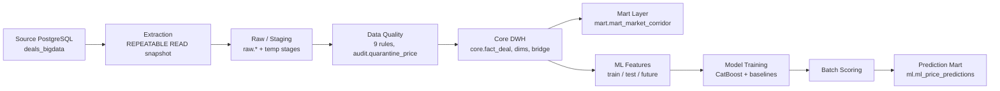
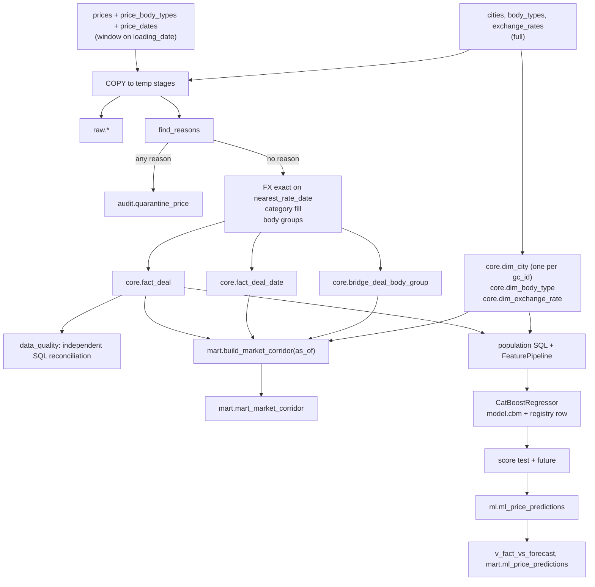
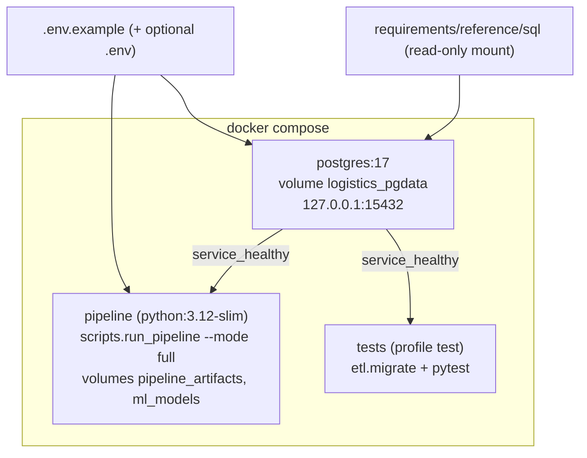

# Architecture — Smart Logistics Data & ML Platform

This document describes the platform as built. Detailed contracts live in the companion documents:

| Document | Contents |
| --- | --- |
| [data_dictionary.md](data_dictionary.md) | Every warehouse table, view, column, key, and index |
| [etl_design.md](etl_design.md) | Extract, validation, normalization, load, idempotency |
| [data_quality_report.md](data_quality_report.md) | Audit of the ETL against the source: rule counts, boundaries, reconciliation, benchmark |
| [mart_design.md](mart_design.md) | Market corridor mart: grain, eligibility, metrics, refresh |
| [feature_engineering_report.md](feature_engineering_report.md) | ML features, distributions, leakage audit |
| [ml_design.md](ml_design.md) | Population, split, training, scoring, fact vs forecast |
| [ml_evaluation_report.md](ml_evaluation_report.md) | Measured metrics, baselines, error analysis |

## 1. Shape of the system

A local, repeatable batch platform. One PostgreSQL 17 server holds two databases: the read-only operational snapshot `deals_bigdata` and the analytical warehouse `logistics_dwh`. A Python 3.12 runner executes the whole chain as a small dependency graph and writes an execution report.



Airflow, Superset, and ClickHouse are not used. The workload is one daily batch over 300,000 deals, and a runner of about 220 lines (`orchestration/dag.py` and `orchestration/runner.py`) covers ordering, retries, and failure propagation without another service to operate. The mart table and the prediction mart are the contracts a BI tool or a ClickHouse copy would read.

## 2. Databases, roles, and schemas

| Database | Schemas | Login role | Privileges |
| --- | --- | --- | --- |
| `deals_bigdata` | `public` (reference DDL, unchanged) | `source_reader` | `CONNECT`, `SELECT` only |
| `logistics_dwh` | `raw`, `core`, `mart`, `ml`, `audit` | `dwh_etl` | Owns the schemas; `CONNECT`, `CREATE`, `TEMPORARY` |

The superuser is used only by container initialization and the health check. The pipeline entrypoint unsets `POSTGRES_PASSWORD` before Python starts. One server is enough for this volume and keeps `docker compose up` to one durable service; the two databases still give hard separation, because PostgreSQL cannot join across databases.

| Layer | Objects | Grain | Retention |
| --- | --- | --- | --- |
| Raw | `raw.prices`, `raw.price_body_types`, `raw.price_dates`, `raw.cities`, `raw.body_types`, `raw.exchange_rates` | One row per source primary key, source types, plus `batch_id` and `extracted_at` | Mirror of the source for the loaded windows, including rejected deals |
| Staging | `stg_*` temporary tables | Current batch | Dropped at commit |
| Quarantine | `audit.quarantine_price` (view `audit.dq_quarantine_prices`) | One row per rejected deal and failed rule | Current state for loaded windows |
| Core DWH | `core.fact_deal`, `core.fact_deal_date`, `core.bridge_deal_body_group`, `core.dim_city`, `core.dim_body_type`, `core.dim_body_group`, `core.dim_exchange_rate` | One accepted deal; one deal × price date; one deal × body group | Current state |
| Mart | `mart.mart_market_corridor` | Month × origin × destination × body group × weight category | Rebuilt as a whole |
| ML | `ml.ml_model_registry`, `ml.ml_price_predictions`, views `ml.v_fact_vs_forecast`, `ml.v_prediction_error_summary`, `ml.v_prediction_error_distribution`, `mart.ml_price_predictions` | One model version; one deal × model version | Current state per version |
| Audit | `audit.etl_batch`, `audit.dq_statistic`, `audit.mart_refresh`, `audit.ml_scoring_batch`, `audit.pipeline_run`, `audit.bootstrap` | One row per run of each step | Append-only |

Core stores money and measures as `numeric` (`price_rub numeric(18,2)`, `fx_rate numeric(18,6)`, `distance_km numeric(12,3)`). Raw keeps the source `double precision`, so raw can be compared with the source byte for byte.

## 3. Data flow



Three dates are used deliberately for different purposes:

| Date | Use |
| --- | --- |
| `prices.loading_date` | ETL and backfill window (as the brief specifies), ML split, calendar features, future predicate |
| `price_dates.price_date` | Mart month. A deal with price dates in two months is an observation in both |
| `nearest_rate_date` | FX lookup, exactly as stored (the source fills it relative to `created_at`) |

`as_of_date = 2026-10-26` is configuration (`AS_OF_DATE`), never the system clock. The runner refuses to start if it differs from the ML split's `as_of`.

## 4. Processing strategy

- **Extraction:** one source transaction, `REPEATABLE READ READ ONLY`, server-side cursor. All tables come from the same snapshot.
- **Transformation:** Polars in memory. Rules, FX, and categories are vectorized expressions shared with the tests (`etl/transform/rules.py`). The body-group mapping also exists in SQL as `core.body_group_for_type`, and a CHECK constraint ties the two together.
- **Load:** `COPY` into temporary stages, then set-based `INSERT … ON CONFLICT … DO UPDATE … WHERE … IS DISTINCT FROM` merges and window deletes. No row-by-row writes.
- **Mart:** a single SQL function computes the whole table. The refresh procedure replaces the table contents in one transaction.
- **ML:** features from SQL over `core`; CatBoost with native categoricals; predictions COPYed into a stage and merged by a PL/pgSQL function that fills actuals from core.

Each writer (ETL batch, mart refresh, scoring batch) runs in one transaction under the advisory lock `logistics_dwh.core_etl` and commits its audit row with its data.

## 5. Idempotency and backfill

| Object | Replay behaviour |
| --- | --- |
| Raw, core, quarantine | Upsert on the natural key, written only when a value differs. Window deletes remove deals that left the source or now fail a rule |
| Core dimensions | Upsert only. A city or rate that leaves the source keeps its row so old facts keep their foreign keys |
| Mart | Full rebuild, skipped when the input fingerprint (every core value the build reads plus both definitions) equals the last successful refresh |
| Model | `model_version` is a hash of config, features, split, train data, and CatBoost version. Same inputs give the same version and a byte-identical `model.cbm` |
| Predictions | Upsert on `(price_id, model_name, model_version)`, written only when a value differs; rows of the scored role that left the population are deleted |
| Audit tables | One new row per run |

Measured on a clean warehouse: the second full run wrote nothing (0 inserted, updated, or deleted deals; mart refresh skipped; 17,699 predictions unchanged) and the run report compared every logical fingerprint as unchanged.

## 6. Data quality

Nine rules, one quarantine row per failed rule; see [etl_design.md](etl_design.md#3-validate). Same-city routes, outliers, auctions, composite routes, and future deals are not rejected; each consumer applies its own eligibility filter. After every ETL batch the `data_quality` task recomputes the expected outcome of every source deal in SQL on the source database and fails the pipeline on any unexplained deal.

`outlier_mark` is used as delivered. The generator marks outliers only for deals created before `2026-10-26 02:30:00`, so the last snapshot day contains unmarked extreme prices. The ETL reports their count on each batch; nothing recomputes the flag.

## 7. Deployment



On an empty volume the `postgres` init script creates the roles and databases, applies `schema.sql` and `synthetic.sql` (with `n_prices = N_PRICES`, seed unchanged), creates the warehouse schemas, and writes `audit.bootstrap`. The health check passes only when that row exists. The pipeline container then waits again for both databases (the server restarts once after init), applies migrations, and runs the full graph. It exits 0 on success. Later `docker compose up` runs reuse the volume and are idempotent.

The image installs `requirements.txt` with `constraints.txt`, which pins all 33 packages to exact versions. The database port is published on `127.0.0.1` only.

## 8. Orchestration

`python -m scripts.run_pipeline --mode {full,etl,mart,train,score,backfill}` builds a plan from declared task dependencies (topological sort, stable on ties):

`source_ready → warehouse_ready → migrate → etl → data_quality → mart → features → train → score_test → score_future → verify`, then the report.

- Transient database errors (lost connection, restart, serialization failure, deadlock) are retried with exponential backoff; data and credential errors fail at once.
- A failed task marks its dependants `not_run`; independent tasks still run; the report is always written.
- The report (`artifacts/reports/*.json` and `audit.pipeline_run`) holds counts, timings, metrics, integrity check results, and logical fingerprints compared with the previous successful run.

## 9. Testing architecture

| Layer | Examples | Database |
| --- | --- | --- |
| Pure unit | Rules, rounding, categories, feature transforms, leakage guards, plan order, CLI parsing | No |
| Warehouse integration | Schema constraints, ETL load, idempotency, backfill, transaction rollback, lock, reconciliation with a negative control | Yes |
| Mart | Independent Python recomputation of every metric on the real warehouse, edge cases, refresh idempotency | Yes |
| ML | Reproducible training, model card, tamper detection, scoring boundaries, NULL future actuals, SQL metrics equal Python metrics | Yes |
| Pipeline | Train and score twice through the runner, injected failure, mart skip and change detection | Yes |

Integration tests run against the generated 300,000-deal snapshot and assert its exact counts.

## 10. Decisions on ambiguous requirements

### 10.1 Resolved from the documents

| Topic | What the documents say | Decision |
| --- | --- | --- |
| How `nearest_rate_date` is filled versus how it is used | Production fills it from the last `setting_date <= created_at`; the ETL section says to convert with the stored date and not fall back to `loading_date` | Join on `num_code = currency_code AND setting_date = nearest_rate_date`. No recomputation. NULL or no match is `FX_RATE_MISSING` |
| Unmarked outliers on the snapshot day | The brief says the newest deals are unmarked; the generator marks only `created_at < 2026-10-26 02:30:00` | Keep `outlier_mark` as delivered and document it |
| Demo dashboard versus the mart | The HTML prototype is weekly with extra filters | Build the brief's monthly mart at the specified grain |
| `is_fact` on non-carrier and future rows | The dictionary sets `is_fact` for types 1–5 and 9, including future rows | Market membership follows `is_fact`; carrier types affect only `carriers_count`. Future scoring does not use `is_fact` |
| Fields named in the leakage section | `price_with_vat`, customer cost, and margin are not source columns | Banned by name if a later extract adds them |
| Python version | Brief: 3.11+ | 3.12 in the image |

### 10.2 Assumptions

| ID | Decision | Why |
| --- | --- | --- |
| A-WIN | The ETL window filters `prices.loading_date`, both bounds included | Named by the ETL brief. Consequence: late source updates are seen only when their window is reloaded |
| A-FX-1 | `price_rub = ROUND(ROUND(price, 2) × ROUND(rate, 6), 2)`, half away from zero. RUB uses rate 1 and needs no rate row. The 1000 threshold applies to RUB source prices only | Rounding and the RUB path are not specified |
| A-FX-2 | Duplicate rate rows for one currency and date: greatest `id` wins | The source has no unique constraint |
| A-CAT | Valid source categories are kept; NULL or invalid ones are recomputed (weight rounded to 0.1 t half up) and flagged | The brief says to fill gaps |
| A-NULL | NULL price, distance, weight, or volume is quarantined under the matching rule | The DDL says NOT NULL; a NULL still needs a defined fate |
| A-CUR | Currencies outside 643, 840, 978 are quarantined as `CURRENCY_UNSUPPORTED` | They cannot be converted |
| A-CITY | City label is `dim_city.name`; region is the trimmed text after the first comma of `full_name_local` | One example given, no punctuation rule |
| A-BODY-ML | The mart uses every distinct linked group; the model uses the group of `prices.body_type` | One training row per deal; duplicating per group would duplicate the target |
| A-MOM | MoM and YoY use `median_trip`, exact shifted-month join, NULL on a gap | "P50" is ambiguous between trip and per-km |
| A-REL | Freshness is `as_of − max(price_date)` inside the cell, ≤ 30 days for HIGH | Otherwise every old month of an active route would be HIGH |
| A-PCT | `percentile_cont` | Either is allowed |
| A-MONTH | Two price dates of one deal in one month collapse to one observation dated by the later date | The source key does not forbid it; the generator does not produce it |
| A-SCORE | Future scoring: core deals with `loading_date > as_of`, `NOT complex`, `price_type <> 6`, `distance_km > 0`. No price-derived predicate | The brief says to score planned deals present in the dataset; deals that failed DQ never reach core |
| A-SEED | CatBoost `random_seed = 42`; `RANDOM_SEED = 20261026` seeds Python and NumPy in the feature stage | Fixed seeds are required; values are not specified |
| A-DB | Source keeps the name `deals_bigdata`; the warehouse is `logistics_dwh`, same server | Design choice |

No metric, grain, or rejection rule beyond the brief was added: no weekly index, no confidence interval, no same-city rejection, no volume category in the mart grain.

## 11. Repository layout

```text
docker-compose.yml, Dockerfile, .env.example, requirements.txt, constraints.txt
docker/                  postgres init, health check, pipeline entrypoint
sql/core/                raw, dimensions, facts, ETL contract, pipeline audit, brief-named views
sql/mart/                market corridor build, refresh, fingerprint; examples.sql
sql/ml/                  registry, predictions, upsert, views, prediction mart; fact_vs_forecast.sql
logistics/               settings and readiness checks
etl/                     extract, transform, load, quality, mart refresh, migrations
ml/                      features, model, scoring
orchestration/           task graph, tasks, verification, report
scripts/                 run_pipeline, check_databases, benchmark_etl, dq_audit
tests/                   unit and integration tests
requirements/reference/  the assignment's source contract, unchanged
docs/                    this document set
```
