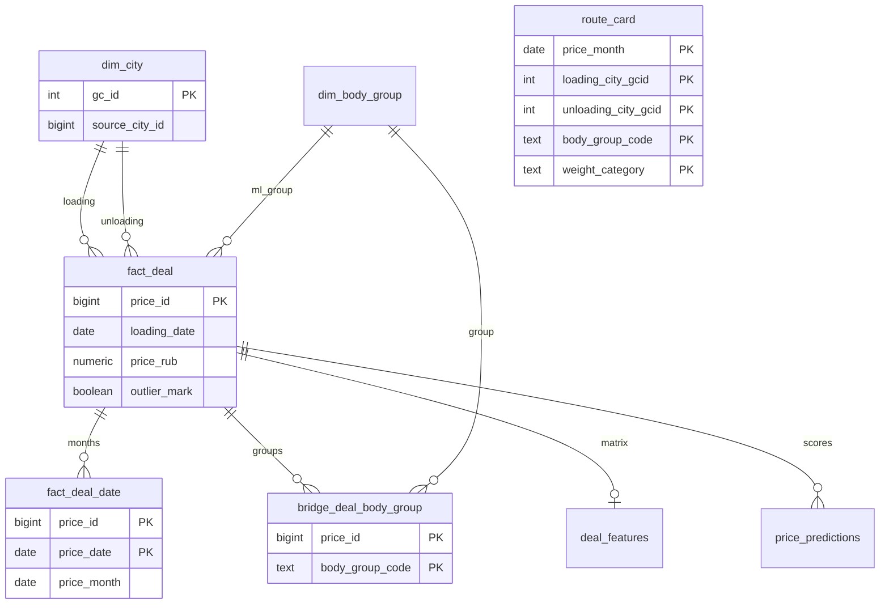

# Data dictionary

Status: design for approval. Physical types below are the warehouse contract. The source column types are the reference DDL.

Conventions:

- Grain is the business meaning of one row.
- Primary keys are natural where the source already has a stable id. Surrogate keys are not added for deals.
- `numeric` money and measures use half-away-from-zero rounding at the staging boundary (assumption A-TYPE, A-FX-1).
- Foreign keys are enforced inside `logistics_dwh`. The source snapshot has only the foreign keys declared in `schema.sql`.
- `as_of_date` is the parameter `2026-10-26`, stored on mart and ML rows so a result can be tied to the snapshot rather than to the run clock.

## 1. Source database `deals_bigdata`

The pipeline reads this database and does not alter it. Init is `schema.sql` then `synthetic.sql` with `n_prices = 300000` and `setseed(0.20261026)`.

### 1.1 `public.migrations`

| | |
| --- | --- |
| Grain | One applied migration name |
| Primary key | `id` |
| Foreign keys | None |
| Indexes | Primary key |
| Pipeline | Not read. Framework bookkeeping |

### 1.2 `public.cities`

| | |
| --- | --- |
| Grain | One source spelling of a populated place. `gc_id` is not a key |
| Primary key | `id` |
| Foreign keys | None |
| Indexes | `cities_gc_id_index (gc_id)` |

Columns used downstream: `id`, `gc_id`, `name`, `full_name_local`, `latitude`, `longitude`. `full_name_gc` duplicates `full_name_local` in the generator and is not a warehouse attribute.

The generator inserts 40 places (`gc_id` 1001–1040) and then a second row for Moscow `1001` (same name) and Kazan `1003` (different `full_name_local`: `Казань г, Татарстан`). Warehouse rule: keep `MIN(id)` per `gc_id`.

### 1.3 `public.body_types`

| | |
| --- | --- |
| Grain | One 1C body type |
| Primary key | `id` |
| Foreign keys | None. `std_id` is not a foreign key |
| Indexes | Primary key |

Seeded ids are `(1, 2, 3, 4, 5, 15, 26, 46, 47, 48, 50, 56, 57, 58, 59, 60, 61, 65, 68)`. The business group is not this table's `std_id` alone: `Прочие` collapses several `std_id` values, and `Не указан` has no row.

### 1.4 `public.exchange_rates`

| | |
| --- | --- |
| Grain | One currency on one Central Bank setting date |
| Primary key | `id` |
| Foreign keys | None |
| Indexes | `exchange_rates_num_code_idx (num_code, setting_date)` |

There is no unique constraint on `(num_code, setting_date)`. The generator inserts one row. Assumption A-FX-2 picks `MAX(id)` if duplicates appear.

Calendar: every day from `2023-06-01` through `2026-10-26` whose ISO day of week is not Monday or Sunday. `643` has `value = 1`. `840` and `978` share that calendar. `num_code` is `varchar`, matching `prices.currency_code`.

### 1.5 `public.price_group_stats`

| | |
| --- | --- |
| Grain | One statistics cell: month of `loading_date` × origin `gc_id` × destination `gc_id` × `prices.body_type` × weight category × volume category, for factual deals with a non-null body type |
| Primary key | `id` |
| Foreign keys | None |
| Indexes | Primary key |

Measures (`avg_price`, `min_km_price`, `max_km_price`, `outliers_amount`, `clear_items_amount`) are computed from raw `price` and raw `price / distance`, including the deals being predicted. The group key is `prices.body_type`, not the collapsed many-to-many group, and the price is not `price_rub`.

This table is forbidden as a model feature, including `price_group_id`. It is not a source for the mart.

### 1.6 `public.prices`

| | |
| --- | --- |
| Grain | One deal or rate record |
| Primary key | `id` |
| Foreign keys | `price_group_id` → `price_group_stats.id` (nullable) |
| Indexes | `prices_subscriber_id_index (subscriber_id)`; `prices_meta_item_id_index (meta_item_id)`; `main_prices_index (loading_city_gcid, unloading_city_gcid, total_weight, total_volume)`; `main_prices_cat_index (loading_city_gcid, unloading_city_gcid, weight_category, volume_category, outlier_mark)`; `price_group_index (price_group_id)` |

There is no foreign key to `cities` or `body_types`. City existence is an ETL check.

Important columns:

| Column | Meaning |
| --- | --- |
| `created_at`, `updated_at` | Equal in the generator. Extract window uses both (A-WIN). Capped at `2026-10-26 22:40:00` |
| `subscriber_id` | Platform subscriber. About 15% of rows sit on seven large subscribers. Not a model feature |
| `organization_id` | Organization on the deal. Carrier evidence only when `price_type IN (3, 9)` |
| `loading_date` | Planned or actual loading date. Model time axis |
| `end_loading_date` | End of a long request. Equal to `loading_date` for about 95% of rows |
| `loading_city_gcid`, `unloading_city_gcid` | Place codes. The generator forces them apart, so same-city rows are absent from this snapshot and still legal |
| `distance` | Kilometres, haversine rounded to an integer in the generator. Not recomputed |
| `total_weight` | Tonnes |
| `total_volume` | Cubic metres. Zero and 120 are deliberate boundary values |
| `body_type` | Declared type id, NULL for about 2% of rows (`r_bt` between 0.40 and 0.42) |
| `price` | Trip price without VAT, in `currency_code` |
| `currency_code` | `643` about 97%, `840` about 2%, `978` about 1% |
| `complex` | Composite route, about 3% (`r_cx < 0.03`). Excluded from mart and training |
| `price_type` | See the role table below |
| `is_fact` | Generator sets `price_type IN (1, 2, 3, 4, 5, 9)` |
| `nearest_rate_date` | `MAX(setting_date)` on the RUB calendar with `setting_date <= created_at`, or NULL when `r_cx > 0.995` |
| `outlier_mark` | True only for facts whose random draw is in the outer 1% of each tail and whose `created_at` is before `2026-10-26 02:30:00` |
| `weight_category`, `volume_category` | Filled by the generator. ETL fills only NULLs (A-CAT) |
| `source` | `data-hub`, `shippers-api`, `sbt`, or NULL for historical types 4 and 5 |

`price_type` roles:

| `price_type` | Record | Organization role | `is_fact` | Market trips | Carrier count | Training |
| --- | --- | --- | --- | --- | --- | --- |
| 1 | Customer request | Cargo owner | true | yes | no | yes, if the other filters pass |
| 2 | Forwarder request | Forwarder | true | yes | no | yes, if the other filters pass |
| 3 | Carrier request | Carrier | true | yes | yes | yes, if the other filters pass |
| 4, 5 | Historical closed requests | Unspecified | true | yes | no | yes, if the other filters pass. Generator emits these only before `2024-06-01`, which is outside the mandatory train window |
| 6 | Auction bid | Bidding carrier | false | no | no | no |
| 9 | Direct order | Carrier | true | yes | yes | yes, if the other filters pass |

About 2% of loading dates are from `2026-10-27` through about 110 days later. Those rows are the future scoring population, subject to A-SCORE. Their source `price` is populated and their published actual is still NULL.

### 1.7 `public.price_body_types`

| | |
| --- | --- |
| Grain | One declared body type on one deal |
| Primary key | `id` |
| Foreign keys | `price_id` → `prices.id` `ON DELETE CASCADE`. `body_type_id` has no foreign key |
| Indexes | Primary key; unique `(price_id, body_type_id)` |

Generator behavior:

- Deals with a NULL `body_type`, and deals with `id % 50 = 7`, have no link rows (the second set is the stated 2% gap).
- Remaining deals get one link. When `loading_date < 2025-01-01` and `id % 50 = 0`, that link is the child id `57`, `46`, or `1` instead of `56`, `4`, or `15`.
- A second link is added when `id % 8 = 3`: tent paired with board, refrigerator paired with isothermal.
- Tent deals with `id % 97 = 5` also receive id `61`, which is the same business group as `56`.

### 1.8 `public.price_dates`

| | |
| --- | --- |
| Grain | One monthly point of a deal from `loading_date` through `end_loading_date` |
| Primary key | `id` |
| Foreign keys | `price_id` → `prices.id` `ON DELETE CASCADE` |
| Indexes | Primary key; unique `(price_id, price_date)`. No index on `price_date` in the source |

The date is `loading_date + k months`, capped by `end_loading_date`, not the first day of the month. About 5% of deals span multiple months (`end_loading_date` about 30 to 119 days after loading). The mart month is the calendar month of `price_date`.

### 1.9 `public.price_participants`

| | |
| --- | --- |
| Grain | One subscriber participating in a deal chain |
| Primary key | `id` |
| Foreign keys | `price_id` → `prices.id` `ON DELETE CASCADE` |
| Indexes | Primary key |

Not an input to `carriers_count` or to the model. Not landed.

### 1.10 `public.selected_directions` and `public.favorite_directions`

| | |
| --- | --- |
| Grain | One subscriber's selected or favorite direction |
| Primary key | `id` |
| Foreign keys | `selected_directions.body_type_id` → `body_types.id`. Favorite body type has no foreign key |
| Indexes | Primary key |

Product context for a future workplace. Not part of the mandatory mart. Not landed.

## 2. Warehouse database `logistics_dwh`

### 2.1 `raw.load_batch`

| | |
| --- | --- |
| Grain | One pipeline run |
| Primary key | `batch_id bigint` |
| Foreign keys | None |
| Indexes | Primary key; `(started_at)` |

Columns: `started_at`, `finished_at`, `mode` (`full` or `window`), `start_date`, `end_date`, `as_of_date`, `status`, `rows_read`, `rows_landed`, `rows_quarantined`, `rows_core`, `rows_mart`, `rows_scored`, `error_message`.

### 2.2 `raw.cities`

| | |
| --- | --- |
| Grain | One source `cities` row from the latest full reference load |
| Primary key | `id` (source `cities.id`) |
| Foreign keys | None |
| Indexes | Primary key; `(gc_id, id)` |

Columns: source columns plus `batch_id`. Duplicates of `gc_id` are preserved here. Deduplication happens in `core.dim_city`.

### 2.3 `raw.body_types`

| | |
| --- | --- |
| Grain | One source body type |
| Primary key | `id` |
| Foreign keys | None |
| Indexes | Primary key |

Columns: `id`, `name`, `id_from_1c`, `std_id`, `batch_id`.

### 2.4 `raw.exchange_rates`

| | |
| --- | --- |
| Grain | One source rate row |
| Primary key | `id` |
| Foreign keys | None |
| Indexes | Primary key; `(num_code, setting_date, id DESC)` |

Columns: `id`, `num_code`, `value`, `setting_date`, `batch_id`.

### 2.5 `raw.prices`

| | |
| --- | --- |
| Grain | One source deal, including deals that fail quality checks |
| Primary key | `id` (source `prices.id`) |
| Foreign keys | None inside `raw`. `price_group_id` is stored and not referenced |
| Indexes | Primary key; `(GREATEST` is not indexed — instead `(created_at)`, `(updated_at)`, `(loading_date)`) |

All source deal columns are landed, plus `batch_id` and `loaded_at`. This table is the evidence that a rejected row was not dropped on extract. Downstream facts are built from staging, not by editing this table in place.

### 2.6 `raw.price_body_types`

| | |
| --- | --- |
| Grain | One source link row for a deal that has been landed |
| Primary key | `id` |
| Foreign keys | `price_id` → `raw.prices.id` |
| Indexes | Primary key; unique `(price_id, body_type_id)`; `(price_id)` |

### 2.7 `raw.price_dates`

| | |
| --- | --- |
| Grain | One source monthly date for a landed deal |
| Primary key | `id` |
| Foreign keys | `price_id` → `raw.prices.id` |
| Indexes | Primary key; unique `(price_id, price_date)`; `(price_date)`; `(price_id)` |

The source has no `price_date` index. The warehouse adds one because the mart predicate is on this column.

### 2.8 `raw.price_group_stats`

| | |
| --- | --- |
| Grain | One source statistics cell |
| Primary key | `id` |
| Foreign keys | None |
| Indexes | Primary key |

Landed so a lineage test can show that `core`, `mart`, and `ml` contain no view or foreign key that reads it. No query outside the extract step is allowed to reference `raw.price_group_stats` or `deals_bigdata.public.price_group_stats`.

## 3. Data quality

### 3.1 `dq.quarantine_prices`

| | |
| --- | --- |
| Grain | One reason for one deal in the current rejected set |
| Primary key | `(price_id, reason_code)` |
| Foreign keys | None to `core`. `batch_id` → `raw.load_batch.batch_id` |
| Indexes | Primary key; `(reason_code)`; `(batch_id)` |

Columns: `price_id`, `reason_code`, `batch_id`, `detected_at`, `created_at`, `loading_date`, `loading_city_gcid`, `unloading_city_gcid`, `distance`, `total_weight`, `total_volume`, `price`, `currency_code`, `nearest_rate_date`, `price_type`, `is_fact`.

`reason_code` is one of `PRICE_NON_POSITIVE`, `RUB_PRICE_LE_1000`, `DISTANCE_NON_POSITIVE`, `WEIGHT_NEGATIVE`, `VOLUME_NEGATIVE`, `CITY_NOT_FOUND`, `FX_RATE_MISSING`, `CURRENCY_UNSUPPORTED`.

A replay deletes quarantine rows for processed deal ids and inserts the current set. The table is the current reject list, not an append-only history. History of counts is `dq.batch_log`.

### 3.2 `dq.batch_log`

| | |
| --- | --- |
| Grain | One run's reject counts by reason |
| Primary key | `(batch_id, reason_code)` |
| Foreign keys | `batch_id` → `raw.load_batch.batch_id` |
| Indexes | Primary key |

Columns: `rows_rejected`, `logged_at`. A reason with zero rows is still written, so a silent rule failure is visible. Append-only.

## 4. Staging

Staging tables are truncated at the beginning of each run. They have primary keys so a bad join fails inside the run. They have no foreign keys to `core`.

### 4.1 `staging.price_candidate`

| | |
| --- | --- |
| Grain | One deal that passed every quality rule, after FX and category fill, before core publish |
| Primary key | `price_id` |
| Foreign keys | None |
| Indexes | Primary key; `(loading_date)` |

Carries the conformed measures: `price_rub`, `fx_rate`, `fx_rate_date`, resolved categories, imputed flags, and `ml_body_group_code` from `prices.body_type` (A-BODY-ML). Deals in quarantine are absent.

### 4.2 `staging.price_body_group`

| | |
| --- | --- |
| Grain | One business body group for one surviving deal |
| Primary key | `(price_id, body_group_code)` |
| Foreign keys | None |
| Indexes | Primary key |

Columns: `body_group_code`, `resolution` (`links`, `fallback_body_type`, `unspecified`). This is the mart bridge input. It can contain more than one group per deal. `staging.price_candidate.ml_body_group_code` can name a group that is also in this table; the model still emits one row.

### 4.3 `staging.price_date`

| | |
| --- | --- |
| Grain | One source `price_date` of a surviving deal |
| Primary key | `(price_id, price_date)` |
| Foreign keys | None |
| Indexes | Primary key; `(price_month)` |

Columns: `price_date`, `price_month` as `date_trunc('month', price_date)::date`. Future dates are kept here and in core. The mart filter applies later, so a core reload can rebuild history without reinterpreting the source.

## 5. Core

### 5.1 `core.dim_city`

| | |
| --- | --- |
| Grain | One `gc_id` |
| Primary key | `gc_id` |
| Foreign keys | None |
| Indexes | Primary key; unique `(source_city_id)` |

Columns: `gc_id`, `source_city_id` (the winning `cities.id`), `name`, `full_name_local`, `region_name`, `latitude`, `longitude`, `duplicate_count`, `batch_id`.

Winner: the `raw.cities` row with `MIN(id)` for that `gc_id`. `region_name` is the trimmed text after the first comma of that row's `full_name_local`, or NULL when there is no comma (A-CITY). Coordinates come from the winning row.

### 5.2 `core.dim_body_type`

| | |
| --- | --- |
| Grain | One source body type |
| Primary key | `body_type_id` |
| Foreign keys | `body_group_code` → `core.dim_body_group.body_group_code` |
| Indexes | Primary key |

Columns: `body_type_id`, `name`, `id_from_1c`, `std_id`, `body_group_code`. The group is assigned by the business id list, not by trusting `std_id` alone. An id that is not in the named lists maps to `OTHER`.

### 5.3 `core.dim_body_group`

| | |
| --- | --- |
| Grain | One business body group |
| Primary key | `body_group_code` |
| Foreign keys | None |
| Indexes | Primary key |

Static rows:

| `body_group_code` | `body_group_name` | `std_id` |
| --- | --- | --- |
| `TENT` | Тент | 56 |
| `REF` | Рефрижератор | 4 |
| `ISO` | Изотерм | 2 |
| `BORT` | Борт | 15 |
| `OTHER` | Прочие | NULL |
| `UNSPECIFIED` | Не указан | NULL |

### 5.4 `core.fact_deal`

| | |
| --- | --- |
| Grain | One deal that passed quality checks |
| Primary key | `price_id` (source `prices.id`) |
| Foreign keys | `loading_city_gcid` → `core.dim_city.gc_id`; `unloading_city_gcid` → `core.dim_city.gc_id`; `ml_body_group_code` → `core.dim_body_group.body_group_code`; `body_type_id` → `core.dim_body_type.body_type_id` (nullable, `ON DELETE` not used — dimensions are upserted); `batch_id` → `raw.load_batch.batch_id` |
| Indexes | Primary key; `(loading_date)`; `(loading_city_gcid, unloading_city_gcid)`; `(is_fact, complex, outlier_mark, loading_date)` |

The table has no `price_group_id` column.

| Column | Notes |
| --- | --- |
| `created_at`, `updated_at` | Source timestamps |
| `subscriber_id`, `organization_id` | Pass-through. `organization_id` feeds `carriers_count` only |
| `loading_date`, `end_loading_date` | Source dates |
| `loading_city_gcid`, `unloading_city_gcid` | Deduped by existence in `dim_city`, not by renaming the code |
| `distance_km numeric(12, 3)` | Source distance |
| `total_weight_t numeric(12, 3)`, `total_volume_m3 numeric(12, 3)` | Source measures |
| `body_type_id` | Source `prices.body_type`, nullable |
| `ml_body_group_code` | Map of `body_type_id`, else `UNSPECIFIED` |
| `price_src numeric(18, 2)` | Source price in `currency_code` |
| `currency_code char(3)` | |
| `fx_rate numeric(18, 6)` | 1 for RUB |
| `fx_rate_date date` | NULL for RUB; otherwise the matched `nearest_rate_date` |
| `price_rub numeric(18, 2)` | Rounded product |
| `complex`, `price_type`, `is_fact`, `outlier_mark` | Source values |
| `weight_category varchar(4)`, `volume_category varchar(4)` | Source value, or the imputed value |
| `weight_category_imputed`, `volume_category_imputed` | True when the source value was NULL |
| `source`, `item_id`, `meta_item_id`, `external_item_uuid` | Lineage. Not features |
| `batch_id` | Last publish |

Population of this table includes auctions, composite routes, outliers, and future loading dates. Filters belong to the mart and the model.

### 5.5 `core.fact_deal_date`

| | |
| --- | --- |
| Grain | One source `price_date` of a conformed deal |
| Primary key | `(price_id, price_date)` |
| Foreign keys | `price_id` → `core.fact_deal.price_id` |
| Indexes | Primary key; `(price_month)`; `(price_month, price_id)` |

Columns: `price_date`, `price_month date` stored as the first day of the month. Rows with `price_date > as_of` are stored.

### 5.6 `core.bridge_deal_body_group`

| | |
| --- | --- |
| Grain | One business body group on one conformed deal |
| Primary key | `(price_id, body_group_code)` |
| Foreign keys | `price_id` → `core.fact_deal.price_id`; `body_group_code` → `core.dim_body_group.body_group_code` |
| Indexes | Primary key; `(body_group_code, price_id)` |

Columns: `resolution`. A deal with tent and board has two rows. A deal whose links are `56` and `61` has one row, `TENT`.

## 6. Mart

### 6.1 `mart.route_card`

| | |
| --- | --- |
| Grain | One calendar month × origin `gc_id` × destination `gc_id` × body group × weight category, for eligible historical observations |
| Primary key | `(price_month, loading_city_gcid, unloading_city_gcid, body_group_code, weight_category)` |
| Foreign keys | Both city codes → `core.dim_city.gc_id`; `body_group_code` → `core.dim_body_group.body_group_code` |
| Indexes | Primary key; `(loading_city_gcid, unloading_city_gcid, body_group_code, weight_category, price_month)`; `(price_month)`; `(reliability_level)` |

| Column | Definition |
| --- | --- |
| `price_month` | First day of the month of `price_date` |
| `loading_city_gcid`, `unloading_city_gcid` | Route |
| `loading_city_name`, `unloading_city_name` | From `dim_city`, attributes |
| `loading_region_name`, `unloading_region_name` | From `dim_city`, attributes |
| `body_group_code`, `body_group_name` | Business group |
| `weight_category` | Deal category after gap fill |
| `p25_trip`, `median_trip`, `p75_trip`, `avg_trip` | `percentile_cont` 0.25 / 0.50 / 0.75 and average of `price_rub` |
| `p25_km`, `median_km`, `p75_km` | Same percentiles of `price_rub / distance_km`. Average per kilometre is not a required column |
| `trips_count` | Distinct `price_id` in the cell |
| `carriers_count` | Distinct `organization_id` where `price_type IN (3, 9)`. Zero when none |
| `cv_rate` | `stddev_samp(price_rub) / avg(price_rub)`, NULL when `trips_count < 2` or the average is 0 |
| `mom_pct`, `yoy_pct` | Percent change of `median_trip` versus the previous month and versus the same month last year (A-MOM). NULL when the comparison cell is absent or its median is 0 |
| `max_price_date` | Latest `price_date` inside the cell. Supports the freshness rule |
| `reliability_level` | `HIGH`, `MEDIUM`, or `LOW_DATA` (A-REL) |
| `as_of_date` | `2026-10-26` |
| `batch_id`, `built_at` | Publish lineage |

Eligible observation, all of the following:

- The deal is in `core.fact_deal`.
- `is_fact` is true, `complex` is false, `outlier_mark` is false.
- `price_rub > 0` and `distance_km > 0`.
- `price_date <= as_of_date`.
- The deal contributes one row per body group on its bridge.
- If several `price_date` values of that deal fall in the same `price_month` and the same body group, one observation is kept: the minimum `price_date` (A-MONTH).

`volume_category` is not a column of this table.

### 6.2 `mart.market_corridor`

| | |
| --- | --- |
| Grain | Same row as `mart.route_card` |
| Primary key | Same key, via the view |
| Foreign keys | Inherited from the table |
| Indexes | Uses the table indexes |

View columns: the grain, city names, `p25_trip`, `median_trip`, `p75_trip`, `avg_trip`, `p25_km`, `median_km`, `p75_km`, `trips_count`, `as_of_date`. Evidence and dynamics remain on `route_card` so the corridor view stays the pricing band.

## 7. Machine learning

### 7.1 `ml.deal_features`

| | |
| --- | --- |
| Grain | One deal in the model population: train, test, or future score |
| Primary key | `price_id` |
| Foreign keys | `price_id` → `core.fact_deal.price_id`; `batch_id` → `raw.load_batch.batch_id` |
| Indexes | Primary key; `(split_role, loading_date)` |

`split_role` is `train`, `test`, or `score_future`.

Feature columns (the model matrix):

| Column | Kind |
| --- | --- |
| `distance_km` | numeric |
| `total_weight_t`, `total_volume_m3` | numeric |
| `origin_city_name`, `destination_city_name` | categorical, from `dim_city.name` |
| `origin_region_name`, `destination_region_name` | categorical, NULL allowed |
| `origin_latitude`, `origin_longitude`, `destination_latitude`, `destination_longitude` | numeric |
| `body_group_code` | categorical, the singular ML group |
| `weight_category`, `volume_category` | categorical |
| `loading_year`, `loading_month`, `loading_isodow`, `loading_doy` | numeric parts of `loading_date` |
| `month_sin`, `month_cos` | `T = 12` |
| `dow_sin`, `dow_cos` | `T = 7`, input is ISO day of week 1–7 |
| `doy_sin`, `doy_cos` | `T = 365.25` |

Audit columns that are not features: `split_role`, `loading_date`, `price_rub`, `as_of_date`, `batch_id`. `price_rub` is stored beside the matrix so training does not join back to a table that also holds forbidden columns. The training code reads it as `y` and the feature list is an explicit allow-list.

No column for `outlier_mark`, `price_group_id`, any `price_group_stats` measure, `price_src`, `fx_rate`, `price_rub / distance`, `price_rub / weight`, VAT, margin, `organization_id`, or `subscriber_id`.

### 7.2 `ml.price_predictions`

| | |
| --- | --- |
| Grain | One current prediction for one deal and one model |
| Primary key | `(price_id, model_name)` |
| Foreign keys | `price_id` → `core.fact_deal.price_id`; `batch_id` → `raw.load_batch.batch_id` |
| Indexes | Primary key; `(loading_date)`; `(model_name, loading_date)` |

| Column | Test row | Future row |
| --- | --- | --- |
| `price_id` | source id | source id |
| `loading_date` | inside the test window | after `2026-10-26` |
| `loading_city_gcid`, `unloading_city_gcid` | route | route |
| `body_group_code` | singular ML group | singular ML group |
| `actual_price_rub` | `price_rub` | NULL |
| `predicted_price_rub` | model output | model output |
| `abs_error_rub` | absolute error | NULL |
| `ape_pct` | absolute percentage error | NULL |
| `model_name` | `catboost_regressor` for the mandatory model | same |
| `scored_at` | run timestamp | run timestamp |
| `batch_id` | lineage | lineage |

`abs_error_rub = ABS(actual_price_rub - predicted_price_rub)`. `ape_pct = ABS(actual_price_rub - predicted_price_rub) / actual_price_rub * 100`. Both expressions are computed only when `split_role = 'test'`.

### 7.3 `ml.run_metrics`

| | |
| --- | --- |
| Grain | One trained model execution |
| Primary key | `run_id` |
| Foreign keys | `batch_id` → `raw.load_batch.batch_id` |
| Indexes | Primary key; `(model_name, started_at)` |

Columns: `model_name`, `random_seed`, `as_of_date`, `train_start`, `train_end_exclusive`, `test_start`, `test_end_inclusive`, `n_train`, `n_test`, `n_future_scored`, `r2`, `mape_pct`, `rmse_rub`, `mae_rub`, `feature_columns text[]`, `started_at`, `finished_at`, `batch_id`.

Metrics are computed on the test role only. Append-only: a replay adds a run and replaces prediction rows.

## 8. Relationship overview

`mart.route_card` is an aggregate and has no foreign key to `fact_deal`. That is intentional: the card's grain is the cell, not the deal.
