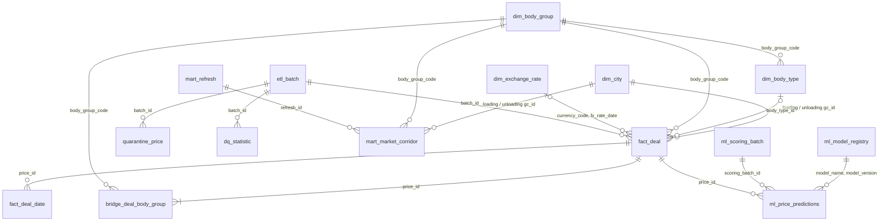

# Data dictionary

This dictionary describes the source snapshot and every warehouse object as built. Sections 2 to 7 are generated from the PostgreSQL catalog of a warehouse after a full pipeline run (`sql/core`, `sql/mart`, `sql/ml` applied), so types, keys, indexes, and constraints are the physical ones. Row counts are from the 300,000-deal snapshot; audit tables are append-only and their counts depend on how many runs happened.

Conventions:

- Grain is the business meaning of one row.
- Deals keep their natural key (`prices.id` as `price_id`). No surrogate keys are added.
- Core money and measures are `numeric`: prices to 0.01, FX rates to 0.000001, distance, weight, and volume to 0.001. Raw keeps the source `double precision`.
- Every raw and core row carries lineage: `source_system`, `extracted_at` (source snapshot time), and `batch_id` (`audit.etl_batch`). Unchanged rows keep their original lineage on a rerun.
- `as_of_date` (`2026-10-26`) is stored on mart and ML rows, so a result is tied to the snapshot, not to the run clock.
- Foreign keys are enforced inside `logistics_dwh`. The source has only the foreign keys declared in `schema.sql`.

## 1. Source database `deals_bigdata`

The pipeline reads this database and does not alter it. Init is `schema.sql` then `synthetic.sql` with `n_prices = 300000` and `setseed(0.20261026)`.

### 1.1 `public.migrations`

| | |
| --- | --- |
| Grain | One applied migration name |
| Primary key | `id` |
| Foreign keys | None |
| Indexes | Primary key |
| Pipeline | Not read. Framework bookkeeping |

### 1.2 `public.cities`

| | |
| --- | --- |
| Grain | One source spelling of a populated place. `gc_id` is not a key |
| Primary key | `id` |
| Foreign keys | None |
| Indexes | `cities_gc_id_index (gc_id)` |

Columns used downstream: `id`, `gc_id`, `name`, `full_name_local`, `latitude`, `longitude`. `full_name_gc` duplicates `full_name_local` in the generator and is not a warehouse attribute.

The generator inserts 40 places (`gc_id` 1001–1040) and then a second row for Moscow `1001` (same name) and Kazan `1003` (different `full_name_local`: `Казань г, Татарстан`). Warehouse rule: keep `MIN(id)` per `gc_id`.

### 1.3 `public.body_types`

| | |
| --- | --- |
| Grain | One 1C body type |
| Primary key | `id` |
| Foreign keys | None. `std_id` is not a foreign key |
| Indexes | Primary key |

Seeded ids are `(1, 2, 3, 4, 5, 15, 26, 46, 47, 48, 50, 56, 57, 58, 59, 60, 61, 65, 68)`. The business group is not this table's `std_id` alone: `Прочие` collapses several `std_id` values, and `Не указан` has no row.

### 1.4 `public.exchange_rates`

| | |
| --- | --- |
| Grain | One currency on one Central Bank setting date |
| Primary key | `id` |
| Foreign keys | None |
| Indexes | `exchange_rates_num_code_idx (num_code, setting_date)` |

There is no unique constraint on `(num_code, setting_date)`. The generator inserts one row. Assumption A-FX-2 picks `MAX(id)` if duplicates appear.

Calendar: every day from `2023-06-01` through `2026-10-26` whose ISO day of week is not Monday or Sunday. `643` has `value = 1`. `840` and `978` share that calendar. `num_code` is `varchar`, matching `prices.currency_code`.

### 1.5 `public.price_group_stats`

| | |
| --- | --- |
| Grain | One statistics cell: month of `loading_date` × origin `gc_id` × destination `gc_id` × `prices.body_type` × weight category × volume category, for factual deals with a non-null body type |
| Primary key | `id` |
| Foreign keys | None |
| Indexes | Primary key |

Measures (`avg_price`, `min_km_price`, `max_km_price`, `outliers_amount`, `clear_items_amount`) are computed from raw `price` and raw `price / distance`, including the deals being predicted. The group key is `prices.body_type`, not the collapsed many-to-many group, and the price is not `price_rub`.

This table is forbidden as a model feature, including `price_group_id`. It is not a source for the mart, and the ETL does not extract it.

### 1.6 `public.prices`

| | |
| --- | --- |
| Grain | One deal or rate record |
| Primary key | `id` |
| Foreign keys | `price_group_id` → `price_group_stats.id` (nullable) |
| Indexes | `prices_subscriber_id_index (subscriber_id)`; `prices_meta_item_id_index (meta_item_id)`; `main_prices_index (loading_city_gcid, unloading_city_gcid, total_weight, total_volume)`; `main_prices_cat_index (loading_city_gcid, unloading_city_gcid, weight_category, volume_category, outlier_mark)`; `price_group_index (price_group_id)` |

There is no foreign key to `cities` or `body_types`. City existence is an ETL check.

Important columns:

| Column | Meaning |
| --- | --- |
| `created_at`, `updated_at` | Equal in the generator. The extract window uses `loading_date` instead (A-WIN). Capped at `2026-10-26 22:40:00` |
| `subscriber_id` | Platform subscriber. About 15% of rows sit on seven large subscribers. Not a model feature |
| `organization_id` | Organization on the deal. Carrier evidence only when `price_type IN (3, 9)` |
| `loading_date` | Planned or actual loading date. Model time axis |
| `end_loading_date` | End of a long request. Equal to `loading_date` for about 95% of rows |
| `loading_city_gcid`, `unloading_city_gcid` | Place codes. The generator forces them apart, so same-city rows are absent from this snapshot and still legal |
| `distance` | Kilometres, haversine rounded to an integer in the generator. Not recomputed |
| `total_weight` | Tonnes |
| `total_volume` | Cubic metres. Zero and 120 are deliberate boundary values |
| `body_type` | Declared type id, NULL for about 2% of rows (`r_bt` between 0.40 and 0.42) |
| `price` | Trip price without VAT, in `currency_code` |
| `currency_code` | `643` about 97%, `840` about 2%, `978` about 1% |
| `complex` | Composite route, about 3% (`r_cx < 0.03`). Excluded from mart and training |
| `price_type` | See the role table below |
| `is_fact` | Generator sets `price_type IN (1, 2, 3, 4, 5, 9)` |
| `nearest_rate_date` | `MAX(setting_date)` on the RUB calendar with `setting_date <= created_at`, or NULL when `r_cx > 0.995` |
| `outlier_mark` | True only for facts whose random draw is in the outer 1% of each tail and whose `created_at` is before `2026-10-26 02:30:00` |
| `weight_category`, `volume_category` | Filled by the generator. The ETL keeps valid values and recomputes NULL or invalid ones (A-CAT) |
| `source` | `data-hub`, `shippers-api`, `sbt`, or NULL for historical types 4 and 5 |

`price_type` roles:

| `price_type` | Record | Organization role | `is_fact` | Market trips | Carrier count | Training |
| --- | --- | --- | --- | --- | --- | --- |
| 1 | Customer request | Cargo owner | true | yes | no | yes, if the other filters pass |
| 2 | Forwarder request | Forwarder | true | yes | no | yes, if the other filters pass |
| 3 | Carrier request | Carrier | true | yes | yes | yes, if the other filters pass |
| 4, 5 | Historical closed requests | Unspecified | true | yes | no | yes, if the other filters pass. Generator emits these only before `2024-06-01`, which is outside the mandatory train window |
| 6 | Auction bid | Bidding carrier | false | no | no | no |
| 9 | Direct order | Carrier | true | yes | yes | yes, if the other filters pass |

About 2% of loading dates are from `2026-10-27` through about 110 days later. Those rows are the future scoring population, subject to A-SCORE. Their source `price` is populated and their published actual is still NULL.

### 1.7 `public.price_body_types`

| | |
| --- | --- |
| Grain | One declared body type on one deal |
| Primary key | `id` |
| Foreign keys | `price_id` → `prices.id` `ON DELETE CASCADE`. `body_type_id` has no foreign key |
| Indexes | Primary key; unique `(price_id, body_type_id)` |

Generator behavior:

- Deals with a NULL `body_type`, and deals with `id % 50 = 7`, have no link rows (the second set is the stated 2% gap).
- Remaining deals get one link. When `loading_date < 2025-01-01` and `id % 50 = 0`, that link is the child id `57`, `46`, or `1` instead of `56`, `4`, or `15`.
- A second link is added when `id % 8 = 3`: tent paired with board, refrigerator paired with isothermal.
- Tent deals with `id % 97 = 5` also receive id `61`, which is the same business group as `56`.

### 1.8 `public.price_dates`

| | |
| --- | --- |
| Grain | One monthly point of a deal from `loading_date` through `end_loading_date` |
| Primary key | `id` |
| Foreign keys | `price_id` → `prices.id` `ON DELETE CASCADE` |
| Indexes | Primary key; unique `(price_id, price_date)`. No index on `price_date` in the source |

The date is `loading_date + k months`, capped by `end_loading_date`, not the first day of the month. About 5% of deals span multiple months (`end_loading_date` about 30 to 119 days after loading). The mart month is the calendar month of `price_date`.

### 1.9 `public.price_participants`

| | |
| --- | --- |
| Grain | One subscriber participating in a deal chain |
| Primary key | `id` |
| Foreign keys | `price_id` → `prices.id` `ON DELETE CASCADE` |
| Indexes | Primary key |

Not an input to `carriers_count` or to the model. Not landed.

### 1.10 `public.selected_directions` and `public.favorite_directions`

| | |
| --- | --- |
| Grain | One subscriber's selected or favorite direction |
| Primary key | `id` |
| Foreign keys | `selected_directions.body_type_id` → `body_types.id`. Favorite body type has no foreign key |
| Indexes | Primary key |

Product context for a future workplace. Not part of the mandatory mart. Not landed.

## 2. Raw (`raw`)

### 2.1 `raw.body_types`

One source body type. Business grouping is applied in core, not here.

| | |
| --- | --- |
| Grain | One source `body_types` row |
| Rows after the full load and pipeline run | 19 |
| Primary key | `(id)` |
| Foreign keys | `(batch_id) REFERENCES audit.etl_batch(batch_id)` |

| Column | Type | Null | Notes |
| --- | --- | --- | --- |
| `id` | `bigint` | no |  |
| `name` | `character varying(255)` | no |  |
| `id_from_1c` | `integer` | no |  |
| `std_id` | `integer` | yes |  |
| `source_system` | `text` | no |  |
| `extracted_at` | `timestamp with time zone` | no |  |
| `batch_id` | `bigint` | no |  |

### 2.2 `raw.cities`

One source cities row. gc_id is not unique here; core.dim_city keeps the minimum id.

| | |
| --- | --- |
| Grain | One source `cities` row (duplicate `gc_id` rows kept) |
| Rows after the full load and pipeline run | 42 |
| Primary key | `(id)` |
| Foreign keys | `(batch_id) REFERENCES audit.etl_batch(batch_id)` |
| Indexes | `raw_cities_gc_id_id_idx` (gc_id, id) |

| Column | Type | Null | Notes |
| --- | --- | --- | --- |
| `id` | `bigint` | no |  |
| `full_name_local` | `character varying(255)` | no |  |
| `full_name_gc` | `character varying(255)` | no |  |
| `gc_id` | `integer` | no |  |
| `name` | `character varying(255)` | no |  |
| `longitude` | `double precision` | yes |  |
| `latitude` | `double precision` | yes |  |
| `created_at` | `timestamp(0) without time zone` | yes |  |
| `updated_at` | `timestamp(0) without time zone` | yes |  |
| `source_system` | `text` | no |  |
| `extracted_at` | `timestamp with time zone` | no |  |
| `batch_id` | `bigint` | no |  |

### 2.3 `raw.exchange_rates`

Source rate rows. The source has no unique key on currency and date.

| | |
| --- | --- |
| Grain | One source `exchange_rates` row |
| Rows after the full load and pipeline run | 2,664 |
| Primary key | `(id)` |
| Foreign keys | `(batch_id) REFERENCES audit.etl_batch(batch_id)` |
| Indexes | `raw_exchange_rates_lookup_idx` (num_code, setting_date, id DESC) |

| Column | Type | Null | Notes |
| --- | --- | --- | --- |
| `id` | `bigint` | no |  |
| `num_code` | `character varying(255)` | no |  |
| `value` | `double precision` | no |  |
| `setting_date` | `date` | no |  |
| `source_system` | `text` | no |  |
| `extracted_at` | `timestamp with time zone` | no |  |
| `batch_id` | `bigint` | no |  |

### 2.4 `raw.price_body_types`

| | |
| --- | --- |
| Grain | One source body-type link of a landed deal |
| Rows after the full load and pipeline run | 325,131 |
| Primary key | `(id)` |
| Unique | `(price_id, body_type_id)` |
| Foreign keys | `(batch_id) REFERENCES audit.etl_batch(batch_id)` `(price_id) REFERENCES raw.prices(id) ON DELETE CASCADE` |
| Indexes | `raw_price_body_types_price_idx` (price_id) |

| Column | Type | Null | Notes |
| --- | --- | --- | --- |
| `id` | `bigint` | no |  |
| `price_id` | `bigint` | no |  |
| `body_type_id` | `integer` | no |  |
| `source_system` | `text` | no |  |
| `extracted_at` | `timestamp with time zone` | no |  |
| `batch_id` | `bigint` | no |  |

### 2.5 `raw.price_dates`

| | |
| --- | --- |
| Grain | One source price date of a landed deal |
| Rows after the full load and pipeline run | 336,802 |
| Primary key | `(id)` |
| Unique | `(price_id, price_date)` |
| Foreign keys | `(batch_id) REFERENCES audit.etl_batch(batch_id)` `(price_id) REFERENCES raw.prices(id) ON DELETE CASCADE` |
| Indexes | `raw_price_dates_price_date_idx` (price_date) |

| Column | Type | Null | Notes |
| --- | --- | --- | --- |
| `id` | `bigint` | no |  |
| `price_id` | `bigint` | no |  |
| `price_date` | `date` | no |  |
| `source_system` | `text` | no |  |
| `extracted_at` | `timestamp with time zone` | no |  |
| `batch_id` | `bigint` | no |  |

### 2.6 `raw.prices`

One source deal, including rows that later fail quality checks.

| | |
| --- | --- |
| Grain | One source deal in a loaded window, accepted or rejected |
| Rows after the full load and pipeline run | 300,000 |
| Primary key | `(id)` |
| Foreign keys | `(batch_id) REFERENCES audit.etl_batch(batch_id)` |
| Indexes | `raw_prices_batch_idx` (batch_id) `raw_prices_created_at_idx` (created_at) `raw_prices_loading_date_idx` (loading_date) `raw_prices_updated_at_idx` (updated_at) |

| Column | Type | Null | Notes |
| --- | --- | --- | --- |
| `id` | `bigint` | no | Source prices.id. |
| `created_at` | `timestamp(0) without time zone` | yes |  |
| `updated_at` | `timestamp(0) without time zone` | yes |  |
| `subscriber_id` | `integer` | yes |  |
| `organization_id` | `integer` | yes |  |
| `loading_date` | `date` | no |  |
| `loading_city_gcid` | `integer` | no |  |
| `unloading_city_gcid` | `integer` | no |  |
| `distance` | `double precision` | no |  |
| `total_weight` | `double precision` | no |  |
| `total_volume` | `double precision` | no |  |
| `body_type` | `integer` | yes |  |
| `price` | `double precision` | no |  |
| `currency_code` | `character varying(3)` | no |  |
| `complex` | `boolean` | no |  |
| `price_type` | `smallint` | no |  |
| `item_id` | `integer` | yes |  |
| `is_fact` | `boolean` | no |  |
| `nearest_rate_date` | `date` | yes |  |
| `meta_item_id` | `bigint` | yes |  |
| `end_loading_date` | `date` | yes |  |
| `source` | `character varying(255)` | yes |  |
| `external_item_uuid` | `uuid` | yes |  |
| `outlier_mark` | `boolean` | no |  |
| `weight_category` | `character varying(4)` | yes |  |
| `volume_category` | `character varying(4)` | yes |  |
| `price_group_id` | `bigint` | yes | Source key only. No foreign key, and core does not carry this column. |
| `source_system` | `text` | no |  |
| `extracted_at` | `timestamp with time zone` | no |  |
| `batch_id` | `bigint` | no |  |

## 3. Core DWH (`core`)

### 3.1 `core.bridge_deal_body_group`

One business group per deal. Child types that share a group do not add another row.

| | |
| --- | --- |
| Grain | One accepted deal and business body group |
| Rows after the full load and pipeline run | 335,077 |
| Primary key | `(price_id, body_group_code)` |
| Foreign keys | `(body_group_code) REFERENCES core.dim_body_group(body_group_code)` `(price_id) REFERENCES core.fact_deal(price_id) ON DELETE CASCADE` |
| Indexes | `bridge_deal_body_group_group_idx` (body_group_code, price_id) |

| Column | Type | Null | Notes |
| --- | --- | --- | --- |
| `price_id` | `bigint` | no |  |
| `body_group_code` | `text` | no |  |
| `resolution` | `text` | no |  |

Check constraints:

- `bridge_deal_body_group_resolution_check`: `((resolution = ANY (ARRAY['links'::text, 'fallback_body_type'::text, 'unspecified'::text])))`

### 3.2 `core.dim_body_group`

Tent 56, refrigerator 4, isotherm 2, flatbed 15, other, and not specified.

| | |
| --- | --- |
| Grain | One business body group (6 rows, seeded by migration) |
| Rows after the full load and pipeline run | 6 |
| Primary key | `(body_group_code)` |
| Unique | `(body_group_name)` |

| Column | Type | Null | Notes |
| --- | --- | --- | --- |
| `body_group_code` | `text` | no |  |
| `body_group_name` | `text` | no |  |
| `std_id` | `integer` | yes |  |

Check constraints:

- `dim_body_group_code_check`: `((body_group_code = ANY (ARRAY['TENT'::text, 'REF'::text, 'ISO'::text, 'BORT'::text, 'OTHER'::text, 'UNSPECIFIED'::text])))`
- `dim_body_group_std_check`: `((((body_group_code = 'TENT'::text) AND (std_id = 56)) OR ((body_group_code = 'REF'::text) AND (std_id = 4)) OR ((body_group_code = 'ISO'::text) AND (std_id = 2)) OR ((body_group_code = 'BORT'::text) AND (std_id = 15)) OR ((body_group_code = ANY (ARRAY['OTHER'::text, 'UNSPECIFIED'::text])) AND (std_id IS NULL))))`

### 3.3 `core.dim_body_type`

One source body type id, including child ids, mapped to exactly one business group.

| | |
| --- | --- |
| Grain | One source body type, plus ids inferred from deals |
| Rows after the full load and pipeline run | 19 |
| Primary key | `(body_type_id)` |
| Foreign keys | `(batch_id) REFERENCES audit.etl_batch(batch_id)` `(body_group_code) REFERENCES core.dim_body_group(body_group_code)` |

| Column | Type | Null | Notes |
| --- | --- | --- | --- |
| `body_type_id` | `integer` | no |  |
| `name` | `text` | no |  |
| `id_from_1c` | `integer` | no |  |
| `source_std_id` | `integer` | yes |  |
| `body_group_code` | `text` | no |  |
| `source_system` | `text` | no |  |
| `extracted_at` | `timestamp with time zone` | yes |  |
| `batch_id` | `bigint` | yes |  |

Check constraints:

- `dim_body_type_group_check`: `((body_group_code = core.body_group_for_type(body_type_id)))`

### 3.4 `core.dim_city`

One row per gc_id. source_city_id is the smallest source cities.id for that code.

| | |
| --- | --- |
| Grain | One place (`gc_id`), from the smallest source `cities.id` |
| Rows after the full load and pipeline run | 40 |
| Primary key | `(gc_id)` |
| Unique | `(source_city_id)` |
| Foreign keys | `(batch_id) REFERENCES audit.etl_batch(batch_id)` |
| Indexes | `dim_city_batch_idx` (batch_id) |

| Column | Type | Null | Notes |
| --- | --- | --- | --- |
| `gc_id` | `integer` | no |  |
| `source_city_id` | `bigint` | no |  |
| `name` | `text` | no |  |
| `full_name_local` | `text` | no |  |
| `region_name` | `text` | yes | Text after the first comma of the winning full_name_local. NULL when there is no comma. |
| `latitude` | `double precision` | yes |  |
| `longitude` | `double precision` | yes |  |
| `duplicate_count` | `integer` | no |  |
| `source_system` | `text` | no |  |
| `extracted_at` | `timestamp with time zone` | no |  |
| `batch_id` | `bigint` | no |  |

Check constraints:

- `dim_city_duplicate_count_check`: `((duplicate_count >= 1))`

### 3.5 `core.dim_exchange_rate`

One rate per currency and setting date. Duplicate source rows keep the greatest source id.

| | |
| --- | --- |
| Grain | One currency and setting date |
| Rows after the full load and pipeline run | 2,664 |
| Primary key | `(currency_code, rate_date)` |
| Unique | `(source_rate_id)` |
| Foreign keys | `(batch_id) REFERENCES audit.etl_batch(batch_id)` |
| Indexes | `dim_exchange_rate_batch_idx` (batch_id) |

| Column | Type | Null | Notes |
| --- | --- | --- | --- |
| `currency_code` | `character(3)` | no |  |
| `rate_date` | `date` | no |  |
| `rate_value` | `numeric(18,6)` | no |  |
| `source_rate_id` | `bigint` | no |  |
| `source_system` | `text` | no |  |
| `extracted_at` | `timestamp with time zone` | no |  |
| `batch_id` | `bigint` | no |  |

Check constraints:

- `dim_exchange_rate_currency_check`: `((currency_code = ANY (ARRAY['643'::bpchar, '840'::bpchar, '978'::bpchar])))`
- `dim_exchange_rate_value_check`: `((rate_value > (0)::numeric))`

### 3.6 `core.fact_deal`

One validated deal per source prices.id. Auctions, outliers, and future dates remain here.

| | |
| --- | --- |
| Grain | One accepted deal (`prices.id`) |
| Rows after the full load and pipeline run | 299,797 |
| Primary key | `(price_id)` |
| Foreign keys | `(batch_id) REFERENCES audit.etl_batch(batch_id)` `(body_group_code) REFERENCES core.dim_body_group(body_group_code)` `(body_type_id) REFERENCES core.dim_body_type(body_type_id)` `(currency_code, fx_rate_date) REFERENCES core.dim_exchange_rate(currency_code, rate_date)` `(loading_city_gcid) REFERENCES core.dim_city(gc_id)` `(unloading_city_gcid) REFERENCES core.dim_city(gc_id)` |
| Indexes | `fact_deal_batch_idx` (batch_id) `fact_deal_created_at_idx` (created_at) `fact_deal_loading_date_idx` (loading_date) `fact_deal_population_idx` (is_fact, complex, outlier_mark, loading_date) `fact_deal_route_idx` (loading_city_gcid, unloading_city_gcid) `fact_deal_updated_at_idx` (updated_at) |

| Column | Type | Null | Notes |
| --- | --- | --- | --- |
| `price_id` | `bigint` | no | Source prices.id. |
| `loading_date` | `date` | no |  |
| `end_loading_date` | `date` | yes |  |
| `loading_city_gcid` | `integer` | no |  |
| `unloading_city_gcid` | `integer` | no |  |
| `distance_km` | `numeric(12,3)` | no |  |
| `total_weight_t` | `numeric(12,3)` | no |  |
| `total_volume_m3` | `numeric(12,3)` | no |  |
| `body_type_id` | `integer` | yes |  |
| `body_group_code` | `text` | no | Group of prices.body_type, or UNSPECIFIED when that column is null. |
| `weight_category` | `character varying(4)` | no |  |
| `volume_category` | `character varying(4)` | no |  |
| `weight_category_imputed` | `boolean` | no |  |
| `volume_category_imputed` | `boolean` | no |  |
| `price_src` | `numeric(18,2)` | no | Original trip price in currency_code, without VAT. |
| `currency_code` | `character(3)` | no |  |
| `fx_rate` | `numeric(18,6)` | no |  |
| `nearest_rate_date` | `date` | yes | Source prices.nearest_rate_date, unchanged. |
| `price_rub` | `numeric(18,2)` | no | price_src converted with fx_rate, in RUB without VAT. |
| `price_type` | `smallint` | no |  |
| `is_fact` | `boolean` | no |  |
| `complex` | `boolean` | no |  |
| `outlier_mark` | `boolean` | no |  |
| `organization_id` | `integer` | yes |  |
| `subscriber_id` | `integer` | yes |  |
| `created_at` | `timestamp(0) without time zone` | yes |  |
| `updated_at` | `timestamp(0) without time zone` | yes |  |
| `source_name` | `character varying(255)` | yes |  |
| `item_id` | `integer` | yes |  |
| `meta_item_id` | `bigint` | yes |  |
| `external_item_uuid` | `uuid` | yes |  |
| `source_system` | `text` | no | Originating database, deals_bigdata. |
| `extracted_at` | `timestamp with time zone` | no | Warehouse extraction timestamp for this version of the row. |
| `batch_id` | `bigint` | no | audit.etl_batch that published this version. |
| `fx_rate_date` | `date` | yes | Exchange-rate date used for conversion. Equals nearest_rate_date for USD and EUR, NULL for RUB. |

Check constraints:

- `fact_deal_body_group_check`: `((((body_type_id IS NULL) AND (body_group_code = 'UNSPECIFIED'::text)) OR ((body_type_id IS NOT NULL) AND (body_group_code = core.body_group_for_type(body_type_id)))))`
- `fact_deal_currency_check`: `((currency_code = ANY (ARRAY['643'::bpchar, '840'::bpchar, '978'::bpchar])))`
- `fact_deal_distance_check`: `((distance_km > (0)::numeric))`
- `fact_deal_fx_check`: `((((currency_code = '643'::bpchar) AND (fx_rate = (1)::numeric) AND (fx_rate_date IS NULL)) OR ((currency_code = ANY (ARRAY['840'::bpchar, '978'::bpchar])) AND (fx_rate_date IS NOT NULL) AND (fx_rate_date = nearest_rate_date))))`
- `fact_deal_fx_rate_check`: `((fx_rate > (0)::numeric))`
- `fact_deal_price_rub_check`: `((price_rub > (0)::numeric))`
- `fact_deal_price_src_check`: `((price_src > (0)::numeric))`
- `fact_deal_price_type_check`: `((price_type = ANY (ARRAY[1, 2, 3, 4, 5, 6, 9])))`
- `fact_deal_volume_category_check`: `(((volume_category)::text = ANY ((ARRAY['FTL'::character varying, 'OTH'::character varying])::text[])))`
- `fact_deal_volume_check`: `((total_volume_m3 >= (0)::numeric))`
- `fact_deal_weight_category_check`: `(((weight_category)::text = ANY ((ARRAY['G20T'::character varying, 'FTL'::character varying, '10T'::character varying, '5T'::character varying, 'L5T'::character varying, 'OTH'::character varying])::text[])))`
- `fact_deal_weight_check`: `((total_weight_t >= (0)::numeric))`

### 3.7 `core.fact_deal_date`

One source price_dates row of a conformed deal. price_month is the first day of that month.

| | |
| --- | --- |
| Grain | One price date of an accepted deal |
| Rows after the full load and pipeline run | 336,576 |
| Primary key | `(price_id, price_date)` |
| Foreign keys | `(price_id) REFERENCES core.fact_deal(price_id) ON DELETE CASCADE` |
| Indexes | `fact_deal_date_month_idx` (price_month) `fact_deal_date_month_price_idx` (price_month, price_id) |

| Column | Type | Null | Notes |
| --- | --- | --- | --- |
| `price_id` | `bigint` | no |  |
| `price_date` | `date` | no |  |
| `price_month` | `date` | yes |  |

## 4. Audit and data quality (`audit`)

### 4.1 `audit.dq_quarantine_prices` (view)

Rejected source deals, one row per deal and failed rule. Read-only view over audit.quarantine_price.

| | |
| --- | --- |
| Grain | Same as `audit.quarantine_price` (brief name) |

| Column | Type | Notes |
| --- | --- | --- |
| `price_id` | `bigint` |  |
| `reason_code` | `text` |  |
| `reason_detail` | `text` |  |
| `loading_date` | `date` |  |
| `loading_city_gcid` | `integer` |  |
| `unloading_city_gcid` | `integer` |  |
| `distance` | `double precision` |  |
| `total_weight` | `double precision` |  |
| `total_volume` | `double precision` |  |
| `price` | `double precision` |  |
| `currency_code` | `character varying(3)` |  |
| `nearest_rate_date` | `date` |  |
| `price_type` | `smallint` |  |
| `is_fact` | `boolean` |  |
| `created_at` | `timestamp(0) without time zone` |  |
| `batch_id` | `bigint` |  |
| `rejected_at` | `timestamp with time zone` |  |
| `source_system` | `text` |  |
| `source_record` | `jsonb` |  |

### 4.2 `audit.bootstrap`

| | |
| --- | --- |
| Grain | One row: container initialization finished |
| Primary key | `(id)` |

| Column | Type | Null | Notes |
| --- | --- | --- | --- |
| `id` | `smallint` | no |  |
| `initialized_at` | `timestamp with time zone` | no |  |
| `source_database` | `text` | no |  |
| `source_price_count` | `bigint` | no |  |
| `n_prices_requested` | `bigint` | no |  |
| `server_version` | `text` | no |  |

Check constraints:

- `bootstrap_id_check`: `((id = 1))`
- `bootstrap_n_prices_requested_check`: `((n_prices_requested > 0))`
- `bootstrap_source_price_count_check`: `((source_price_count >= 0))`

### 4.3 `audit.dq_statistic`

Reject counts by reason for one batch, including zeros.

| | |
| --- | --- |
| Grain | One batch and reason code |
| Primary key | `(batch_id, reason_code)` |
| Foreign keys | `(batch_id) REFERENCES audit.etl_batch(batch_id)` |

| Column | Type | Null | Notes |
| --- | --- | --- | --- |
| `batch_id` | `bigint` | no |  |
| `reason_code` | `text` | no |  |
| `rows_rejected` | `bigint` | no |  |
| `logged_at` | `timestamp with time zone` | no |  |

Check constraints:

- `dq_statistic_reason_check`: `((reason_code = ANY (ARRAY['PRICE_NON_POSITIVE'::text, 'RUB_PRICE_LE_1000'::text, 'DISTANCE_NON_POSITIVE'::text, 'WEIGHT_NEGATIVE'::text, 'VOLUME_NEGATIVE'::text, 'ORIGIN_CITY_NOT_FOUND'::text, 'DESTINATION_CITY_NOT_FOUND'::text, 'CURRENCY_UNSUPPORTED'::text, 'FX_RATE_MISSING'::text])))`
- `dq_statistic_rows_check`: `((rows_rejected >= 0))`

### 4.4 `audit.etl_batch`

One pipeline execution. Source extracts, quarantine, and core rows point here.

| | |
| --- | --- |
| Grain | One ETL batch attempt |
| Primary key | `(batch_id)` |
| Indexes | `etl_batch_started_at_idx` (started_at) |

| Column | Type | Null | Notes |
| --- | --- | --- | --- |
| `batch_id` | `bigint` | no |  |
| `source_system` | `text` | no |  |
| `mode` | `text` | no |  |
| `status` | `text` | no |  |
| `start_date` | `date` | yes | Inclusive prices.loading_date lower bound. NULL for a full load. |
| `end_date` | `date` | yes | Inclusive prices.loading_date upper bound. NULL for a full load. |
| `as_of_date` | `date` | yes |  |
| `started_at` | `timestamp with time zone` | no |  |
| `completed_at` | `timestamp with time zone` | yes |  |
| `error_message` | `text` | yes |  |
| `extracted_count` | `bigint` | yes |  |
| `accepted_count` | `bigint` | yes |  |
| `rejected_count` | `bigint` | yes |  |
| `inserted_count` | `bigint` | yes | core.fact_deal rows inserted by this batch. |
| `updated_count` | `bigint` | yes | core.fact_deal rows whose values changed in this batch. |
| `unchanged_count` | `bigint` | yes |  |
| `deleted_count` | `bigint` | yes | core.fact_deal rows removed because they left the window or failed checks. |
| `summary` | `jsonb` | yes | Full execution summary: per-layer counts, reason counts, and timings. |

Check constraints:

- `etl_batch_completed_check`: `((((status = 'running'::text) AND (completed_at IS NULL)) OR ((status = ANY (ARRAY['succeeded'::text, 'failed'::text])) AND (completed_at IS NOT NULL) AND (completed_at >= started_at))))`
- `etl_batch_counts_check`: `((((extracted_count IS NULL) OR (extracted_count >= 0)) AND ((accepted_count IS NULL) OR (accepted_count >= 0)) AND ((rejected_count IS NULL) OR (rejected_count >= 0)) AND ((inserted_count IS NULL) OR (inserted_count >= 0)) AND ((updated_count IS NULL) OR (updated_count >= 0)) AND ((unchanged_count IS NULL) OR (unchanged_count >= 0)) AND ((deleted_count IS NULL) OR (deleted_count >= 0))))`
- `etl_batch_mode_check`: `((mode = ANY (ARRAY['full'::text, 'window'::text])))`
- `etl_batch_status_check`: `((status = ANY (ARRAY['running'::text, 'succeeded'::text, 'failed'::text])))`
- `etl_batch_window_check`: `((((mode = 'full'::text) AND (start_date IS NULL) AND (end_date IS NULL)) OR ((mode = 'window'::text) AND (start_date IS NOT NULL) AND (end_date IS NOT NULL) AND (start_date <= end_date))))`

### 4.5 `audit.mart_refresh`

| | |
| --- | --- |
| Grain | One mart refresh attempt |
| Primary key | `(refresh_id)` |
| Indexes | `mart_refresh_started_idx` (mart_name, started_at) |

| Column | Type | Null | Notes |
| --- | --- | --- | --- |
| `refresh_id` | `bigint` | no |  |
| `mart_name` | `text` | no |  |
| `as_of_date` | `date` | no |  |
| `status` | `text` | no |  |
| `started_at` | `timestamp with time zone` | no |  |
| `completed_at` | `timestamp with time zone` | yes |  |
| `rows_deleted` | `bigint` | yes |  |
| `rows_inserted` | `bigint` | yes |  |
| `error_message` | `text` | yes |  |
| `input_fingerprint` | `text` | yes | mart.market_corridor_input_fingerprint() under the refresh lock. Equal value and as_of means the rebuild can be skipped. |

Check constraints:

- `mart_refresh_check`: `((((status = 'running'::text) AND (completed_at IS NULL)) OR ((status = ANY (ARRAY['succeeded'::text, 'failed'::text])) AND (completed_at IS NOT NULL))))`
- `mart_refresh_rows_deleted_check`: `((rows_deleted >= 0))`
- `mart_refresh_rows_inserted_check`: `((rows_inserted >= 0))`
- `mart_refresh_status_check`: `((status = ANY (ARRAY['running'::text, 'succeeded'::text, 'failed'::text])))`

### 4.6 `audit.ml_scoring_batch`

| | |
| --- | --- |
| Grain | One scoring batch attempt |
| Primary key | `(scoring_batch_id)` |
| Foreign keys | `(model_name, model_version) REFERENCES ml.ml_model_registry(model_name, model_version)` |
| Indexes | `ml_scoring_batch_model_idx` (model_name, model_version, started_at) |

| Column | Type | Null | Notes |
| --- | --- | --- | --- |
| `scoring_batch_id` | `bigint` | no |  |
| `model_name` | `text` | no |  |
| `model_version` | `text` | no |  |
| `as_of_date` | `date` | no |  |
| `status` | `text` | no |  |
| `started_at` | `timestamp with time zone` | no |  |
| `completed_at` | `timestamp with time zone` | yes |  |
| `rows_test` | `integer` | yes |  |
| `rows_future` | `integer` | yes |  |
| `rows_inserted` | `integer` | yes |  |
| `rows_updated` | `integer` | yes |  |
| `rows_unchanged` | `integer` | yes |  |
| `rows_deleted` | `integer` | yes |  |
| `test_metrics` | `jsonb` | yes |  |
| `future_summary` | `jsonb` | yes |  |
| `error_message` | `text` | yes |  |
| `split_roles` | `text[]` | no | Roles this batch staged and reconciled. |

Check constraints:

- `ml_scoring_batch_completed_check`: `(((status = 'running'::text) = (completed_at IS NULL)))`
- `ml_scoring_batch_status_check`: `((status = ANY (ARRAY['running'::text, 'succeeded'::text, 'failed'::text])))`

### 4.7 `audit.pipeline_run`

One row per scripts.run_pipeline execution or Airflow DAG run (mode airflow, run_id derived from the Airflow run_id): per-task status, counts, metrics, and logical fingerprints.

| | |
| --- | --- |
| Grain | One pipeline runner execution, or one Airflow DAG run (a retried or cleared run updates its row) |
| Primary key | `(run_id)` |
| Indexes | `pipeline_run_mode_started_idx` (mode, started_at) |

| Column | Type | Null | Notes |
| --- | --- | --- | --- |
| `run_id` | `uuid` | no |  |
| `mode` | `text` | no |  |
| `status` | `text` | no |  |
| `start_date` | `date` | yes |  |
| `end_date` | `date` | yes |  |
| `as_of_date` | `date` | no |  |
| `started_at` | `timestamp with time zone` | no |  |
| `completed_at` | `timestamp with time zone` | no |  |
| `duration_s` | `numeric(12,3)` | no |  |
| `failed_task` | `text` | yes |  |
| `error_message` | `text` | yes |  |
| `tasks` | `jsonb` | no |  |
| `report` | `jsonb` | no | The execution report also written to artifacts/reports/. fingerprints compare logical results across runs. |

Check constraints:

- `pipeline_run_failure_check`: `(((status = 'failed'::text) = (failed_task IS NOT NULL)))`
- `pipeline_run_mode_check`: `((mode = ANY (ARRAY['full'::text, 'etl'::text, 'mart'::text, 'train'::text, 'score'::text, 'backfill'::text, 'airflow'::text])))`
- `pipeline_run_status_check`: `((status = ANY (ARRAY['succeeded'::text, 'failed'::text])))`
- `pipeline_run_time_check`: `(((completed_at >= started_at) AND (duration_s >= (0)::numeric)))`
- `pipeline_run_window_check`: `((((start_date IS NULL) AND (end_date IS NULL)) OR ((start_date IS NOT NULL) AND (end_date IS NOT NULL) AND (start_date <= end_date))))`

### 4.8 `audit.quarantine_price`

Current rejected source deals, one row per price_id and reason. Not a core fact.

| | |
| --- | --- |
| Grain | One rejected deal and failed rule |
| Primary key | `(price_id, reason_code)` |
| Foreign keys | `(batch_id) REFERENCES audit.etl_batch(batch_id)` |
| Indexes | `quarantine_price_batch_idx` (batch_id) `quarantine_price_loading_date_idx` (loading_date) `quarantine_price_reason_idx` (reason_code) |

| Column | Type | Null | Notes |
| --- | --- | --- | --- |
| `price_id` | `bigint` | no | Source prices.id. There is no foreign key to core.fact_deal. |
| `reason_code` | `text` | no |  |
| `batch_id` | `bigint` | no |  |
| `rejected_at` | `timestamp with time zone` | no | When this reason was first recorded for the current source version. |
| `source_system` | `text` | no |  |
| `created_at` | `timestamp(0) without time zone` | yes |  |
| `loading_date` | `date` | yes |  |
| `loading_city_gcid` | `integer` | yes |  |
| `unloading_city_gcid` | `integer` | yes |  |
| `distance` | `double precision` | yes |  |
| `total_weight` | `double precision` | yes |  |
| `total_volume` | `double precision` | yes |  |
| `price` | `double precision` | yes |  |
| `currency_code` | `character varying(3)` | yes |  |
| `nearest_rate_date` | `date` | yes |  |
| `price_type` | `smallint` | yes |  |
| `is_fact` | `boolean` | yes |  |
| `reason_detail` | `text` | no | Human-readable value that failed the rule. |
| `source_record` | `jsonb` | no | Complete source prices row. raw.prices.id is the same price_id. |

Check constraints:

- `quarantine_price_reason_check`: `((reason_code = ANY (ARRAY['PRICE_NON_POSITIVE'::text, 'RUB_PRICE_LE_1000'::text, 'DISTANCE_NON_POSITIVE'::text, 'WEIGHT_NEGATIVE'::text, 'VOLUME_NEGATIVE'::text, 'ORIGIN_CITY_NOT_FOUND'::text, 'DESTINATION_CITY_NOT_FOUND'::text, 'CURRENCY_UNSUPPORTED'::text, 'FX_RATE_MISSING'::text])))`

## 5. Mart (`mart`)

### 5.1 `mart.ml_price_predictions` (view)

Fact vs forecast per deal and model version. Future rows (split_role = future) have NULL actual and error.

| | |
| --- | --- |
| Grain | One deal and model version (brief name for the prediction mart) |

| Column | Type | Notes |
| --- | --- | --- |
| `price_id` | `bigint` |  |
| `loading_date` | `date` |  |
| `loading_city_gcid` | `integer` |  |
| `unloading_city_gcid` | `integer` |  |
| `body_group` | `text` |  |
| `actual_price_rub` | `numeric(18,2)` |  |
| `predicted_price_rub` | `numeric(18,2)` |  |
| `abs_error_rub` | `numeric(18,2)` |  |
| `ape_pct` | `numeric(12,4)` |  |
| `model_name` | `text` |  |
| `scored_at` | `timestamp with time zone` |  |
| `model_version` | `text` |  |
| `split_role` | `text` |  |

### 5.2 `mart.mart_market_corridor`

Market price corridor per month (from price_dates), city pair, body group, and weight category. Completed direct non-outlier deals with price_date <= as_of. LOW_DATA rows are kept, not dropped.

| | |
| --- | --- |
| Grain | Month × origin `gc_id` × destination `gc_id` × body group × weight category |
| Rows after the full load and pipeline run | 203,644 |
| Primary key | `(price_month, loading_city_gcid, unloading_city_gcid, body_group_code, weight_category)` |
| Foreign keys | `(body_group_code) REFERENCES core.dim_body_group(body_group_code)` `(loading_city_gcid) REFERENCES core.dim_city(gc_id)` `(refresh_id) REFERENCES audit.mart_refresh(refresh_id)` `(unloading_city_gcid) REFERENCES core.dim_city(gc_id)` |
| Indexes | `mart_market_corridor_month_reliability_idx` (price_month, reliability_level) `mart_market_corridor_route_idx` (loading_city_gcid, unloading_city_gcid, body_group_code, weight_category, price_month) |

| Column | Type | Null | Notes |
| --- | --- | --- | --- |
| `price_month` | `date` | no | date_trunc(month, core.fact_deal_date.price_date). |
| `loading_city_gcid` | `integer` | no |  |
| `unloading_city_gcid` | `integer` | no |  |
| `body_group_code` | `text` | no |  |
| `weight_category` | `text` | no |  |
| `origin_city_name` | `text` | no |  |
| `destination_city_name` | `text` | no |  |
| `body_group_name` | `text` | no |  |
| `p25_trip` | `numeric(18,2)` | no |  |
| `median_trip` | `numeric(18,2)` | no |  |
| `p75_trip` | `numeric(18,2)` | no |  |
| `avg_trip` | `numeric(18,2)` | no |  |
| `p25_km` | `numeric(18,4)` | no |  |
| `median_km` | `numeric(18,4)` | no |  |
| `p75_km` | `numeric(18,4)` | no |  |
| `trips_count` | `integer` | no | COUNT(DISTINCT price_id) in the cell. A deal spanning several months counts once in each month. |
| `carriers_count` | `integer` | no | COUNT(DISTINCT organization_id) over price_type 3 and 9 rows of the cell. |
| `cv_rate` | `numeric(12,6)` | yes | stddev_samp(price_rub) / avg(price_rub). NULL below two observations or with a zero mean. A ratio, not a percent. |
| `mom_pct` | `numeric(12,4)` | yes | Percent change of median_trip against the same cell in the exact previous calendar month, else NULL. |
| `yoy_pct` | `numeric(12,4)` | yes | Percent change of median_trip against the same cell exactly twelve months earlier, else NULL. |
| `max_price_date` | `date` | no |  |
| `freshness_days` | `integer` | no | as_of_date - max_price_date. |
| `reliability_level` | `text` | no |  |
| `as_of_date` | `date` | no |  |
| `refresh_id` | `bigint` | no |  |

Check constraints:

- `mart_market_corridor_band_check`: `(((p25_trip <= median_trip) AND (median_trip <= p75_trip) AND (p25_km <= median_km) AND (median_km <= p75_km)))`
- `mart_market_corridor_counts_check`: `(((trips_count > 0) AND (carriers_count >= 0) AND (carriers_count <= trips_count)))`
- `mart_market_corridor_dates_check`: `(((max_price_date <= as_of_date) AND (max_price_date >= price_month) AND (freshness_days = (as_of_date - max_price_date))))`
- `mart_market_corridor_month_check`: `((price_month = (date_trunc('month'::text, (price_month)::timestamp with time zone))::date))`
- `mart_market_corridor_reliability_check`: `((reliability_level = ANY (ARRAY['HIGH'::text, 'MEDIUM'::text, 'LOW_DATA'::text])))`
- `mart_market_corridor_weight_check`: `((weight_category = ANY (ARRAY['G20T'::text, 'FTL'::text, '10T'::text, '5T'::text, 'L5T'::text, 'OTH'::text])))`

### 5.3 BI views for Superset (`sql/ml/003_bi_views.sql`)

Read-only views for the Superset dashboard; `bi_reader` can select them. They rename columns and add no business rules. All three have the filter columns `month` (`YYYY-MM`), `origin_city`, `destination_city`, `body_group` (name), and `weight_category`. See [superset.md](superset.md).

| View | Grain | Source | Columns |
| --- | --- | --- | --- |
| `mart.v_market_observation` | Deal × price month × body group: one observation of the mart | `mart.bi_market_observations()` joined to its `mart.mart_market_corridor` cell | `price_month`, `month`, `year`, `month_of_year`, `price_date`, `price_id`, `origin_city`, `destination_city`, `body_group`, `weight_category`, `price_rub`, `price_km`, `carrier_id` (organization of price types 3 and 9, else NULL), `reliability_level` (of the cell), `as_of_date` |
| `mart.v_route_pricing` | Mart cell | `mart.mart_market_corridor` | `price_month`, `month`, `origin_city`, `destination_city`, `body_group`, `weight_category`, `p25_trip`, `p50_trip` (= `median_trip`), `p75_trip`, `avg_trip`, `p25_km`, `p50_km` (= `median_km`), `p75_km`, `mom_pct`, `yoy_pct`, `trips_count`, `carriers_count`, `reliability_level`, `cv_rate`, `max_price_date`, `freshness_days`, `as_of_date` |
| `mart.v_fact_vs_forecast` | Deal × model version | `ml.v_fact_vs_forecast` + `core.fact_deal.weight_category` | `record_type`, `split_role`, `model_name`, `model_version`, `price_id`, `loading_date`, `month`, `origin_city`, `destination_city`, `body_group`, `weight_category`, `distance_km`, `actual_price_rub`, `predicted_price_rub`, `error_rub`, `abs_error_rub`, `pct_error`, `ape_pct`, `ape_band`, `scored_at` |

Per cell, `v_market_observation` reproduces the mart: its row count is `trips_count`, its distinct `carrier_id` count is `carriers_count`, and its percentiles are the mart's percentiles.

## 6. Machine learning (`ml`)

### 6.1 `ml.v_fact_vs_forecast` (view)

Actual vs predicted per deal. pct_error is signed (positive = over-prediction). Future rows have no error.

| | |
| --- | --- |
| Grain | One prediction, with names, distance, and errors |

| Column | Type | Notes |
| --- | --- | --- |
| `model_name` | `text` |  |
| `model_version` | `text` |  |
| `split_role` | `text` |  |
| `record_type` | `text` |  |
| `price_id` | `bigint` |  |
| `loading_date` | `date` |  |
| `loading_city_gcid` | `integer` |  |
| `origin_city` | `text` |  |
| `unloading_city_gcid` | `integer` |  |
| `destination_city` | `text` |  |
| `body_group` | `text` |  |
| `body_group_name` | `text` |  |
| `distance_km` | `numeric(12,3)` |  |
| `actual_price_rub` | `numeric(18,2)` |  |
| `predicted_price_rub` | `numeric(18,2)` |  |
| `error_rub` | `numeric` |  |
| `abs_error_rub` | `numeric(18,2)` |  |
| `pct_error` | `numeric` |  |
| `ape_pct` | `numeric(12,4)` |  |
| `ape_band` | `text` |  |
| `scored_at` | `timestamp with time zone` |  |
| `scoring_batch_id` | `bigint` |  |

### 6.2 `ml.v_prediction_error_distribution` (view)

| | |
| --- | --- |
| Grain | One model version and APE band (historical rows) |

| Column | Type | Notes |
| --- | --- | --- |
| `model_name` | `text` |  |
| `model_version` | `text` |  |
| `ape_band` | `text` |  |
| `deals` | `bigint` |  |
| `pct_deals` | `numeric` |  |
| `mean_signed_pct_error` | `numeric` |  |

### 6.3 `ml.v_prediction_error_summary` (view)

Per model version: historical rows carry R2, MAE, RMSE, MAPE; future rows carry counts and mean prediction.

| | |
| --- | --- |
| Grain | One model version and record type |

| Column | Type | Notes |
| --- | --- | --- |
| `model_name` | `text` |  |
| `model_version` | `text` |  |
| `record_type` | `text` |  |
| `deals` | `bigint` |  |
| `first_loading_date` | `date` |  |
| `last_loading_date` | `date` |  |
| `mean_actual_rub` | `numeric` |  |
| `mean_predicted_rub` | `numeric` |  |
| `mae_rub` | `numeric` |  |
| `rmse_rub` | `numeric` |  |
| `mape_pct` | `numeric` |  |
| `r2` | `numeric` |  |
| `bias_rub` | `numeric` |  |
| `median_ape_pct` | `numeric` |  |
| `p90_ape_pct` | `numeric` |  |
| `within_10_pct` | `numeric` |  |
| `within_20_pct` | `numeric` |  |

### 6.4 `ml.ml_model_registry`

One trained model version. Artifacts live in ml/artifacts/<model_version>/.

| | |
| --- | --- |
| Grain | One trained model version |
| Rows after the full load and pipeline run | 1 |
| Primary key | `(model_name, model_version)` |

| Column | Type | Null | Notes |
| --- | --- | --- | --- |
| `model_name` | `text` | no |  |
| `model_version` | `text` | no |  |
| `algorithm` | `text` | no |  |
| `as_of_date` | `date` | no |  |
| `train_start` | `date` | no |  |
| `train_end` | `date` | no |  |
| `test_start` | `date` | no |  |
| `test_end` | `date` | no |  |
| `random_seed` | `integer` | no |  |
| `feature_columns` | `text[]` | no |  |
| `categorical_features` | `text[]` | no |  |
| `training_config` | `jsonb` | no |  |
| `metrics` | `jsonb` | no |  |
| `baseline_metrics` | `jsonb` | no |  |
| `model_sha256` | `text` | no |  |
| `training_rows` | `integer` | no |  |
| `validation_rows` | `integer` | no |  |
| `best_iteration` | `integer` | no |  |
| `core_batch_id` | `bigint` | yes |  |
| `registered_at` | `timestamp with time zone` | no |  |

Check constraints:

- `ml_model_registry_period_check`: `(((train_start <= train_end) AND (train_end < test_start) AND (test_start <= test_end) AND (test_end <= as_of_date)))`

### 6.5 `ml.ml_price_predictions`

One prediction per deal and model version: held-out test deals with actuals, future deals without.

| | |
| --- | --- |
| Grain | One scored deal and model version (test or future) |
| Rows after the full load and pipeline run | 17,699 |
| Primary key | `(price_id, model_name, model_version)` |
| Foreign keys | `(body_group) REFERENCES core.dim_body_group(body_group_code)` `(loading_city_gcid) REFERENCES core.dim_city(gc_id)` `(model_name, model_version) REFERENCES ml.ml_model_registry(model_name, model_version)` `(price_id) REFERENCES core.fact_deal(price_id) ON DELETE CASCADE` `(scoring_batch_id) REFERENCES audit.ml_scoring_batch(scoring_batch_id)` `(unloading_city_gcid) REFERENCES core.dim_city(gc_id)` |
| Indexes | `ml_price_predictions_route_idx` (loading_city_gcid, unloading_city_gcid, body_group) `ml_price_predictions_version_role_idx` (model_name, model_version, split_role, loading_date) |

| Column | Type | Null | Notes |
| --- | --- | --- | --- |
| `price_id` | `bigint` | no |  |
| `model_name` | `text` | no |  |
| `model_version` | `text` | no |  |
| `split_role` | `text` | no |  |
| `as_of_date` | `date` | no |  |
| `loading_date` | `date` | no |  |
| `loading_city_gcid` | `integer` | no |  |
| `unloading_city_gcid` | `integer` | no |  |
| `body_group` | `text` | no |  |
| `actual_price_rub` | `numeric(18,2)` | yes | core.fact_deal.price_rub for test rows. Always NULL for future rows, whatever the source price says. |
| `predicted_price_rub` | `numeric(18,2)` | no |  |
| `abs_error_rub` | `numeric(18,2)` | yes |  |
| `ape_pct` | `numeric(12,4)` | yes | abs_error_rub / actual_price_rub * 100. |
| `scored_at` | `timestamp with time zone` | no |  |
| `scoring_batch_id` | `bigint` | no |  |

Check constraints:

- `ml_price_predictions_role_check`: `((((split_role = 'test'::text) AND (loading_date <= as_of_date) AND (actual_price_rub > (0)::numeric) AND (abs_error_rub = abs((actual_price_rub - predicted_price_rub))) AND (ape_pct IS NOT NULL)) OR ((split_role = 'future'::text) AND (loading_date > as_of_date) AND (actual_price_rub IS NULL) AND (abs_error_rub IS NULL) AND (ape_pct IS NULL))))`

## 7. Functions and procedures

| Routine | Kind | Notes |
| --- | --- | --- |
| `core.body_group_for_type(body_type_id integer)` | function | Maps a source body type id to one business group. NULL becomes Not specified. |
| `mart.bi_market_observations()` | function, `SECURITY DEFINER` | `mart.market_corridor_observations` at the `as_of_date` of the current mart rows, plus `as_of_date`. `EXECUTE` only for `bi_reader`. Behind `mart.v_market_observation`. |
| `mart.build_market_corridor(p_as_of date)` | function | Market corridor aggregate for a snapshot date. Unrounded. Used by mart.refresh_market_corridor. |
| `mart.market_corridor_observations(p_as_of date)` | function | Eligible observations (deal × price month × body group) for a snapshot date: the input of the market corridor. Used by `mart.build_market_corridor` and `mart.bi_market_observations`. |
| `mart.market_corridor_input_fingerprint()` | function | Change detector for mart.mart_market_corridor inputs. Used to skip a rebuild when nothing it reads changed. |
| `mart.refresh_market_corridor(IN p_as_of date, IN p_refresh_id bigint, INOUT rows_deleted bigint, INOUT rows_inserted bigint)` | procedure | Replace mart.mart_market_corridor for a snapshot date inside the caller's transaction. |
| `ml.upsert_price_predictions(p_model_name text, p_model_version text, p_as_of date, p_batch_id bigint, p_split_roles text[])` | function |  |

## 7a. ClickHouse analytical copy (database `CLICKHOUSE_DB`, default `logistics`)

Not part of PostgreSQL. Built only by `python -m etl.clickhouse.sync` from the PostgreSQL objects named below, and checked against them; DDL in `clickhouse/sql/001_schema.sql`. Design and trade-offs: [clickhouse.md](clickhouse.md).

| Table | Engine | Partition | Sorting key | Source in PostgreSQL | Rows now |
| --- | --- | --- | --- | --- | ---: |
| `fact_deal` | MergeTree | `toYYYYMM(loading_date)` | route, body group, weight category, `loading_date`, `price_id` | `core.fact_deal` (all columns except `source_system`, `extracted_at`) | 299,797 |
| `fact_price_observation` | MergeTree | `toYYYYMM(price_month)` | route, body group, weight category, `price_month`, `price_id` | `mart.market_corridor_observations(as_of)` plus `distance_km`, `price_km` as `float8`, `as_of_date` | 291,020 |
| `route_month_stats` | AggregatingMergeTree | `toYYYYMM(price_month)` | route, body group, weight category, `price_month` | derived from `fact_price_observation` | 203,644 |
| `market_corridor` | MergeTree | `toYYYYMM(price_month)` | route, body group, weight category, `price_month` | derived; compared with `mart.mart_market_corridor` | 203,644 |
| `ml_price_predictions` | ReplacingMergeTree(`scored_at`) | `model_version` | `model_name`, `model_version`, `price_id` | `ml.ml_price_predictions` | 17,699 |
| `ml_prediction_daily` | SummingMergeTree | `model_version` | model, `record_type`, `loading_date`, route, `body_group` | derived; compared with `ml.v_prediction_error_summary` | 15,802 |
| `dim_city`, `dim_body_group` | MergeTree | — | `gc_id`, `body_group_code` | `core.dim_city` (`gc_id`, `name`), `core.dim_body_group` (code, name) | 40, 6 |
| `sync_watermark` | ReplacingMergeTree(`updated_at`) | — | `source` | prediction `scored_at` watermark | 1 per source |
| `sync_log` | MergeTree | `toYYYYMM(started_at)` | `started_at`, `run_id`, table, partition | one row per partition action and per run | append-only |

Column types: integers keep their width (`UInt64` for `price_id`, `UInt32` for city codes), money and quantities keep their PostgreSQL decimal scale (`Decimal(18,2)`, `Decimal(12,3)`, `Decimal(18,6)`, `Decimal(12,4)`), `timestamp(0)` becomes `DateTime('UTC')`, `timestamptz` becomes `DateTime64(6,'UTC')`, and nullable PostgreSQL columns are `Nullable`. Synced base tables carry `_sync_run_id` and `_loaded_at`.

`route_month_stats` columns: `observations`, `price_rub_sum`, `price_km_sum`, `max_price_date` (simple aggregates); `trips` (`uniqExact(price_id)`), `carriers` (`uniqExactIf(organization_id, price_type IN (3, 9))`), `price_quantiles` and `price_km_quantiles` (`quantilesExactInclusive(0.25, 0.5, 0.75)`), `price_stddev` (`stddevSampStable(price_rub)`). Read with the `-Merge` combinators.

`market_corridor` has the columns of `mart.mart_market_corridor` without `refresh_id`, with unrounded `Float64` values.

`ml_prediction_daily` columns: `deals`, `actual_deals`, `actual_sum`, `predicted_sum`, `signed_error_sum` (predicted − actual), `abs_error_sum`, `sq_error_sum`, `ape_sum`. `record_type` is `historical` for `split_role = 'test'`, else `future`.

## 8. Relationship overview

A deal is in exactly one of `core.fact_deal` and `audit.quarantine_price`. The mart is derived from `fact_deal`, `fact_deal_date`, the bridge, and the dimensions; it has no foreign key to individual deals. Predictions cascade when their deal is deleted from core.
