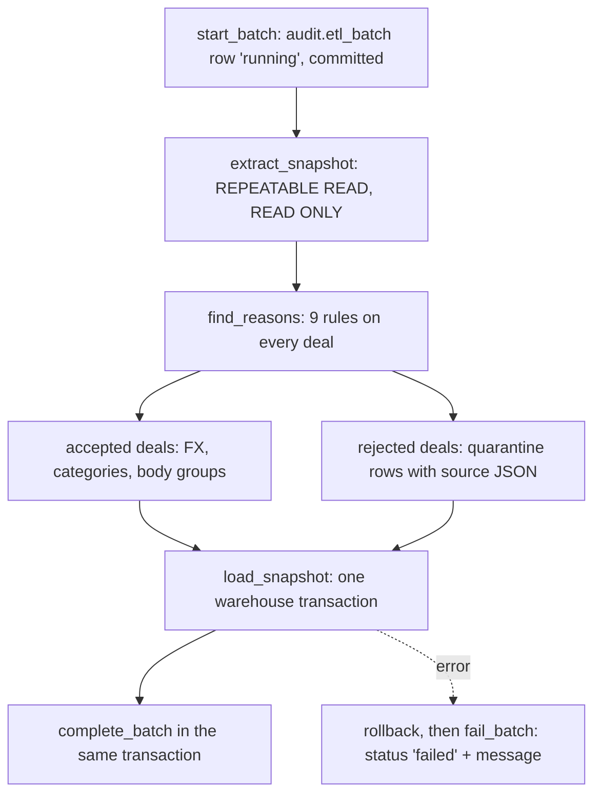

# ETL design (as built)

The ETL moves deals from the operational database `deals_bigdata` into the warehouse `logistics_dwh`: `raw` snapshots, the `core` star, and the `audit` quarantine and batch history. The mart refresh and the ML stages read `core` afterwards. They are described in [mart_design.md](mart_design.md) and [ml_design.md](ml_design.md).

| Module | Responsibility |
| --- | --- |
| `etl/main.py` | CLI: `python -m etl.main --full` or `--start-date D --end-date D` |
| `etl/config.py` | Settings from the environment, `DateWindow`, SQLAlchemy engines |
| `etl/pipeline/runner.py` | One batch: start, extract, transform, load, complete or fail |
| `etl/pipeline/batch.py` | `audit.etl_batch` lifecycle |
| `etl/extract/source.py` | Consistent snapshot read from the source |
| `etl/transform/validate.py` | Data-quality rules, one reason row per failed rule |
| `etl/transform/normalize.py` | FX conversion, categories, cities, body groups, quarantine rows |
| `etl/transform/rules.py` | Constants and rule expressions shared by the transform and the tests |
| `etl/load/warehouse.py` | COPY to temporary stages and set-based merge, one transaction |
| `etl/quality/reconcile.py` | Independent source-to-core reconciliation (the pipeline's `data_quality` task) |
| `etl/quality/fingerprint.py` | Logical and lineage hashes of a loaded window |
| `etl/migrate.py` | Applies `sql/core`, `sql/mart`, `sql/ml` in file-name order |

Stack: Python 3.12, SQLAlchemy 2 Core, psycopg 3, Polars. No ORM. The source role is `SELECT` only.

## 1. Flow of one batch



1. `start_batch` inserts a `running` row into `audit.etl_batch` and commits it, so a crash still leaves a visible record.
2. `extract_snapshot` reads everything in one source transaction.
3. `transform_snapshot` validates and normalizes in memory with Polars.
4. `load_snapshot` merges into `raw`, `core`, and `audit` in a single warehouse transaction. `complete_batch` marks the batch `succeeded` with its counts inside that same transaction, so the status and the data commit together.
5. On any exception the load transaction rolls back and `fail_batch` records `failed` with the error text in a separate transaction.

Exit codes of `python -m etl.main`: 0 committed, 1 failed (recorded in `audit.etl_batch`), 2 usage or configuration error. Log lines are JSON on stdout (`batch_started`, `extract_completed`, `transform_completed`, `batch_completed` or `batch_failed`). A readable summary goes to stderr.

## 2. Extract

- One connection, `SET TRANSACTION ISOLATION LEVEL REPEATABLE READ READ ONLY`. All six queries see the same snapshot, and `extracted_at` is `transaction_timestamp()` of that snapshot.
- Window predicate: `p.loading_date BETWEEN :start_date AND :end_date`, both bounds included. A full load uses `TRUE`.
- `price_body_types` and `price_dates` are read by joining to `prices` with the same predicate, so every child of a selected deal is read, including `price_dates` outside the window.
- `cities`, `body_types`, and `exchange_rates` are small and read in full on every run. A price window is not a correct filter for reference data.
- Rows stream through a named server-side cursor in chunks of `ETL_FETCH_SIZE` (default 50,000) and are assembled into typed Polars frames.
- `price_group_stats` is not read. It is a nightly aggregate that includes the deal being priced, and the mart recomputes everything from deals.

## 3. Validate

`find_reasons` evaluates every rule against every deal. A deal is rejected if any rule fires, and every failed rule is stored as its own row (`audit.quarantine_price`, key `(price_id, reason_code)`).

| Code | Condition |
| --- | --- |
| `PRICE_NON_POSITIVE` | `price IS NULL OR price <= 0` |
| `RUB_PRICE_LE_1000` | `currency_code = '643' AND price > 0 AND price <= 1000` |
| `DISTANCE_NON_POSITIVE` | `distance IS NULL OR distance <= 0` |
| `WEIGHT_NEGATIVE` | `total_weight IS NULL OR total_weight < 0` |
| `VOLUME_NEGATIVE` | `total_volume IS NULL OR total_volume < 0` |
| `ORIGIN_CITY_NOT_FOUND` | `loading_city_gcid` NULL or not a `gc_id` in source `cities` |
| `DESTINATION_CITY_NOT_FOUND` | `unloading_city_gcid` NULL or not a `gc_id` in source `cities` |
| `CURRENCY_UNSUPPORTED` | `currency_code` NULL or not in `643`, `840`, `978` |
| `FX_RATE_MISSING` | USD or EUR, and no rate row whose date equals `nearest_rate_date` (NULL date included) |

Deliberately not rules: same-city routes (`loading_city_gcid = unloading_city_gcid`), `outlier_mark`, `complex`, `is_fact = false`, any `price_type`, and `loading_date > as_of_date`. These deals are loaded as the source has them; the mart and the model filter them by their own eligibility rules.

Edge values: RUB `1000` is rejected and `1000.01` is accepted; a foreign price below 1000 is accepted when its rate exists; zero weight and zero volume pass. `price = 0` gets only `PRICE_NON_POSITIVE`, so it is not counted twice.

Each quarantine row carries the reason, a readable detail (`no exchange rate for currency 840 on 2026-03-02`), the main source columns, the full source row as JSONB, `batch_id`, and `rejected_at`. The view `audit.dq_quarantine_prices` exposes the same rows under the name used in the brief.

## 4. Normalize

### Currency conversion

- RUB (`643`): `fx_rate = 1`, `fx_rate_date` NULL. No rate row is needed, so a RUB deal with NULL `nearest_rate_date` converts.
- USD (`840`) and EUR (`978`): the rate whose `setting_date` equals the deal's `nearest_rate_date`, nothing else. No nearest-date search, no `loading_date` lookup, no recomputation of `nearest_rate_date` from `created_at`. The source fills `nearest_rate_date` relative to `created_at`; the ETL trusts it.
- Duplicate source rows for one currency and date: the row with the greatest `exchange_rates.id` wins (also in `core.dim_exchange_rate`).
- Arithmetic is exact. `price_src` is rounded to cents and the rate to micro-units, both half away from zero, as integers. `price_rub_cents = (price_src_cents * fx_rate_micro + 500000) // 1000000`, which equals PostgreSQL `ROUND(ROUND(price, 2) * ROUND(rate, 6), 2)`. The loader stores `numeric(18,2)` and `numeric(18,6)`. An int64 overflow guard raises before conversion.
- `half_up` adds `round(6)` before flooring to remove binary noise (`29.95 * 10 = 299.4999…`), so Polars and PostgreSQL agree on halves.

### Categories

A valid source category is kept. A NULL or invalid one is recalculated and flagged `weight_category_imputed` / `volume_category_imputed`:

- weight, after rounding to 0.1 t half up: `G20T` ≥ 30, `FTL` [10, 30), `10T` [5, 10), `5T` [2.5, 5), `L5T` [0.5, 2.5), otherwise `OTH`;
- volume: `FTL` when `0 < V <= 120`, otherwise `OTH`.

### Cities

`core.dim_city` has one row per `gc_id`, taken from the smallest source `cities.id`. `duplicate_count` records how many source rows share the `gc_id` (Moscow and Kazan have duplicates in the snapshot). `region_name` is the text after the first comma of `full_name_local`. Joining deals to the deduplicated dimension cannot multiply them.

### Body groups

`core.body_group_for_type(id)` in SQL and `rules.body_group` in Polars implement the same mapping:

| Source body type ids | Group |
| --- | --- |
| 56–61 | `TENT` |
| 4, 46, 47, 48 | `REF` |
| 2 | `ISO` |
| 1, 15 | `BORT` |
| any other id | `OTHER` |
| NULL | `UNSPECIFIED` |

- `core.fact_deal.body_group_code` comes from `prices.body_type`. A CHECK enforces the mapping.
- `core.bridge_deal_body_group` holds one row per deal and group, used by the mart: distinct groups of the deal's `price_body_types` links (`resolution = 'links'`); if there are no links, the group of `prices.body_type` (`fallback_body_type`); if that is NULL too, `UNSPECIFIED`.
- A body type id used by a deal but missing from source `body_types` is added to `core.dim_body_type` with `source_system = 'etl_inferred'`, so the foreign key holds.

## 5. Load

All steps run in the caller's transaction:

1. `pg_advisory_xact_lock(hashtext('logistics_dwh.core_etl'))` serializes the ETL with other writers (mart refresh and scoring take the same lock).
2. `ANALYZE` the large targets, because statistics left by a previous bulk load can mislead the merge plans.
3. Create `ON COMMIT DROP` temporary stages and `COPY` every frame into them; add primary keys and `ANALYZE`.
4. Merge each target with:

   ```sql
   INSERT INTO target AS t (...) SELECT ... FROM stage
   ON CONFLICT (key) DO UPDATE SET ...
   WHERE (t.c1, t.c2, ...) IS DISTINCT FROM (EXCLUDED.c1, EXCLUDED.c2, ...)
   ```

   Unchanged rows are not rewritten. They keep their original `batch_id` and `extracted_at`, and the batch reports them as `unchanged`.

5. Delete rows that no longer belong:

| Target | Deleted when |
| --- | --- |
| `raw.cities`, `raw.body_types`, `raw.exchange_rates` | id no longer in the source (full mirror) |
| `raw.prices` | `loading_date` in the window and id not in this extract |
| `raw.price_body_types`, `raw.price_dates` | parent deal in this extract and child id not in it |
| `core.fact_deal` | (`loading_date` in the window, or deal in this extract) and deal not accepted now. Children cascade |
| `core.fact_deal_date`, `core.bridge_deal_body_group` | deal accepted now and child row no longer produced |
| `audit.quarantine_price` | (`loading_date` in the window, or deal in this extract) and `(price_id, reason_code)` not produced now |

   Core dimensions are upsert-only. A city or rate that leaves the source stays in core so historical facts keep their foreign keys.

6. Write `audit.dq_statistic` (one row per reason code, zeros included) and complete the batch.

Consequences: a deal that starts failing a rule moves from core to quarantine in the same commit; a deal that is fixed moves back; no deal is ever in both (a reconciliation check and a test assert this).

## 6. Idempotency, retries, and backfill

| Situation | Behavior |
| --- | --- |
| Same command run again | 0 inserted, 0 updated, 0 deleted; all rows `unchanged`, lineage untouched. One new `audit.etl_batch` row |
| Failed batch | Whole transaction rolled back; batch row `failed`. Rerunning the same command is the recovery |
| Concurrent runs | Second run waits on the advisory lock |
| Backfill of a month | `--start-date 2026-09-01 --end-date 2026-09-30`: only deals with `loading_date` in September are compared, inserted, updated, or deleted. Other months are not touched |
| Full reload | `--full`: every deal is compared; with unchanged source data nothing is written |

The window is on `loading_date`, as the brief specifies. Known gaps, accepted for this snapshot:

- A deal whose source row changes after its window was loaded is picked up only when a window containing its `loading_date` (or a full load) runs again. There is no `updated_at` watermark.
- A deal whose `loading_date` moves from window A to window B is deleted by a reload of A and inserted again by the next load of B (or a full load).

After the ETL, the `data_quality` task runs `etl.quality.reconcile` for the same window. It recomputes the expected outcome of every source deal in SQL on `deals_bigdata`, independently of the Polars code (reasons, FX rate, `price_rub`, categories, city ids), and compares row by row with `raw`, `core.fact_deal`, and the quarantine. Any unexplained deal or duplicate id fails the pipeline.

## 7. Verified behavior

Measured on the 300,000-deal snapshot (`N_PRICES=300000`, seed `0.20261026`):

| Measure | Value |
| --- | --- |
| Extracted / accepted / quarantined | 300,000 / 299,797 / 203 deals |
| Reasons | 164 `PRICE_NON_POSITIVE`, 39 `FX_RATE_MISSING`, others 0 |
| Full load, empty warehouse | 52.5 s in the pipeline run (extract, transform, COPY, merge, ANALYZE) |
| Full load, unchanged source | 14.6 s, 299,797 unchanged |
| September backfill | 13,767 extracted, 13,756 accepted, 11 quarantined, every layer unchanged |
| Reconciliation | 0 unexplained, 0 duplicate ids |

Peak memory of a full load is about 675 MB (all frames are in memory at once). Detailed rule counts, boundary tests, and the benchmark are in [data_quality_report.md](data_quality_report.md).

Tests: `tests/test_etl_transform.py` (rules and rounding, no database), `tests/test_etl_load.py`, `tests/test_dq_*.py` (edge cases, idempotency, backfill, transaction safety, reconciliation and its negative control).

## 8. Not implemented

- Recomputing `outlier_mark`. The flag is used as delivered. Deals created on `2026-10-26` after the nightly job are unmarked; see the README.
- An `updated_at` change-data-capture watermark.
- Synthesizing missing `price_dates`. A deal without dates stays in core and does not enter the mart.
- Loading `price_participants`, `favorite_directions`, `selected_directions`, and `migrations`. No mandatory output needs them.
- Streaming the full load in chunks. The single-transaction, in-memory design is fine for 300,000 deals but not for tens of millions.
