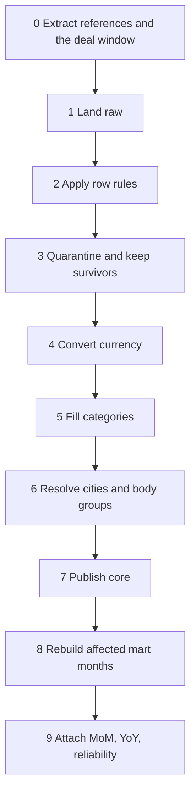

# ETL design

Status: design for approval. This document defines the mandatory batch. It does not include an outlier recomputation job.

Orchestration is a Python 3.12 command, `python -m etl.cli`, using SQLAlchemy 2.x Core and psycopg 3. Transformations that join or aggregate run as SQL in `logistics_dwh`. Python lands batches with `COPY` and controls transactions. ORM object graphs are not used for the deal population.

Parameters:

| Parameter | Default | Meaning |
| --- | --- | --- |
| `mode` | `full` on container start; `window` when both dates are set | Full reload, or a replay window |
| `start_date`, `end_date` | unbounded in `full` | Inclusive filter on `prices.loading_date` (A-WIN, set by the Stage 3 brief) |
| `as_of_date` | `2026-10-26` | Mart future cutoff and ML snapshot. Not `CURRENT_DATE` |
| `random_seed` | `20261026` | Model seed. The source seed stays inside `synthetic.sql` |

Every run opens one `raw.load_batch` row, writes structured logs, and closes the batch with counts or an error. A failed run rolls back the warehouse transaction that publishes core and mart. Raw landing uses its own committed batches so a failed conform can be retried without rereading PostgreSQL tuples that were already copied; the retry is still idempotent because raw keys are the source keys.

## 1. Stage map

Machine-learning stages continue in `docs/ml_design.md` and run only after stage 9 commits.

## 2. Stage 0–1. Extract and land

Input: `deals_bigdata.public` cities, body types, exchange rates, `price_group_stats`, and the deal window with its `price_body_types` and `price_dates`.

Output: upserted `raw` tables; `raw.load_batch.rows_read` and `rows_landed`.

Rules:

- Reference tables and `price_group_stats` are read in full on every run.
- Deals are read in full in `full` mode. In `window` mode the predicate is `GREATEST(created_at, updated_at)::date BETWEEN start_date AND end_date`.
- Child rows are read for the selected parent ids, including `price_dates` outside the window.
- Landing is `COPY` into a session temp table, then `INSERT ... ON CONFLICT DO UPDATE`.
- For parents in the batch, `raw.price_body_types` and `raw.price_dates` are deleted and inserted again so a removed child does not survive.
- The source role is `SELECT` only.

Acceptance:

- After two extracts of the same window, `raw.prices` has one row per source id and the same `COUNT(*)` and `SUM(price::numeric)` for those ids.
- A deal whose `created_at` is outside the window is unchanged in `raw`.
- Every selected parent has the same child count as the source.
- `raw.price_group_stats` is populated and is not referenced by later SQL objects. A test reads `pg_depend` / view definitions for `core`, `mart`, and `ml`.

## 3. Stage 2–3. Validate and quarantine

Input: `raw.prices` rows in the run's deal set, `raw.cities`, `raw.exchange_rates`.

Output: `dq.quarantine_prices` replaced for those deal ids; `dq.batch_log` appended; `staging.price_candidate` filled only with deals that have zero reasons. Staging is truncated first.

A deal is evaluated against every rule. One failed rule is enough to keep it out of staging. All failed rules are stored.

| Order | Code | Rule |
| --- | --- | --- |
| 1 | `PRICE_NON_POSITIVE` | `price IS NULL OR price <= 0` |
| 2 | `RUB_PRICE_LE_1000` | `currency_code = '643' AND price > 0 AND price <= 1000` |
| 3 | `DISTANCE_NON_POSITIVE` | `distance IS NULL OR distance <= 0` |
| 4 | `WEIGHT_NEGATIVE` | `total_weight IS NULL OR total_weight < 0` |
| 5 | `VOLUME_NEGATIVE` | `total_volume IS NULL OR total_volume < 0` |
| 6 | `ORIGIN_CITY_NOT_FOUND`, `DESTINATION_CITY_NOT_FOUND` | loading or unloading `gc_id` not present in `raw.cities`, one code per side |
| 7 | `CURRENCY_UNSUPPORTED` | `currency_code NOT IN ('643', '840', '978')` |
| 8 | `FX_RATE_MISSING` | currency in (`840`, `978`) and the exact rate lookup in stage 4 returns no row |

Rules 1–7 do not need the rate. Rule 8 is written in the same quarantine statement after the lookup, still before core publish.

Explicit non-rules:

- `loading_city_gcid = unloading_city_gcid` does not create a reason.
- `outlier_mark = true` does not create a reason.
- `complex = true` does not create a reason.
- `price_type = 6` does not create a reason.
- `loading_date > as_of_date` does not create a reason.
- A foreign price of 1000 or less stays, when it is positive and its rate exists.
- A RUB price of exactly 1000 is rejected. A RUB price of 1000.01 stays.

Acceptance:

- A fixture with `price = 0` and currency `643` stores `PRICE_NON_POSITIVE` and does not store a core row. `RUB_PRICE_LE_1000` is reserved for positive RUB prices at or below 1000, so zero is not double-counted.
- A fixture with RUB `price = 1000` is quarantined. A fixture with RUB `price = 1000.01` is not quarantined by this rule.
- A fixture with USD `price = 500` and a matching rate is not quarantined by the 1000 rule.
- A fixture with equal city codes and `distance > 0` is present in `staging.price_candidate`.
- A fixture with equal city codes and `distance = 0` is quarantined only as `DISTANCE_NON_POSITIVE`.
- A missing unloading city is `DESTINATION_CITY_NOT_FOUND` even when the loading city exists.
- `total_weight = 0` and `total_volume = 0` pass these rules.
- Replaying the fixture does not increase the quarantine row count.

## 4. Stage 4. Convert currency

Input: survivors of rules 1–7; `raw.exchange_rates`.

Output: `fx_rate`, `fx_rate_date`, `price_rub` on the staging row, or `FX_RATE_MISSING`.

Rules:

- For `643`, `fx_rate = 1`, `fx_rate_date` is NULL, and `price_rub = ROUND(price::numeric, 2)`. No rate row is required. This covers RUB rows whose `nearest_rate_date` is NULL.
- For `840` and `978`, the rate row is the one with `num_code = currency_code` and `setting_date = nearest_rate_date`. If several exist, `MAX(id)` wins (A-FX-2).
- `price_rub = ROUND(price::numeric * fx_rate, 2)`.
- The lookup does not use `loading_date`, does not use the next available rate, and does not recompute `nearest_rate_date` from `created_at`.
- A NULL `nearest_rate_date` on a foreign currency is `FX_RATE_MISSING`.

The generator's stored date is the latest RUB setting date on or before `created_at`. USD and EUR are inserted on that same calendar, so a non-null date matches. The production "earliest later rate" branch is how the source fills the column when no past rate exists. This snapshot's history starts after the rate calendar, and the ETL does not implement that filler.

Acceptance:

- A USD row converts at the rate whose `setting_date` equals `nearest_rate_date`, including when an earlier and a later rate exist.
- A USD row with NULL `nearest_rate_date` is quarantined and absent from core.
- A RUB row with NULL `nearest_rate_date` and `price > 1000` has `price_rub = ROUND(price, 2)`.
- Changing the rate on `loading_date` while leaving `nearest_rate_date` unchanged does not change `price_rub`.

## 5. Stage 5. Fill categories

Input: staging survivors with source `total_weight`, `total_volume`, `weight_category`, `volume_category`.

Output: resolved category columns and imputed flags.

Rules (A-CAT):

- If `weight_category` is not NULL, keep it and set `weight_category_imputed = false`.
- If it is NULL, set `w = ROUND(total_weight::numeric, 1)` and:
  - `G20T` when `w >= 30`
  - `FTL` when `w >= 10` and `w < 30`
  - `10T` when `w >= 5` and `w < 10`
  - `5T` when `w >= 2.5` and `w < 5`
  - `L5T` when `w >= 0.5` and `w < 2.5`
  - `OTH` otherwise
- If `volume_category` is not NULL, keep it.
- If it is NULL: `FTL` when `total_volume > 0` and `total_volume <= 120`, otherwise `OTH`.

Boundary examples after rounding: `29.96 → 30.0 → G20T`; `9.96 → 10.0 → FTL`; `10.0 → FTL`; `30.0 → G20T`; `2.5 → 5T`; `0.5 → L5T`; `0.49 → 0.5 → L5T`; `0.44 → 0.4 → OTH`. Volume `0 → OTH`, `120 → FTL`, `120.01 → OTH`.

Python `round` is not used for this step. Banker's rounding would disagree with the generator on halves.

Acceptance:

- A NULL weight of `30.0` becomes `G20T` and `weight_category_imputed` is true.
- A populated `weight_category = 'FTL'` on a weight of `31` is kept. The pipeline does not silently "correct" the source.
- Volume `120` with a NULL category becomes `FTL`. Volume `0` becomes `OTH`.

## 6. Stage 6. Cities and body groups

Input: `raw.cities`, `raw.body_types`, `raw.price_body_types`, staging survivors.

Output: `core.dim_city`, `core.dim_body_type`, `core.dim_body_group`, `staging.price_body_group`, `staging.price_candidate.ml_body_group_code`.

City rules:

- Replace `core.dim_city` from `raw.cities` by choosing `DISTINCT ON (gc_id) ... ORDER BY gc_id, id`.
- `duplicate_count` is the number of source rows for that `gc_id`.
- Region parse follows A-CITY. The winning Kazan row is the earlier insert, `Казань, Республика Татарстан`, so the region is `Республика Татарстан`. The winning Moscow region is `г. Москва`.

Body-group map:

| Ids | Code | Name |
| --- | --- | --- |
| 56–61 | `TENT` | Тент |
| 4, 46, 47, 48 | `REF` | Рефрижератор |
| 2 | `ISO` | Изотерм |
| 1, 15 | `BORT` | Борт |
| any other non-null id | `OTHER` | Прочие |
| no id | `UNSPECIFIED` | Не указан |

Mart bridge:

1. If the deal has one or more `price_body_types` rows, map each `body_type_id` and insert distinct codes with `resolution = 'links'`.
2. If it has none and `prices.body_type` is not NULL, insert that one code with `resolution = 'fallback_body_type'`.
3. If it has none and `prices.body_type` is NULL, insert `UNSPECIFIED`.

Model group (A-BODY-ML), stored on the candidate and later on `fact_deal`:

1. If `prices.body_type` is not NULL, map that id.
2. Otherwise `UNSPECIFIED`.

The model group does not consult the second link. The mart group list does not add `prices.body_type` when links already exist.

Acceptance:

- Joining deals to cities without dedup would multiply Moscow and Kazan. After `dim_city`, each `gc_id` returns one row. A Kazan deal keeps a single `price_rub` in an aggregate of deals.
- A deal linked to `56` and `61` has one staging group, `TENT`.
- A deal linked to `56` and `15` has `TENT` and `BORT`.
- A deal with no links and `body_type = 4` has one group, `REF`, resolution `fallback_body_type`.
- A deal with NULL `body_type` and no links has `UNSPECIFIED`.
- An old deal whose link is `57` and whose `body_type` is `56` has mart group `TENT` once, and ML group `TENT`.

## 7. Stage 7. Publish core

Input: `staging.price_candidate`, `staging.price_body_group`, `staging.price_date`, dimensions.

Output: `core.fact_deal`, `core.fact_deal_date`, `core.bridge_deal_body_group`.

Rules, in one transaction:

- Upsert `fact_deal` on `price_id`.
- Delete date and bridge rows for those ids and insert the staging children.
- Delete core deals that are in the run's id list and are absent from staging (they failed this run). Their quarantine rows already explain them.
- Do not delete core deals outside the id list.
- Copy `price_date` values after `as_of_date` into `fact_deal_date`.

Acceptance:

- A deal that fails on a second run, because a rate was removed in a fixture, disappears from core and appears in quarantine.
- A deal outside the window keeps its core row, dates, and groups.
- Future `price_date` rows are present in `fact_deal_date`.
- `fact_deal` contains no `price_group_id` column.
- Row counts and `SUM(price_rub)` are unchanged after a replay with unchanged source data.

## 8. Stage 8. Rebuild mart months

Input: core tables; the set of `price_month` values touched by the run.

Touched months are the union of:

- `price_month` currently stored for deals in the run, before they are replaced;
- `price_month` about to be stored for those deals;
- months that become empty after a deal leaves them.

In `full` mode every month present in `fact_deal_date` is touched, including months that the filter will then drop.

Output: deleted and reinserted slices of `mart.route_card` for touched months. The insert reads every eligible core observation in that month, not only the deals in the extract window.

Eligibility and metrics are specified in `docs/mart_design.md`. This stage writes the measure columns. Stage 9 fills `mom_pct`, `yoy_pct`, and `reliability_level` using the rebuilt table plus unaffected months.

Acceptance:

- A window that contains one October deal does not change `trips_count` of an October cell beyond the effect of that deal, and it does not change September cells that the deal does not touch.
- `price_date = 2026-10-26` can appear in the October cell. `price_date = 2026-10-27` cannot.
- `outlier_mark = true` deals in core are absent from the card.
- `complex = true` and `is_fact = false` deals in core are absent from the card.
- Two links in one business group do not increase `trips_count` by two.
- Two links in two business groups increase `trips_count` by one in each cell.

## 9. Stage 9. Dynamics and reliability

Input: `mart.route_card` after the measure rebuild, including months outside the touched set so a comparison cell can be found.

Output: `mom_pct`, `yoy_pct`, `reliability_level` updated for touched months.

Rules:

- Previous month is `price_month - 1 month` with the same city pair, body group, and weight category. Same month last year is `price_month - 1 year` with the same keys.
- `mom_pct = (median_trip / prev.median_trip - 1) * 100` when the previous row exists and `prev.median_trip <> 0`, else NULL. YoY is the same pattern.
- No search for the latest non-empty month.
- Reliability uses A-REL and the fixed `as_of_date`.

Acceptance:

- A cell whose previous month is absent has `mom_pct` NULL and still has its own median.
- A cell with `trips_count = 9` is `LOW_DATA` even when carriers and freshness would pass the HIGH tests.
- A cell with `trips_count = 30`, `carriers_count = 4`, and fresh dates is `MEDIUM`.
- A cell with `trips_count = 30`, `carriers_count = 5`, and `as_of_date - max_price_date > 30` is `MEDIUM`.
- A cell that passes all three HIGH predicates is `HIGH`.
- A second run yields the same medians, the same percentages, and the same reliability labels.

## 10. Logging

Each stage logs a structured event with `batch_id`, stage name, rows in, rows out, and rows rejected. The batch row stores the same totals. Log lines do not include connection strings.

Minimum totals: source deals read, raw rows written, quarantine rows by reason, core deals upserted, core deals removed, mart rows replaced, and, from the ML stage, train count, test count, future count, and the four test metrics.

## 11. Backfill examples

| Request | Command behavior |
| --- | --- |
| First load | `mode=full`. Land everything. Rebuild every mart month. Train and score |
| Replay yesterday's snapshot day | Window `2026-10-26` to `2026-10-26` on `created_at`. Replace those deals, rebuild only months their `price_dates` touch, score again |
| Repair one historical creation month | Window on that creation month. Mart months of long deals that were created then are rebuilt in full from core |
| Logic change in the corridor SQL | `mode=full` mart rebuild from core, without requiring a new synthetic snapshot |

A backfill does not mean "insert the delta on top of the cell". Percentiles are recomputed from the surviving observations.

## 12. Failure behavior

| Failure | Result |
| --- | --- |
| Source unavailable | Batch marked failed. Warehouse publish not started |
| Quality SQL error | Staging transaction rolled back. Previous core and mart remain |
| Mart SQL error | Core and mart transaction rolled back together |
| Model error after a committed mart | Mart stays. Predictions from the previous successful model stay because prediction upsert happens after a successful fit, in one transaction |
| Replay of a successful window | Counts and sums of facts, quarantine, mart, and predictions unchanged. One new batch log and one new metrics row |

## 13. Out of the mandatory ETL

- Recalculating `outlier_mark` with IQR or with P5–P95 of `price_km`.
- Synthesizing `price_dates` when a deal has none. Such a deal can sit in core and will not enter the mart. The generator always creates dates. A missing-date count is logged and is not a new reject code.
- Loading `price_participants`, favorites, or selected directions.
- Writing ClickHouse, Airflow, or Superset objects.
