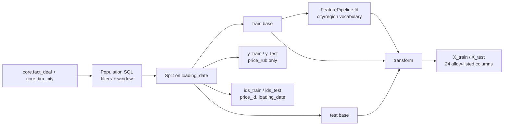

# Feature engineering report

Stage 6 builds the feature matrix for the carrier price model, with target `y = price_rub` (RUB without VAT). No model is trained in this stage.

All numbers below come from builds against the real warehouse: 299,797 core deals, as_of 2026-10-26. Run `python -m ml.features.dataset` to rebuild. It takes 0.6 s and writes to `artifacts/features/` (or to `ML_FEATURE_DIR` if set).

I built twice, on core batch 327 and on core batch 368, with the full ETL reloaded in between. Both builds gave the same SHA-256 digests:

| Split | X | y |
|---|---|---|
| train | `3e0c7164ff9e…` | `9ff9ef472099…` |
| test | `b8d3e16155b4…` | `f8599db8463e…` |

## Pipeline

| Module | Role |
|---|---|
| `ml/features/spec.py` | Feature definitions, allow-list, categorical list, fixed domains, ban list, split windows, seed |
| `ml/features/extract.py` | The population SQL over `core.fact_deal` ⋈ `core.dim_city` (origin and destination) |
| `ml/features/transform.py` | `raw_features` (row-wise values) and `FeaturePipeline` (categorical vocabulary fitted on train) |
| `ml/features/dataset.py` | Split, fit on train, transform both splits, leakage guard, Parquet + metadata, CLI |
| `ml/features/profile.py` | The statistics and the automated leakage audit in this report |



The build writes these outputs:

| File | Contents |
|---|---|
| `X_train.parquet`, `X_test.parquet` | Feature matrix only: the 24 allow-listed columns, in a fixed order |
| `y_train.parquet`, `y_test.parquet` | One column, `price_rub` |
| `ids_train.parquet`, `ids_test.parquet` | `price_id`, `loading_date`. Row-aligned with X and y, and never part of X |
| `metadata.json` | Feature definitions, categorical list, frozen vocabulary, tokens, ban list, split, seed, predicate, extract columns, row counts, SHA-256 of every X, y and ids frame |
| `profile.json` | Every statistic below, plus the leakage audit |

`FeaturePipeline.from_dict(metadata["categorical_encoding"])` restores the fitted encoder, so a later scoring job applies exactly the train vocabulary.

## Data filtering

The population comes from validated core rows only. Quarantined source rows never reach core.

```sql
is_fact AND NOT complex AND NOT outlier_mark
AND price_rub > 0 AND distance_km > 0
AND loading_date >= DATE '2026-07-26' AND loading_date < DATE '2026-10-27'
```

| Step, loading_date 2026-07-26..2026-10-26 | Deals | Removed |
|---|---|---|
| Core deals in the window | 46,634 | |
| `is_fact = true` | 39,003 | 7,631 auction bids (price_type 6, the only `is_fact = false` type) |
| `complex = false` | 37,803 | 1,200 composite routes |
| `price_rub > 0`, `distance > 0` | 37,803 | 0. Core constraints already enforce both |
| `outlier_mark = false` | **37,034** | 769 source-marked outliers |

Not in core at all: 44 source deals in the window were quarantined by the ETL, 36 `PRICE_NON_POSITIVE` and 8 `FX_RATE_MISSING`. "Valid `price_rub`" therefore means "converted and accepted by the core quality rules".

Some `is_fact` deals have loading dates up to 2027-02-13. They are after as_of and outside the window, so they are not in train or test.

### Temporal split

| Split | Interval on `loading_date` | Rows | Actual dates |
|---|---|---|---|
| train | [2026-07-26, 2026-10-05) | 24,226 | 2026-07-26 .. 2026-10-04 |
| test | [2026-10-05, 2026-10-27) | 12,808 | 2026-10-05 .. 2026-10-26 |

- `2026-10-05` is in test only. `2026-10-26` is in test. `2026-10-27` is excluded.
- The bounds are literals in `SplitWindows`. Nothing reads the system clock, and a test scans the package for `date.today`, `now()`, `CURRENT_DATE` and shuffle calls.
- Rows are ordered by `(loading_date, price_id)` and never shuffled.
- The pipeline has no random step. `RANDOM_SEED = 20261026` seeds `random` and NumPy and is recorded for the model stage.
- Rebuilding gives byte-identical frames: same SHA-256 digests, same metadata and profile.

## Feature definitions

There are 24 features: 7 categorical and 17 numeric.

| Feature | Group | Kind | Source | Definition |
|---|---|---|---|---|
| `origin_city` | geography | categorical | `dim_city.full_name_local` of the loading gc_id | Text before the first comma |
| `destination_city` | geography | categorical | same, unloading gc_id | Text before the first comma |
| `origin_region` | geography | categorical | same, loading | Text after the first comma, trimmed |
| `destination_region` | geography | categorical | same, unloading | Text after the first comma, trimmed |
| `origin_latitude`, `origin_longitude` | geography | numeric | `dim_city` | As stored |
| `destination_latitude`, `destination_longitude` | geography | numeric | `dim_city` | As stored |
| `distance` | transport | numeric | `fact_deal.distance_km` | Kilometres |
| `total_weight` | transport | numeric | `fact_deal.total_weight_t` | Tonnes |
| `total_volume` | transport | numeric | `fact_deal.total_volume_m3` | Cubic metres |
| `body_group` | transport | categorical | `fact_deal.body_group_code` | TENT, REF, ISO, BORT, OTHER, UNSPECIFIED |
| `weight_category` | transport | categorical | `fact_deal.weight_category` | G20T, FTL, 10T, 5T, L5T, OTH |
| `volume_category` | transport | categorical | `fact_deal.volume_category` | FTL, OTH |
| `year` | temporal | numeric | `loading_date` | Calendar year |
| `month` | temporal | numeric | `loading_date` | 1..12 |
| `day_of_week` | temporal | numeric | `loading_date` | ISO, Monday = 1 .. Sunday = 7 |
| `day_of_year` | temporal | numeric | `loading_date` | 1..366 |
| `month_sin`, `month_cos` | temporal | numeric | `month` | sin and cos of (2π · month / 12) |
| `weekday_sin`, `weekday_cos` | temporal | numeric | `day_of_week` | sin and cos of (2π · day_of_week / 7) |
| `day_of_year_sin`, `day_of_year_cos` | temporal | numeric | `day_of_year` | sin and cos of (2π · day_of_year / 365.25) |

### Geography

- City and region come from the deduplicated `core.dim_city`: one row per gc_id, from the smallest source city id.
- Moscow (1001) and Kazan (1003) each have two source rows. They still produce one feature row per deal; an integration test compares the Moscow-origin count with core.
- `full_name_local` is split at the first comma: `Казань, Республика Татарстан` gives city `Казань` and region `Республика Татарстан`.
- On all 40 cities, the parsed values equal `dim_city.name` and `dim_city.region_name`.
- Origin and destination are encoded independently. There is no concatenated route column. The test window has 1,532 city pairs; one of them, covering 3 test rows, never occurs in train. Its origin and destination cities are each known.

### Transport and cargo

- `body_group` is the group of `prices.body_type`. A deal with several linked body types (4,304 deals in the population) keeps one row and is not duplicated per group. That group is always one of the deal's linked groups (0 mismatches).
- Weight and volume are kept as stored. Zero is a real value, not a missing marker:
  - zero weight: 16 train rows and 11 test rows;
  - zero volume: 1,900 train rows and 967 test rows.

### Temporal

- All calendar features come from `loading_date`, not `price_date` or `created_at`.
- Polars `dt.weekday()` is ISO; tests pin Sunday = 7 and Monday = 1.
- Day of year is 366 on 31 December of a leap year, and the period stays 365.25 in every year.
- Unit tests confirm the end of each cycle wraps round to the start:
  - 31 December sits next to 1 January on the day-of-year circle.
  - December sits next to January on the month circle.
  - Sunday sits next to Monday on the weekday circle.

### Categorical encoding and missing values

| Feature | Vocabulary | Source of levels |
|---|---|---|
| `origin_city`, `destination_city` | 40 | Train only |
| `origin_region`, `destination_region` | 38 | Train only. Tatarstan and Samara oblast each hold two cities |
| `body_group` | 6 | Fixed core domain |
| `weight_category` | 6 | Fixed core domain |
| `volume_category` | 2 | Fixed core domain |

- A null or blank value becomes `__MISSING__`.
- A value outside the vocabulary becomes `__UNKNOWN__`. A city first seen in test is therefore not learned from test.
- `FeaturePipeline.levels(name)` lists every value a column can hold, in a fixed order: vocabulary, then `__MISSING__`, then `__UNKNOWN__`.
- Numeric nulls stay null, and no imputer is fitted. If a later model needs imputation, it must be fitted on train.

## Feature cardinality

| Feature | Distinct train | Distinct test | `__MISSING__` | `__UNKNOWN__` in test |
|---|---|---|---|---|
| `origin_city` | 40 | 40 | 0 | 0 |
| `destination_city` | 40 | 40 | 0 | 0 |
| `origin_region` | 38 | 38 | 0 | 0 |
| `destination_region` | 38 | 38 | 0 | 0 |
| `body_group` | 6 | 6 | 0 | 0 |
| `weight_category` | 6 | 6 | 0 | 0 |
| `volume_category` | 2 | 2 | 0 | 0 |
| `distance` | 711 | 711 | | |
| `total_weight` | 417 | 417 | | |
| `total_volume` | 89 | 89 | | |
| Coordinates, each | 39 | 39 | | |

There are 39 distinct values per coordinate column, not 40, because the synthetic data repeats single values: Samara and Penza share a latitude, and Moscow and Tula share a longitude. Every city's coordinate pair is still unique.

## Missing-value statistics

Every feature has 0 nulls in train and in test. No categorical value maps to `__MISSING__` or `__UNKNOWN__`.

That is a property of this snapshot, not an assumption of the code:
- Core requires distance, weight, volume, body group and both categories.
- All 40 cities have coordinates and a region.

Unit tests cover the missing paths anyway: a null or blank full name, a null body group, an unknown weight category, and a test-only city.

## Leakage audit

### Banned inputs

| Banned input | How it is kept out |
|---|---|
| `price`, `price_src` | Not selected by the population SQL |
| `price_rub` | Selected once as the target, written only to `y_*.parquet` |
| `price_with_vat` | Not in the source schema. Banned by name and by the `vat` fragment |
| `price / distance`, `price / total_weight` | No ratio is computed. `price_per_km`, `price_per_ton`, `price_km` and `km_price` are banned names |
| `customer_cost`, `transportation_cost`, `profit`, `carrier_cost` | Not in the source schema. Banned by name and by the `cost`, `profit` and `margin` fragments |
| `price_group_id`, `avg_price`, `min_km_price`, `max_km_price` | `price_group_stats` is not extracted into the warehouse. The feature SQL reads only `core` |
| `outlier_mark` | Used in the WHERE clause only |
| `fx_rate`, `currency_code`, `nearest_rate_date` | Together with the source price they rebuild the target. Not selected |
| Post-factum aggregates | None exist. Every feature is a function of its own row plus the frozen train vocabulary |
| Mart medians, MoM and YoY | Not read |

### Automated checks

Every check passed on the real build; they are recorded in `profile.json`.

| Check | Result |
|---|---|
| Feature columns equal the allow-list, in order | 24 columns |
| No banned column in the matrix | none |
| No banned name fragment (`price`, `cost`, `profit`, `vat`, `outlier`, `margin`, `fx_`) | none |
| Target not in the matrix | `y_*` only |
| Identifiers not in the matrix | `ids_*` only |
| X, y and ids row-aligned | 24,226 / 12,808 |
| Train dates in [2026-07-26, 2026-10-05) | 2026-07-26 .. 2026-10-04 |
| Test dates in [2026-10-05, 2026-10-26] | 2026-10-05 .. 2026-10-26 |
| No deal in both splits | 0 |
| Chronological `(loading_date, price_id)` order | yes |
| City and region vocabularies drawn from train values | 40 / 40 / 38 / 38 |
| No numeric feature a near copy of the target (\|Spearman\| < 0.99 on train) | max `distance` 0.867 |

`assemble` also calls `assert_no_leakage` on every matrix it builds. A banned column or a changed allow-list raises an error before anything is written.

### Tests

`tests/test_ml_features.py` has 51 unit tests and needs no database. These are the ones that guard against leakage:

- Every column the brief bans, plus the derived unit prices, is in `FORBIDDEN_COLUMNS` and absent from the allow-list.
- `assert_no_leakage` rejects each banned name, a `*vat*` name, a dropped feature, and an extra `organization_id`.
- A base frame with the target copied into 13 banned columns gives the same matrix as a clean frame.
- Replacing the target with scrambled values changes neither the features nor the fitted vocabulary.
- Transforming row by row equals transforming the whole frame, which rules out cross-row aggregates.
- The population SQL reads no banned column except the target, and never touches `price_group_stats`, `raw`, `price_src`, `fx_rate` or organization identifiers.
- A test-only city becomes `__UNKNOWN__` and is not in the vocabulary.
- A shuffled input comes back in chronological order, with every train date before every test date.

`tests/test_ml_feature_dataset.py` has 6 integration tests on the real warehouse:

- Row counts match an independent SQL count.
- Deals on 2026-07-26, 2026-10-04, 2026-10-05 and 2026-10-26 land in the right split; deals on 2026-07-25 and 2026-10-27 are absent.
- Outlier, complex and non-fact deals in the window are absent.
- `y` equals `core.fact_deal.price_rub` for every row.
- Geography matches `dim_city`, and the duplicate Moscow source row does not multiply deals.
- Two builds give identical digests, metadata and profile, and the audit passes.

## Train/test distributions

PSI is the population stability index of test against train: train deciles for numeric features and levels for categorical ones. Below 0.1 is stable.

### Target `price_rub`

These statistics are reported for orientation. They are not features.

| | Train | Test |
|---|---|---|
| Rows | 24,226 | 12,808 |
| Mean | 187,418.66 | 195,051.24 |
| Std | 192,467.43 | 191,313.26 |
| Min | 5,564.24 | 5,085.84 |
| p05 / p25 / p50 / p75 / p95 | 28,571.71 / 68,178.44 / 124,815.77 / 232,488.62 / 569,259.21 | 29,503.93 / 72,214.19 / 131,363.76 / 243,493.24 / 595,845.28 |
| Max | 5,742,723.36 | 1,979,856.54 |
| Skew, raw / ln | 3.78 / −0.04 | 2.29 / −0.06 |
| ln mean / ln std | 11.743 / 0.905 | 11.788 / 0.903 |

- The target is right-skewed and close to log-normal, as the research note describes.
- The test median is 5.2% above the train median, and the train monthly medians rise: July 120,971, August 123,510, September 125,750, early October 131,232. That is the price trend the model has to carry forward.
- A log-IQR fence fitted on train (10,827 .. 1,464,007 RUB) would flag 105 train rows and 31 test rows. It is not applied, because the brief's filter is `outlier_mark` only. Any further outlier rule must be fitted on train, as the research note requires.
- The largest train trip is Vladivostok → Krasnodar, REF, 8,726 km, at 5.74 M RUB.

### Numeric features

Columns show p25 / p50 / p75 for each split, mean as train / test, then PSI.

| Feature | Train | Test | Mean | PSI |
|---|---|---|---|---|
| `distance` | 881 / 1,457 / 2,646 | 896.5 / 1,479 / 2,752 | 2,073.5 / 2,105.8 | 0.001 |
| `total_weight` | 4.2 / 13.2 / 22.8 | 4.2 / 13.4 / 23.0 | 14.13 / 14.19 | 0.002 |
| `total_volume` | 44 / 68 / 93 | 43 / 68 / 93 | 67.43 / 67.46 | 0.000 |
| `origin_latitude` | 53.20 / 55.76 / 56.30 | 53.20 / 55.76 / 56.30 | 54.37 / 54.32 | 0.001 |
| `origin_longitude` | 37.62 / 44.51 / 56.25 | 37.62 / 44.51 / 56.25 | 51.73 / 51.77 | 0.000 |
| `destination_latitude` | 51.77 / 55.01 / 56.30 | 51.77 / 54.78 / 56.30 | 53.78 / 53.76 | 0.001 |
| `destination_longitude` | 38.98 / 47.50 / 60.61 | 38.98 / 47.50 / 60.61 | 54.05 / 54.07 | 0.000 |
| `year` | 2026 | 2026 | 2026 / 2026 | 0.000 |
| `month` | 8 / 9 / 9 | 10 / 10 / 10 | 8.51 / 10.00 | 4.168 |
| `day_of_week` | 2 / 4 / 6 | 2 / 4 / 6 | 4.07 / 3.83 | 0.041 |
| `day_of_year` | 226 / 245 / 262 | 285 / 291 / 296 | 243.9 / 290.1 | 8.249 |
| `month_sin` | −1.000 / −0.866 / −0.866 | −0.866 | −0.898 / −0.866 | 10.353 |
| `month_cos` | −0.500 / 0.000 / 0.000 | 0.500 | −0.234 / 0.500 | 4.168 |
| `weekday_sin` | −0.782 / 0.000 / 0.782 | −0.782 / 0.000 / 0.782 | −0.007 / 0.053 | 0.018 |
| `weekday_cos` | −0.901 / −0.223 / 0.624 | −0.901 / −0.223 / 0.624 | 0.019 / 0.085 | 0.020 |
| `day_of_year_sin` | −0.979 / −0.879 / −0.679 | −0.982 / −0.957 / −0.929 | −0.816 / −0.956 | 4.670 |
| `day_of_year_cos` | −0.734 / −0.478 / −0.204 | 0.189 / 0.289 / 0.371 | −0.462 / 0.272 | 8.249 |

Geography, transport and cargo are stable: PSI is 0.002 or less. The calendar columns shift strongly, and that comes from the split itself, not from leakage:

- Test `day_of_year` runs from 278 to 299, entirely beyond train's 207–277. `day_of_year_cos` in test (0.07..0.42) is entirely above its train range (−0.91..0.05). Tree models do not extrapolate, so they will treat test days like the last days of train.
- Test `month` is always 10. Train holds October only from 1 to 4 October: 1,670 rows, 6.9% of train.
- `year` is constant, 2026, in both splits, so it carries no information inside this window. It stays in the matrix because the brief lists it, and it becomes informative if the window ever crosses a year boundary.
- `day_of_week` is stable: the same weekly cycle appears in both windows.

### Categorical features

Top levels, as a percentage of rows in train / test:

| Feature | Top levels | PSI |
|---|---|---|
| `origin_city` | Москва 19.00 / 19.07, Санкт-Петербург 6.73 / 6.86, Казань 4.97 / 5.11, Екатеринбург 4.29 / 4.18 | 0.003 |
| `destination_city` | Москва 8.12 / 7.78, Санкт-Петербург 5.31 / 5.28, Ростов-на-Дону 4.91 / 4.68, Казань 4.07 / 4.29 | 0.005 |
| `origin_region` | г. Москва 19.00 / 19.07, г. Санкт-Петербург 6.73 / 6.86, Республика Татарстан 6.34 / 6.52, Самарская обл. 4.81 / 4.83 | 0.003 |
| `destination_region` | г. Москва 8.12 / 7.78, Республика Татарстан 5.70 / 6.02, г. Санкт-Петербург 5.31 / 5.28, Самарская обл. 5.16 / 5.18 | 0.005 |
| `body_group` | TENT 52.72 / 52.65, REF 20.54 / 20.05, OTHER 10.10 / 10.16, BORT 7.76 / 8.42, ISO 6.99 / 6.75, UNSPECIFIED 1.89 / 1.97 | 0.001 |
| `weight_category` | FTL 53.34 / 53.30, L5T 11.97 / 11.93, 10T 11.86 / 12.20, 5T 10.15 / 9.56, G20T 6.74 / 6.78, OTH 5.96 / 6.23 | 0.001 |
| `volume_category` | FTL 88.11 / 88.66, OTH 11.89 / 11.34 | 0.000 |

Median price per km in train, used here only as a diagnostic and never as a feature, rises in the order the research note describes:

| Body group | BORT | UNSPECIFIED | TENT | OTHER | ISO | REF |
|---|---|---|---|---|---|---|
| RUB/km | 85.3 | 89.9 | 89.9 | 99.9 | 103.4 | 116.6 |

### Volume over time

Weekly deal counts grow steadily in the synthetic snapshot. Weeks start on Monday, and the first and last weeks are partial.

| Train | Week from 07-20 | 07-27 | 08-03 | 08-10 | 08-17 | 08-24 | 08-31 | 09-07 | 09-14 | 09-21 | 09-28 |
|---|---|---|---|---|---|---|---|---|---|---|---|
| Rows | 331 | 2,142 | 2,150 | 2,107 | 2,205 | 2,347 | 2,408 | 2,479 | 2,534 | 2,645 | 2,878 |

| Test | Week from 10-05 | 10-12 | 10-19 | 10-26 |
|---|---|---|---|---|
| Rows | 3,154 | 3,626 | 4,782 | 1,246 (one day) |

Test covers 22 days but holds 35% of the population.

## Notes on the design

- **Storage:** the matrices are Parquet files plus metadata, not a warehouse table. Predictions, not features, are the published database output.
- **Population:** the brief's filters are used as written. `price_type <> 6` is implied by `is_fact`.
- **Future deals:** `FeaturePipeline.transform` takes any frame with the base columns and no target. Batch inference (`ml/scoring/score.py`) reuses it with the frozen train vocabulary. See [ml_design.md](ml_design.md).

## Out of scope

- No model, no hyperparameters, no metrics.
- No outlier rule beyond `outlier_mark`.
- No rolling market features.
- No Superset, no ClickHouse.
