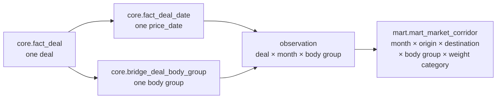

# Mart design: market corridor and route card

`mart.mart_market_corridor` is the market price band for one calendar month, one city pair, one body group, and one weight category. It answers the product questions in the meeting summary:

- which rate to use;
- whether a price sits inside the market band;
- whether the sample is large enough to trust;
- how the band moved against the previous month and the same month a year earlier.

The forecast comparison lives in `ml.ml_price_predictions` and its views (see [ml_design.md](ml_design.md)).

The mart reads only validated core tables: `core.fact_deal`, `core.fact_deal_date`, `core.bridge_deal_body_group`, `core.dim_city`, and `core.dim_body_group`. It never reads `raw`, the source database, or the source aggregate `price_group_stats`.

One physical table serves both BI modes: a network view of one month, and one route's history. The brief names the deliverable `mart_route_card` / `mart_market_corridor`. Here they are the same table, so the two cannot diverge.

## Objects

| Object | File | Purpose |
|---|---|---|
| `mart.mart_market_corridor` | `sql/mart/001_market_corridor.sql` | The published table |
| `mart.market_corridor_observations(p_as_of date)` | same | The eligible observations (deal × price month × body group); the first step of the build, also read by the Superset view `mart.v_market_observation` |
| `mart.build_market_corridor(p_as_of date)` | same | The transformation as a `STABLE` SQL function. Returns unrounded rows and writes nothing |
| `mart.refresh_market_corridor(p_as_of, p_refresh_id, ...)` | same | Replaces the table contents with `build_market_corridor(p_as_of)`, rounded on insert |
| `mart.market_corridor_input_fingerprint()` | same | MD5 of every core value the build reads, plus both definitions. Used to skip a refresh that would change nothing |
| `audit.mart_refresh` | same | One row per refresh attempt: status, counts, fingerprint, error |
| `etl/mart/refresh.py` | | Python task and CLI around the procedure |
| `sql/mart/examples.sql` | | The six example queries below |

`python -m etl.migrate` applies `sql/core/*`, `sql/mart/*`, then `sql/ml/*`. Only numbered files are migrations.

## Grain



Primary key: `(price_month, loading_city_gcid, unloading_city_gcid, body_group_code, weight_category)`.

- `price_month = date_trunc('month', price_date)` over `core.fact_deal_date`. A long deal with price dates in two months contributes one observation to each month. `trips_count` is therefore not additive across months.
- Cities are `core.dim_city.gc_id`. The dimension keeps one row per `gc_id`: the smallest source `cities.id`. The duplicate source rows for Moscow (1001) and Kazan (1003) cannot multiply deals, and Kazan keeps `Казань, Республика Татарстан`.
- Body group comes from the bridge. The bridge prefers `price_body_types`, falls back to `prices.body_type`, and uses `UNSPECIFIED` when both are missing. It holds one row per deal and group:
  - child types 56, 57, and 61 give one Тент observation;
  - 56 and 15 give one Тент and one Борт observation.
- If one deal has two price dates in the same month, they collapse to one observation dated by the later date.
- `volume_category` is not part of the grain and is not stored. Cells mix volumes, and storing one label would need an aggregation rule that the brief does not give.

## Eligibility

A deal is an observation only if all of these hold:

| Predicate | Reason |
|---|---|
| `is_fact` and `price_type IN (1, 2, 3, 4, 5, 9)` | Completed factual deals. Auctions (`price_type = 6`) stay in core and out of the mart |
| `NOT complex` | Direct routes only |
| `NOT outlier_mark` | The source flag, not recomputed. See the snapshot limitation in the README |
| `price_rub > 0`, `distance_km > 0` | A positive RUB price and a usable per-km ratio |
| Currency 643, 840, or 978, with `fx_rate > 0` | `price_rub` was actually converted |
| `price_date <= as_of` | Future planned months never enter market history |

Carrier rows are not a separate population. Types 1, 2, 4, and 5 count in the percentiles and in `trips_count`. Only types 3 and 9 count towards `carriers_count`.

## Metrics: corridor and Data Trust

| Column | Definition |
|---|---|
| `p25_trip`, `median_trip`, `p75_trip` | `percentile_cont(0.25 / 0.5 / 0.75)` of `price_rub`, rounded to 0.01 |
| `avg_trip` | `avg(price_rub)` |
| `p25_km`, `median_km`, `p75_km` | `percentile_cont` of `price_rub / distance_km` per observation, rounded to 0.0001 |
| `trips_count` | `count(DISTINCT price_id)` |
| `carriers_count` | `count(DISTINCT organization_id)` over observations with `price_type` 3 or 9. NULL organizations are ignored, and no carrier rows gives 0 |
| `cv_rate` | `stddev_samp(price_rub) / avg(price_rub)`. NULL with fewer than 2 observations or a zero mean. A ratio, not a percent |
| `mom_pct` | `(median_trip / median_trip of the same key in the previous calendar month − 1) × 100`. NULL if that exact cell does not exist or its median is 0 |
| `yoy_pct` | The same against the same calendar month one year earlier |
| `max_price_date` | Latest eligible price date in the cell |
| `freshness_days` | `as_of_date − max_price_date` |
| `reliability_level` | HIGH if `trips_count ≥ 30`, `carriers_count ≥ 5`, and `freshness_days ≤ 30`. Otherwise MEDIUM if `trips_count ≥ 10`. Otherwise LOW_DATA |

Design decisions behind these definitions:

- `percentile_cont` interpolates, so the median of an even count is the mean of the two central values. The brief allows either `percentile_cont` or `percentile_disc`.
- MoM and YoY use `median_trip`, the P50 of the trip price. They are exact joins on the shifted month. A gap stays NULL, and the last available month is never substituted. A different weight category is a different series.
- Freshness is the age of the newest price date inside the cell itself, against the fixed `as_of`. Old months therefore cannot be HIGH just because the route is active today.
- LOW_DATA cells are stored, not dropped. A buyer should see that a market is thin. Consumers filter on `reliability_level`.

## Refresh

```bash
python -m etl.mart.refresh                     # as_of = AS_OF_DATE (default 2026-10-26)
python -m etl.mart.refresh --as-of 2026-10-26
python -m etl.mart.refresh --if-changed        # what the pipeline runs
```

A refresh runs in four steps:

1. Insert a `running` row into `audit.mart_refresh` and commit it.
2. In a single transaction:
   - take the advisory lock that the core ETL also uses, so a refresh never reads a half-loaded core;
   - compute the input fingerprint;
   - `DELETE` every mart row;
   - `INSERT` the output of `build_market_corridor(as_of)`;
   - `ANALYZE` the mart;
   - mark the audit row `succeeded` with the counts and the fingerprint.
3. Commit.
4. On any error the transaction rolls back, the previous mart stays visible, and the audit row is marked `failed` with the error.

Readers keep seeing the old rows until the commit, because the refresh uses `DELETE`, not `TRUNCATE`. The cost is that the heap briefly holds two versions of every row. Autovacuum reclaims them.

**Skip when nothing changed.** `--if-changed` compares the current input fingerprint with the one stored on the last successful refresh for the same `as_of`. It also checks that every mart row still belongs to that refresh. If both hold, it skips the rebuild in about 1.4 s instead of 12 s. The fingerprint covers:

- every `core.fact_deal` column the build reads;
- `fact_deal_date`, the bridge, city names, and body-group names;
- the definitions of the build function and the refresh procedure.

A change to the mart SQL therefore also triggers a rebuild. `python -m scripts.run_pipeline --force-mart` always rebuilds.

**Why a full rebuild, not a month-by-month rebuild.** The original design rebuilt only the months that a backfill window touched. The implementation always rebuilds the whole table:

- A full rebuild is 12 s at this volume.
- It is trivially correct: percentiles and MoM/YoY are always recomputed from every surviving observation.
- The fingerprint removes the cost when nothing changed.

At a much larger volume, the next step is a partition-by-month table and rebuilding only the touched months.

Every row carries `as_of_date` and the `refresh_id` that wrote it.

## Indexes

| Index | Serves |
|---|---|
| Primary key | Point lookup of a cell, and the MoM/YoY self-join in the build |
| `(loading_city_gcid, unloading_city_gcid, body_group_code, weight_category, price_month)` | One route's history (example 1b: 0.5 ms) |
| `(price_month, reliability_level)` | Network view of a month filtered by reliability (index-only count of one month: 2.6 ms) |
| `core.fact_deal_date (price_month, price_id)`, `core.bridge_deal_body_group (body_group_code, price_id)` | Hash-join inputs of the build |

## Results on the real warehouse

Refreshed against the full core load: 299,797 deals, as_of 2026-10-26.

| Measure | Value |
|---|---|
| Cells | 203,644 |
| Months | 37 (2023-10 to 2026-10) |
| City pairs | 1,560 |
| Observations (sum of `trips_count`) | 291,020 |
| HIGH / MEDIUM / LOW_DATA | 10 / 924 / 202,710 |
| Cells with `mom_pct` / `yoy_pct` | 75,986 / 42,624 |
| Refresh time | 12.1 s. Skipped refresh: 1.4 s |
| Repeated refresh | Same row count and content hash. Only `refresh_id` changes |

The market is thin at this grain:

- 159,375 cells (78%) hold a single deal.
- In 2026-10, 99.0% of cells are LOW_DATA and only 7 are HIGH.
- 2026-10 is a partial month: it ends at 2026-10-26.

`carriers_count` counts only price types 3 and 9, so a cell of type-1 deals has trips but zero carriers. For example, Moscow → Kazan, Изотерм, 5T has 6 trips and 0 carriers in 2026-10.

## Example queries

All six queries are in `sql/mart/examples.sql`:

```bash
psql -f sql/mart/examples.sql
```

The results below come from the real warehouse. Long outputs are shortened here; the file returns 20 rows each.

### 1. Moscow → Kazan

1a lists every body group and weight category in 2026-10. It returns 28 rows; the top rows are:

| Body | Weight | Trips | Carriers | p25 | Median | p75 | Median / km | MoM % | YoY % | Reliability |
|---|---|---|---|---|---|---|---|---|---|---|
| Тент | FTL | 37 | 9 | 84,734.66 | 95,018.57 | 104,907.97 | 105.9293 | 1.2629 | 10.1330 | HIGH |
| Рефрижератор | FTL | 14 | 6 | 103,273.00 | 122,729.10 | 131,353.15 | 136.8217 | 3.3520 | 6.4753 | MEDIUM |
| Тент | L5T | 11 | 3 | 36,389.44 | 37,245.48 | 42,067.54 | 41.5223 | 3.8816 | 4.3290 | MEDIUM |
| Изотерм | FTL | 9 | 3 | 95,712.58 | 109,379.33 | 126,411.16 | 121.9391 | 8.9313 | −2.1667 | LOW_DATA |
| Борт | L5T | 5 | 1 | 36,126.64 | 37,234.48 | 37,245.48 | 41.5100 | −2.9737 | NULL | LOW_DATA |

Борт L5T has no 2025-10 cell, so `yoy_pct` is NULL. The Изотерм G20T and Рефрижератор G20T rows both show one trip at 148,781.77: that is one deal with child types in two groups.

1b is the Тент FTL history for 2025-10 to 2026-10:

| Month | Trips | Carriers | Median | MoM % | YoY % | Freshness | Reliability |
|---|---|---|---|---|---|---|---|
| 2025-10 | 15 | 9 | 86,276.22 | 3.5773 | 11.7641 | 360 | MEDIUM |
| 2026-01 | 22 | 12 | 101,149.19 | 12.1237 | 25.4528 | 268 | MEDIUM |
| 2026-04 | 19 | 8 | 82,552.93 | −11.9073 | 15.6882 | 180 | MEDIUM |
| 2026-07 | 25 | 10 | 87,712.22 | −0.0149 | 10.0509 | 87 | MEDIUM |
| 2026-09 | 29 | 10 | 93,833.58 | 5.1034 | 12.6501 | 27 | MEDIUM |
| 2026-10 | 37 | 9 | 95,018.57 | 1.2629 | 10.1330 | 0 | HIGH |

The query returns all 13 months. 2026-09 misses HIGH by one trip (29 < 30). Earlier months also fail the freshness rule.

### 2. Top 20 most expensive routes

These are 2026-10 cells with MEDIUM or HIGH reliability, ranked by median trip price.

| Route | Body | Weight | Median | p25 | p75 | Median / km | Trips | Reliability |
|---|---|---|---|---|---|---|---|---|
| Москва → Хабаровск | Рефрижератор | FTL | 981,035.12 | 881,895.23 | 1,079,518.92 | 127.8388 | 16 | MEDIUM |
| Москва → Владивосток | Тент | FTL | 838,237.47 | 776,020.77 | 918,665.63 | 104.5314 | 14 | MEDIUM |
| Москва → Хабаровск | Тент | FTL | 785,707.96 | 733,917.31 | 842,251.08 | 102.3857 | 23 | MEDIUM |
| Москва → Иркутск | Тент | FTL | 522,402.98 | 444,693.82 | 574,856.13 | 99.4296 | 17 | MEDIUM |
| Краснодар → Новосибирск | Тент | FTL | 430,350.03 | 375,696.73 | 443,591.63 | 105.3746 | 10 | MEDIUM |
| … | | | | | | | | |
| Москва → Новосибирск | Тент | FTL | 346,362.04 | 295,772.08 | 399,583.33 | 98.5103 | 38 | HIGH |
| Санкт-Петербург → Краснодар | Тент | FTL | 222,116.07 | 197,587.28 | 241,525.74 | 101.3303 | 23 | MEDIUM |

Rank 13 is Moscow → Novosibirsk and rank 20 is St Petersburg → Krasnodar. The ranking by trip price follows distance; the price per km stays around 96–128 RUB.

### 3. LOW_DATA routes

3a is the reliability mix in 2026-10:

| Reliability | Cells | Observations | % of cells |
|---|---|---|---|
| LOW_DATA | 9,854 | 15,560 | 99.0 |
| MEDIUM | 90 | 1,397 | 0.9 |
| HIGH | 7 | 351 | 0.1 |

3b lists the LOW_DATA cells closest to MEDIUM. All of the top 20 have 9 trips. Some already have 5 carriers and are fresh, so one more deal would make them MEDIUM:

| Route | Body | Weight | Trips | Carriers | Median | CV | Freshness |
|---|---|---|---|---|---|---|---|
| Москва → Самара | Тент | 10T | 9 | 5 | 76,734.26 | 0.196022 | 0 |
| Новосибирск → Уфа | Тент | FTL | 9 | 5 | 211,552.58 | 0.174078 | 1 |
| Уфа → Санкт-Петербург | Тент | FTL | 9 | 5 | 179,778.75 | 0.209895 | 0 |
| Екатеринбург → Казань | Тент | FTL | 9 | 4 | 94,159.11 | 0.162277 | 0 |
| Москва → Владивосток | Рефрижератор | FTL | 9 | 3 | 1,092,263.14 | 0.123835 | 0 |

### 4. Highest month-over-month increase

These are 2026-10 MEDIUM and HIGH cells with an exact 2026-09 cell. The previous-month median is derived from `mom_pct`.

| Route | Body | Weight | Median | Previous month | MoM % | YoY % | Trips | Reliability |
|---|---|---|---|---|---|---|---|---|
| Санкт-Петербург → Ижевск | Тент | FTL | 181,788.79 | 136,364.94 | 33.3105 | 17.8606 | 13 | MEDIUM |
| Москва → Нижний Новгород | Борт | FTL | 57,168.23 | 47,928.20 | 19.2789 | 20.0138 | 10 | MEDIUM |
| Москва → Рязань | Тент | FTL | 33,571.04 | 28,410.98 | 18.1622 | 39.3659 | 16 | MEDIUM |
| Барнаул → Москва | Тент | FTL | 410,151.68 | 347,430.71 | 18.0528 | 23.1873 | 10 | MEDIUM |
| Санкт-Петербург → Новосибирск | Тент | FTL | 415,240.54 | 359,583.80 | 15.4781 | 18.8533 | 12 | MEDIUM |
| Москва → Нижний Новгород | Тент | FTL | 61,686.41 | 53,874.55 | 14.5001 | 29.5781 | 34 | HIGH |

The HIGH cell, Moscow → Nizhny Novgorod Тент FTL, is rank 7. Most of the top rises are on 10–16 trips, so they are MEDIUM evidence.

### 5. Trip price versus kilometre price

These are 2026-10 MEDIUM and HIGH cells, ranked by median RUB per km and compared with their rank by trip price.

| Route | Body | Weight | Median trip | Median / km | Implied km | Trip rank | km rank | Trips |
|---|---|---|---|---|---|---|---|---|
| Москва → Рязань | Тент | FTL | 33,571.04 | 145.9610 | 230 | 95 | 1 | 16 |
| Москва → Тверь | Тент | FTL | 28,828.54 | 142.7155 | 202 | 96 | 2 | 11 |
| Екатеринбург → Челябинск | Тент | FTL | 33,999.37 | 140.4933 | 242 | 94 | 3 | 10 |
| Москва → Санкт-Петербург | Рефрижератор | FTL | 110,171.82 | 139.2817 | 791 | 60 | 5 | 19 |
| Москва → Хабаровск | Рефрижератор | FTL | 981,035.12 | 127.8388 | 7,674 | 1 | 9 | 16 |
| Москва → Тула | Тент | FTL | 27,739.10 | 127.8300 | 217 | 97 | 10 | 21 |

There are 97 ranked cells. The cheapest trips have the most expensive kilometres: short Тент hauls near Moscow rank 94–97 by trip price and 1–3 by price per km.

On the 7 routes where both Тент FTL and Рефрижератор FTL are MEDIUM or better, Рефрижератор costs more per km on every one; for example, 136.8 against 105.9 RUB/km on Moscow → Kazan. The most expensive trip, Moscow → Khabarovsk, is only 9th by price per km.

### 6. Largest carrier competition

These are 2026-10 cells ranked by distinct carriers.

| Route | Body | Weight | Carriers | Trips | Carriers / trip | Median | CV | Reliability |
|---|---|---|---|---|---|---|---|---|
| Москва → Ростов-на-Дону | Тент | FTL | 39 | 112 | 0.35 | 126,991.51 | 0.171357 | HIGH |
| Москва → Санкт-Петербург | Тент | FTL | 18 | 47 | 0.38 | 88,023.20 | 0.401762 | HIGH |
| Москва → Ростов-на-Дону | Рефрижератор | FTL | 14 | 49 | 0.29 | 163,418.54 | 0.156141 | HIGH |
| Москва → Новосибирск | Тент | FTL | 14 | 38 | 0.37 | 346,362.04 | 0.203229 | HIGH |
| Москва → Краснодар | Тент | FTL | 11 | 26 | 0.42 | 152,112.53 | 0.167186 | MEDIUM |
| Москва → Казань | Тент | FTL | 9 | 37 | 0.24 | 95,018.57 | 0.175255 | HIGH |

Moscow → Rostov-on-Don Тент FTL is the busiest cell in the snapshot. Moscow → St Petersburg Тент FTL has the widest dispersion among the HIGH cells (CV 0.40).

## Edge cases

| Case | Behaviour |
|---|---|
| Moscow or Kazan duplicate `gc_id` | One city attribute set. Deals are not doubled |
| Links `56` and `61` | One `TENT` observation |
| Links `56` and `15` | One observation in `TENT` and one in `BORT`, with the same `price_rub` in each cell |
| No links, `body_type = 50` | One `OTHER` observation. Dump trucks are not a separate mart group |
| No links, `body_type` NULL | One `UNSPECIFIED` observation |
| `outlier_mark = true`, `price_type = 6`, or `complex = true` | In core, absent from every cell |
| Deal created on 2026-10-26 after 02:30 with an extreme price | Included, because the pipeline respects the source flag (see the README) |
| Long deal crossing `as_of` | Months with `price_date <= as_of` are in the mart. Later months are not |
| First month of a route, or no cell a year earlier | `mom_pct` or `yoy_pct` is NULL |
| Single-deal cell | Percentiles equal the trip price, `cv_rate` is NULL, `reliability_level` is LOW_DATA |
| Same-city route with a positive distance | Included |

## Tests

`tests/test_mart_market_corridor.py` has 19 integration tests.

- The full-mart, snapshot-shape, and refresh tests run on the real warehouse.
- The fixture tests load deals through the real ETL (`transform_snapshot` and `load_snapshot`), using 2099 dates and gc_ids 960001+. They call `build_market_corridor('2099-06-15')` and roll back.

| Test | What it proves |
|---|---|
| Every cell matches an independent reference | A Polars recomputation from core matches the whole mart, all 203,644 cells: same key set, exact counts, freshness and reliability, percentiles within the rounding step, exact-month MoM/YoY |
| Snapshot shape | No month after 2026-10, no `max_price_date` after as_of, no duplicate keys, no reads from raw, the source, or `price_group_stats` |
| Hand-computed percentiles | Trips of 100k, 120k, 150k, and 210k give p25 115,000, median 135,000, p75 165,000, and the matching per-km values and CV |
| numpy reference percentiles | 7 random prices match `numpy.percentile(method="linear")` |
| Duplicate gc_id | A second source row for gc 960001 yields one dimension row and does not multiply the 4 deals |
| Child body types | 56+57+61 is one Тент observation; 56+15 is Тент and Борт |
| Exact MoM/YoY | February against January is +10%, and against the previous February +25%. April with no March and no previous April is NULL for both. A 10T cell in March does not feed FTL |
| Reliability boundaries | 30 trips, 5 carriers, 30 days is HIGH. 31 days, 29 trips, 4 carriers, or 10 trips is MEDIUM. 9 trips is LOW_DATA |
| Carriers | Types 3 and 9 only, distinct organizations |
| Future dates | The as-of day is included; the next day and later months are excluded |
| Filters | Outlier, complex, and type-6 deals are dropped. A single observation has NULL CV |
| Two dates in one month | Count once, dated by the later date |
| Repeated refresh | Two more refreshes give the same content hash and row count, one `refresh_id` in the table, and successful audit rows |
| Failed refresh | A refresh that fails after its DELETE rolls back and leaves the previous mart intact |

`tests/test_pipeline_integration.py` adds two checks:

- the `--if-changed` skip;
- the fingerprint changes when a core value the mart reads changes (inside a rolled-back transaction).

## What this mart does not publish

- Average RUB per kilometre, a weekly series, or a year-to-date index.
- Cargo type, haul-length band, or a separate dump, container, or low-bed group. These appear in the demo dashboard but are not in the brief's mart, and the source has no cargo-type column.
- A forecast or a fact-versus-forecast error. Those live in `ml.ml_price_predictions` and the `ml.v_*` views.
- Any measure taken from `price_group_stats`.
- A filled calendar. Months with no eligible deals have no row, and that absence is what makes MoM and YoY NULL.
