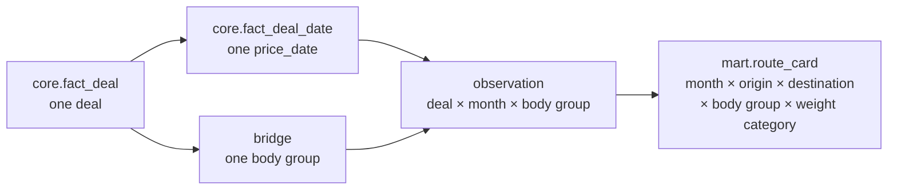

# Mart design

Status: design for approval. The mart answers the four product questions in the meeting summary: which rate to use, whether a price sits in the market band, whether the sample is large enough to trust, and how closed deals compare with the band and the forecast. The forecast comparison is the ML table in `docs/ml_design.md`. This document is the band and the evidence.

There is one physical aggregate, `mart.route_card`. `mart.market_corridor` is a view over it. BI that needs a network table and BI that needs one route's history read the same grain.

## 1. Question the card answers

For a month, a city pair, a body group, and a weight category, on completed direct deals that are not source-marked outliers and whose `price_date` is on or before `2026-10-26`:

- the interquartile band and the median of the trip price in RUB without VAT;
- the same band of RUB per kilometre;
- the average trip price;
- how many distinct deals and how many distinct carriers support the band;
- how dispersed the trip price is;
- how the median moved versus the previous calendar month and versus the same month a year earlier;
- a reliability label.

The demo's weekly index, cargo filter, haul-length filter, and extra body-type split are not columns and not filters of this mart.

## 2. Grain



One observation is one `price_id` in one `price_month` in one `body_group_code`, after the filters below. The deal's weight category is already a single value, so it is part of the cell key rather than another fan-out.

`price_month = date_trunc('month', price_date)::date`.

A long request with `price_date` values in September, October, and November, and with `as_of = 2026-10-26`, contributes to September and October only. November stays in `core.fact_deal_date` and stays out of the card.

`volume_category` is not part of the grain and is not stored on the cell. Cells mix volumes. Keeping one volume label would require a rule the brief does not give.

## 3. Eligibility

An observation enters the aggregate when every condition holds:

| Predicate | Reason |
| --- | --- |
| `is_fact = true` | Completed factual population. Equivalent check used in tests: `price_type IN (1, 2, 3, 4, 5, 9)` |
| `complex = false` | Direct routes only |
| `outlier_mark = false` | Source flag. The mart does not recompute it |
| `price_rub > 0` | Conformed positive RUB price. Quality checks already removed non-positive source prices; this predicate guards the aggregate |
| `distance_km > 0` | Required for the per-km ratio and already required by quality checks |
| `price_date <= DATE '2026-10-26'` | Future planned months stay out of history |
| Body group from `core.bridge_deal_body_group` | Many-to-many collapse already applied |

`loading_date > as_of` is not an extra mart predicate. Those deals are excluded because their generated `price_date` values are after the snapshot. The documented rule remains the `price_date` rule, because that is the one the brief states.

Carrier rows are not a separate population. Types 1, 2, 4, and 5 contribute to trip percentiles and `trips_count`. Only types 3 and 9 contribute to `carriers_count`.

## 4. Deduplication before the aggregate

City: the observation already carries `gc_id`. Names come from `core.dim_city`, one row per `gc_id`. The mart SQL does not join `raw.cities` or the source `cities` table.

Body: the bridge already has one row per `(price_id, body_group_code)`. The observation join cannot multiply a deal inside one group.

Month: if one deal has two `price_date` values in the same calendar month and the same body group, the observation uses `MIN(price_date)` and the price once (A-MONTH). `trips_count` is `COUNT(*)` of this deduplicated observation, which equals `COUNT(DISTINCT price_id)`.

## 5. Metric definitions

Let the cell's multiset of observations be `S`.

| Column | Expression | NULL rule |
| --- | --- | --- |
| `p25_trip` | `percentile_cont(0.25)` of `price_rub` | A cell is not written when `S` is empty |
| `median_trip` | `percentile_cont(0.50)` of `price_rub` | |
| `p75_trip` | `percentile_cont(0.75)` of `price_rub` | |
| `avg_trip` | `avg(price_rub)` | |
| `p25_km` | `percentile_cont(0.25)` of `price_rub / distance_km` | |
| `median_km` | `percentile_cont(0.50)` of `price_rub / distance_km` | |
| `p75_km` | `percentile_cont(0.75)` of `price_rub / distance_km` | |
| `trips_count` | number of observations in `S` | |
| `carriers_count` | `COUNT(DISTINCT organization_id) FILTER (WHERE price_type IN (3, 9))` | NULL organizations are ignored by `DISTINCT`. No carrier rows yields 0, not NULL |
| `cv_rate` | `stddev_samp(price_rub) / avg(price_rub)` | NULL when `trips_count < 2` or `avg(price_rub) = 0` |
| `mom_pct` | `(median_trip / prev.median_trip - 1) * 100` | NULL when the previous calendar cell is missing or its median is 0 |
| `yoy_pct` | `(median_trip / yoy.median_trip - 1) * 100` | NULL when the year-ago cell is missing or its median is 0 |
| `reliability_level` | case expression below | |

`percentile_cont` is assumption A-PCT. It interpolates, so the median of an even count is the average of the two central values.

`cv_rate` is a ratio. It is not multiplied by 100. `mom_pct` and `yoy_pct` are percents.

Comparison keys for MoM and YoY are `loading_city_gcid`, `unloading_city_gcid`, `body_group_code`, and `weight_category`. The month is shifted by one month or by one year. A different weight category is a different series. The SQL does not use `LAG(...) IGNORE NULLS` across a denser calendar, because a gap must stay NULL.

### 5.1 Reliability

`max_price_date` is `MAX(price_date)` of the observations in the cell.

```text
if trips_count >= 30
   and carriers_count >= 5
   and (as_of_date - max_price_date) <= 30
then HIGH
else if trips_count >= 10
then MEDIUM
else LOW_DATA
```

Assumption A-REL: freshness is the age of the newest `price_date` inside that cell, measured in days against the fixed snapshot `2026-10-26`. A September cell whose latest date is `2026-09-30` is 26 days old and can be `HIGH`. A September cell whose latest date is `2026-09-01` is 55 days old and cannot be `HIGH`. An old cell with 40 trips is `MEDIUM` when it fails freshness or carriers, because `trips_count >= 10` is the second branch.

`carriers_count` of 0 fails the HIGH carrier test and does not by itself force `LOW_DATA`.

## 6. Build pattern

Two statements inside the core/mart transaction, after core publish:

1. Delete `mart.route_card` rows whose `price_month` is in the touched-month set.
2. Insert the aggregate for those months from core.
3. Update `mom_pct`, `yoy_pct`, and `reliability_level` for the touched months by joining the card to itself.

Step 3 runs after the insert so a touched month can see a comparison month that was not touched. Comparison months are not rewritten except for their own dynamics when they themselves are touched.

Illustrative shape of the aggregate, not the implementation file:

```sql
SELECT
    d.price_month,
    f.loading_city_gcid,
    f.unloading_city_gcid,
    b.body_group_code,
    f.weight_category,
    percentile_cont(0.25) WITHIN GROUP (ORDER BY f.price_rub) AS p25_trip,
    percentile_cont(0.50) WITHIN GROUP (ORDER BY f.price_rub) AS median_trip,
    percentile_cont(0.75) WITHIN GROUP (ORDER BY f.price_rub) AS p75_trip,
    avg(f.price_rub) AS avg_trip,
    percentile_cont(0.25) WITHIN GROUP (ORDER BY f.price_rub / f.distance_km) AS p25_km,
    percentile_cont(0.50) WITHIN GROUP (ORDER BY f.price_rub / f.distance_km) AS median_km,
    percentile_cont(0.75) WITHIN GROUP (ORDER BY f.price_rub / f.distance_km) AS p75_km,
    count(*) AS trips_count,
    count(DISTINCT f.organization_id) FILTER (WHERE f.price_type IN (3, 9)) AS carriers_count,
    CASE
        WHEN count(*) < 2 OR avg(f.price_rub) = 0 THEN NULL
        ELSE stddev_samp(f.price_rub) / avg(f.price_rub)
    END AS cv_rate,
    max(d.price_date) AS max_price_date
FROM core.fact_deal AS f
JOIN (
    SELECT DISTINCT ON (price_id, price_month, body_group_code)
           price_id, price_month, price_date, body_group_code
    FROM core.fact_deal_date
    JOIN core.bridge_deal_body_group USING (price_id)
    WHERE price_date <= DATE '2026-10-26'
    ORDER BY price_id, price_month, body_group_code, price_date
) AS d ON d.price_id = f.price_id
JOIN core.bridge_deal_body_group AS b
  ON b.price_id = f.price_id
 AND b.body_group_code = d.body_group_code
WHERE f.is_fact
  AND NOT f.complex
  AND NOT f.outlier_mark
  AND f.price_rub > 0
  AND f.distance_km > 0
  AND d.price_month = ANY (:touched_months)
GROUP BY 1, 2, 3, 4, 5;
```

The `DISTINCT ON` subquery is the A-MONTH guard. When the bridge is already one row per group, the join does not fan out. `as_of_date` is a bound parameter, not `CURRENT_DATE`.

City names and the reliability update are a second statement. They read `core.dim_city` and the card.

## 7. How the two BI modes use one table

Network review for a tender: filter `price_month` to the decision month, select many city pairs, and read `median_trip`, `p25_trip`, `p75_trip`, the per-km trio, `mom_pct`, `yoy_pct`, `trips_count`, `carriers_count`, `cv_rate`, and `reliability_level`. The supporting index is `(price_month)` plus the primary key.

One route over time: filter the four stable keys and order by `price_month`. The supporting index is `(loading_city_gcid, unloading_city_gcid, body_group_code, weight_category, price_month)`.

`LOW_DATA` is a label on the row, not a reason to drop the row. A buyer should see a thin market, and dropping it would hide the evidence the meeting summary asks for.

## 8. Worked edge cases

| Case | Expected card behavior |
| --- | --- |
| Moscow or Kazan duplicate `gc_id` | One city attribute set. Deals are not doubled. Region for Kazan is `Республика Татарстан` |
| Links `56` and `61` | One `TENT` observation |
| Links `56` and `15` | One observation in `TENT` and one in `BORT`, same `price_rub` in each cell |
| No links, `body_type = 50` | One `OTHER` observation. Dump trucks are not a separate mart group |
| No links, `body_type` NULL | One `UNSPECIFIED` observation |
| `outlier_mark = true` | In core, absent from every cell |
| Deal created on `2026-10-26` after `02:30` with an extreme price and `outlier_mark = false` | Included, because the mandatory pipeline respects the flag |
| `price_type = 6` | In core, absent from every cell |
| `complex = true` | In core, absent from every cell |
| Types 4 and 5 | In the percentiles when the other filters pass. They do not increment `carriers_count` |
| `organization_id` NULL on a type 3 row | The trip counts. The carrier count ignores that NULL |
| Long deal crossing `as_of` | Months with `price_date <= as_of` are in the card. Later months are not |
| First month a route exists | `mom_pct` is NULL |
| Route missing in the same month last year | `yoy_pct` is NULL. The latest older month is not substituted |
| Single-deal cell | Percentiles equal the trip price. `cv_rate` is NULL. `reliability_level` is `LOW_DATA` |
| `trips_count = 10`, one carrier, fresh | `MEDIUM` |
| Same city codes, positive distance, otherwise eligible | Included |
| Summing `trips_count` across months | Not a distinct annual trip count. A long deal is in each of its months. The card does not publish an annual distinct count because the brief does not define one |

## 9. Acceptance criteria

- Grain uniqueness: the primary key rejects a second insert for the same cell.
- For a fixture deal with two groups, `SUM(trips_count)` across its groups in one month equals 2, and each cell's `trips_count` contribution of that deal is 1.
- For a fixture deal with two child ids in `TENT`, the `TENT` cell gains 1 trip, not 2.
- A fixture month after `2026-10-26` has no card row.
- A fixture `price_date` of `2026-10-26` is eligible.
- Outlier, complex, and auction fixtures remain in `core.fact_deal` and have no card row.
- MoM on a hand-computed two-month fixture equals `(m2 / m1 - 1) * 100`, and deleting the first month makes the second month's `mom_pct` NULL.
- `cv_rate` on one observation is NULL. On two observations it equals the sample standard deviation divided by the mean.
- `carriers_count` ignores a type 1 organization and counts a type 3 organization once even if that organization has two deals.
- Rebuilding the same months twice leaves every measure and label unchanged.
- The card SQL text does not reference `price_group_stats`, `raw.cities`, or `deals_bigdata`.

## 10. Performance notes for this volume

Three hundred thousand deals, with about 5% spanning extra months and about 12% carrying a second body group, produce a few hundred thousand bridge rows and a much smaller number of aggregated cells: 40 origins, 40 destinations, 6 groups, 6 weight bands, and roughly three years of months, sparsely filled. A full rebuild in PostgreSQL 17 is an acceptable startup path. Windowed runs still rebuild a month from all of its core rows so percentiles stay correct.

The deduplicated observation set should be built with hash joins on `price_id`. The indexes in the dictionary cover the self-join for MoM and YoY. `work_mem` for the percentile aggregate is an operations setting in the compose file, not a business rule. A materialized view is not used: a table rebuilt by delete and insert gives a clear idempotent boundary and a primary key.

## 11. What this mart does not publish

- Average RUB per kilometre.
- A weekly series, a 4-week change, or a year-to-date change against January.
- Cargo type, haul-length band, or a separate dump, container, or low-bed group.
- A forecast, a prediction interval, or a fact-versus-forecast error. Those live in `ml.price_predictions`.
- Any measure taken from `price_group_stats`.
- A filled calendar. Months with no eligible deals have no row, and that absence is what makes MoM and YoY NULL.
