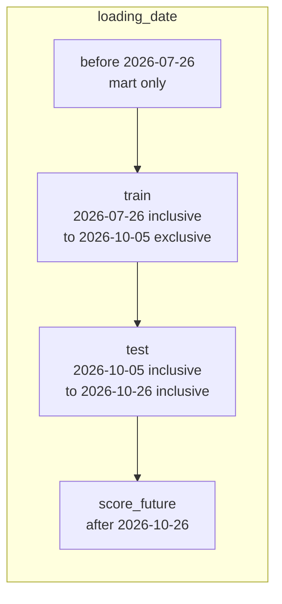
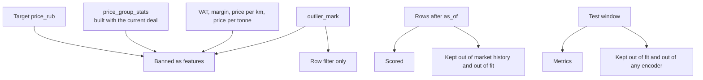

# ML design

Status: design for approval. The mandatory model predicts the carrier-facing trip price in RUB without VAT, `y = price_rub`, for direct factual deals, and it scores future planned deals whose actuals must stay empty.

The research note's metric levels (R² near 0.93, MAPE near 13% for CatBoost) are orientation from another dataset. They are not acceptance thresholds for the synthetic snapshot. The run reports the metrics it measures.

## 1. Population

A core deal is a candidate when:

- it passed quality checks, so `price_rub` exists;
- `complex = false`;
- `distance_km > 0`;
- `price_rub > 0`;
- `price_type <> 6`.

Candidates are then labeled:

| `split_role` | Predicate | Used for |
| --- | --- | --- |
| `train` | `is_fact` and `outlier_mark = false` and `loading_date >= 2026-07-26` and `loading_date < 2026-10-05` | Fit only |
| `test` | `is_fact` and `outlier_mark = false` and `loading_date >= 2026-10-05` and `loading_date <= 2026-10-26` | Metrics and published actuals |
| `score_future` | `loading_date > 2026-10-26`, under assumption A-SCORE, without an `is_fact` requirement beyond `price_type <> 6` | Published prediction, NULL actual and errors |
| excluded | everything else that sits in core | Not written to `ml.deal_features` |

History before `2026-07-26` stays in the mart. It is not added to train. The research note's general remark about "earlier history" is superseded by the fixed window in the brief.

`2026-10-05` is test, not train. `2026-10-26` is test, not future. `2026-10-27` is future.

`outlier_mark` removes a row from train and test. It is not a column in the matrix. Deals created at or after `2026-10-26 02:30:00` keep whatever flag the source stored, including `false` on unmarked extremes. Those unmarked rows remain in test when their loading date is in the test window. That is a property of the snapshot, documented in the README at implementation time, and it is not "fixed" by a second outlier rule.

Assumption A-SCORE: future rows must be direct, non-auction, quality-checked deals. Composite routes and auction bids are not scored. If this assumption is rejected, the future predicate becomes "every core deal with `loading_date > as_of`" and the feature query still has to define a body group and a distance.



The split is a filter on `loading_date`. It is not `train_test_split(..., shuffle=True)` and it is not a random fold. The run date is irrelevant. A test that sets the system clock forward still has to produce these bounds.

## 2. Feature matrix

Features are selected in SQL and stored in `ml.deal_features`. Python trains on an explicit allow-list. Anything stored for audit (`price_rub`, `split_role`, `loading_date`, `batch_id`) is omitted from that list.

### 2.1 Geography

From `core.dim_city` of the loading and unloading `gc_id`, using the minimum-`id` city:

- `origin_city_name`, `destination_city_name`
- `origin_region_name`, `destination_region_name`
- `origin_latitude`, `origin_longitude`, `destination_latitude`, `destination_longitude`

City and region are separate categorical features. The route is not concatenated into one string. The research note calls out high-cardinality route strings as a sparsity problem and attributes about 30% of the lift to separate origin and destination geography. With 40 places, city cardinality is small; the columns are still separate because that is the stated encoding.

Region text is the raw substring after the first comma (A-CITY). No dictionary of region aliases is applied, so `г. Москва` and `Свердловская обл.` stay as written on the winning city row.

### 2.2 Load and equipment

- `distance_km` — the stored distance, not a fresh haversine
- `total_weight_t`, `total_volume_m3`
- `body_group_code` — mapping of `prices.body_type`, or `UNSPECIFIED` (A-BODY-ML)
- `weight_category`, `volume_category` — values after gap fill

`distance_km` is the dominant numeric driver in the research note. It stays in original kilometres. The model is a tree model, so the mandatory path does not log-scale it.

Secondary body-type links change the mart and do not create a second feature row. A deal linked to tent and board is trained once, with the group of its `body_type` column. Duplicating it would copy `price_rub` into two groups and pull the loss toward deals that happen to carry two types.

### 2.3 Calendar

From `loading_date`, not from `price_date` and not from `created_at`:

| Feature | Definition |
| --- | --- |
| `loading_year` | calendar year |
| `loading_month` | 1–12 |
| `loading_isodow` | ISO day of week, Monday = 1 through Sunday = 7 |
| `loading_doy` | day of year, 1–366 |
| `month_sin`, `month_cos` | `sin(2π * loading_month / 12)`, `cos(2π * loading_month / 12)` |
| `dow_sin`, `dow_cos` | `sin(2π * loading_isodow / 7)`, `cos(2π * loading_isodow / 7)` |
| `doy_sin`, `doy_cos` | `sin(2π * loading_doy / 365.25)`, `cos(2π * loading_doy / 365.25)` |

The year carries the inflation trend. The sine and cosine pairs keep December next to January and Sunday next to Monday. Day-of-year uses `365.25` in both leap and non-leap years, as specified. PostgreSQL `EXTRACT(DOW)` is not used, because its Sunday-zero numbering would disagree with a Python `weekday()` path. SQL and Python tests both assert ISO numbering.

### 2.4 Allow-list

```text
distance_km
total_weight_t
total_volume_m3
origin_city_name
destination_city_name
origin_region_name
destination_region_name
origin_latitude
origin_longitude
destination_latitude
destination_longitude
body_group_code
weight_category
volume_category
loading_year
loading_month
loading_isodow
loading_doy
month_sin
month_cos
dow_sin
dow_cos
doy_sin
doy_cos
```

Categorical columns for CatBoost: the six name and category columns (`origin_city_name`, `destination_city_name`, `origin_region_name`, `destination_region_name`, `body_group_code`, `weight_category`, `volume_category`). NULL region is a valid category level.

## 3. Leakage controls



Banned inputs, whether or not the column exists today:

| Banned input | Why |
| --- | --- |
| `price`, `price_src`, `price_rub` as a feature | The target or its unconverted form |
| `price_with_vat` | Direct rescaling of the target. Not in the source schema |
| `price_rub / distance_km`, `price / distance`, `price_rub / total_weight_t` | Unit prices of the deal being predicted |
| Customer cost, forwarder margin, `carrier_cost = transportation_cost - profit` | Accounting identity with the target. Not in the source schema |
| `price_group_stats.avg_price`, `min_km_price`, `max_km_price` | Aggregates that include the row being predicted, on raw price |
| `price_group_id` | Key into that aggregate |
| `outlier_mark` | Used only to drop rows from the target population |
| `fx_rate` | Together with the source price it reconstructs the target. The currency code is also omitted; the target is already RUB |
| `organization_id`, `subscriber_id` | Not in the feature specification. High-cardinality identifiers can memorize who priced the deal |
| Any mart median, `mom_pct`, or `yoy_pct` | The mart cell includes the deal's own month, and future cells are defined not to exist |
| Statistics fitted on test or on future rows | Temporal leakage |

`price_group_stats` remains in `raw` for the extract audit. The feature SQL, the training script, and `ml.deal_features` do not read it. A test fails if the feature column list intersects the ban list, and if any view in `ml` or `mart` depends on `raw.price_group_stats`.

The mandatory model adds no rolling market features. A lag of last month's corridor would need a definition that excludes the current deal and uses only months before `loading_date`. The brief does not ask for that feature, and a careless version is the leakage pattern the research note describes. It is out of scope.

Outlier fences, imputers, scalers, and target encoders are fit on `split_role = 'train'` only. The mandatory CatBoost path does not need an imputer or a scaler: required measures are non-null on core rows, and categoricals are native. The optional Ridge path, if implemented, one-hot encodes categoricals and fits `SimpleImputer` and `StandardScaler` on train, then applies the frozen transformers to test and future. Those transformers are not fit on a frame that still contains test rows.

Early stopping does not use the test window. The mandatory run uses a fixed `iterations` value so there is no validation slice to leak through. If a later experiment uses early stopping, its validation rows are the latest part of train only, and the reported metrics stay on the untouched test window.

Target transformation: trees are trained on `price_rub` in RUB, not on `ln(price_rub)`. The research note says the log does not improve tree metrics. Log fences are part of the optional outlier job, which is not in this pipeline.

## 4. Training

| Setting | Value |
| --- | --- |
| Estimator | `catboost.CatBoostRegressor` |
| Loss | `RMSE` |
| `random_seed` | `20261026` |
| Iterations | 500, an engineering default, not a business requirement |
| Learning rate and depth | CatBoost defaults, unless a recorded experiment changes them before the graded run |
| Categorical features | the seven columns listed in section 2.4 |
| Eval set | none in the mandatory run |
| `allow_writing_files` | false, so the container does not depend on a CatBoost log directory |

NumPy's generator is seeded with the same integer before the fit, for any shuffle CatBoost still performs inside a bootstrap. The data order passed to `fit` is `ORDER BY price_id` so a replay sees the same row order.

The optional comparison models are `sklearn.linear_model.Ridge` and `sklearn.tree.DecisionTreeRegressor`, same seed and same split. They are not required for acceptance. If they are trained, their predictions go to `ml.price_predictions` under their own `model_name` and do not overwrite `catboost_regressor`.

The fitted CatBoost file is written to the pipeline container's model volume as an artifact. The graded output is the database table, not the file. A scoring replay loads the artifact saved by that run. The first `docker compose up` trains and then scores in the same process.

## 5. Metrics

Computed on test rows only, with `y` the actual `price_rub` and `ŷ` the prediction:

| Metric | Definition |
| --- | --- |
| RMSE, RUB | square root of the mean squared error |
| MAE, RUB | mean absolute error |
| R² | one minus the residual sum of squares over the total sum of squares around the test mean |
| MAPE, % | mean of `abs(y - ŷ) / y * 100` |

The test filter requires `y > 0`, so MAPE is defined. The implementation still refuses to divide by zero.

These four numbers are printed in the run log and inserted into `ml.run_metrics`. R² on a single city pair is not a release metric. The research note explains why a thin slice can show a low R² with an acceptable MAPE. Route-level MAPE is not a mandatory output.

## 6. Batch scoring

Input: `ml.deal_features` where `split_role IN ('test', 'score_future')`, ordered by `price_id`.

Output: upsert into `ml.price_predictions` for `model_name = 'catboost_regressor'`.

| Column | Test | Future |
| --- | --- | --- |
| `actual_price_rub` | feature-table `price_rub` | NULL |
| `predicted_price_rub` | model output as `numeric(18, 2)` | model output as `numeric(18, 2)` |
| `abs_error_rub` | absolute difference | NULL |
| `ape_pct` | absolute percentage error | NULL |
| `scored_at` | transaction timestamp | transaction timestamp |

The future branch does not read `core.fact_deal.price_src` when filling `actual_price_rub`. The column is set NULL in SQL, not "NULL if the source price is NULL".

Predictions for deals that are no longer in the scoring population are deleted for this `model_name`. Train deals are not written to the prediction table. The brief asks for the held-out period and the future applications, which is the fact-versus-forecast table. Filling it with training fitted values would look like accuracy and would not be the requested comparison.

Idempotency: the same artifact and the same features produce the same `predicted_price_rub`. A second run replaces rows in place on `(price_id, model_name)`.

## 7. Acceptance criteria

- Train minimum date is `2026-07-26`. Train contains no `2026-10-05`. Test contains `2026-10-05` and `2026-10-26` when such deals exist and pass filters. Future starts at `2026-10-27`.
- A deal with `loading_date = 2026-07-25` is absent from `ml.deal_features`.
- An outlier inside the train window is absent from `ml.deal_features`.
- A complex deal and a type 6 deal inside the window are absent.
- `ml.deal_features` column names and `ml.run_metrics.feature_columns` are equal to the allow-list. The intersection with the ban list is empty.
- No SQL object in `ml` references `price_group_stats`.
- For every `score_future` prediction, `actual_price_rub`, `abs_error_rub`, and `ape_pct` are NULL, including when `core.fact_deal.price_src` is not NULL.
- For every test prediction, `actual_price_rub` equals `core.fact_deal.price_rub`, and both error columns are populated.
- Two scoring runs with the same seed leave prediction values unchanged and add one `ml.run_metrics` row.
- A unit test builds sine and cosine for 31 December and 1 January and checks the day-of-year pair is close, and builds Sunday = 7 and Monday = 1 and checks the day-of-week pair is close.
- If Ridge is implemented, a test fits the scaler on a frame that includes a test-only category level and shows the test row was not part of `fit`.

## 8. Reproducibility

| Source of variation | Control |
| --- | --- |
| Synthetic snapshot | `setseed(0.20261026)` and `n_prices=300000` in init. The pipeline does not call `setseed` again |
| Split | Literal dates in the feature SQL, parameterized by `AS_OF_DATE` whose default is `2026-10-26` |
| Row order | `ORDER BY price_id` |
| Model | `random_seed = 20261026`, fixed iterations |
| Category boundaries | SQL `ROUND(numeric, 1)`, shared by ETL and features |
| Cyclical fields | SQL expressions, asserted from Python |
| Package versions | Pinned in the image requirements file at implementation time |

## 9. Out of the mandatory model

- Recalculated outlier filters, log-price fences, and prediction intervals.
- Hyperparameter search.
- A weekly forecast horizon or a market-index forecast like the locked panel in the demo.
- Target encoding of city pairs.
- Using `mart.route_card` as a feature.
- Scoring `outlier_mark = true` rows "to see the error". They are outside the defined target.
- Treating R² ≈ 0.93 or MAPE ≈ 13% as a pass gate on this synthetic draw.
